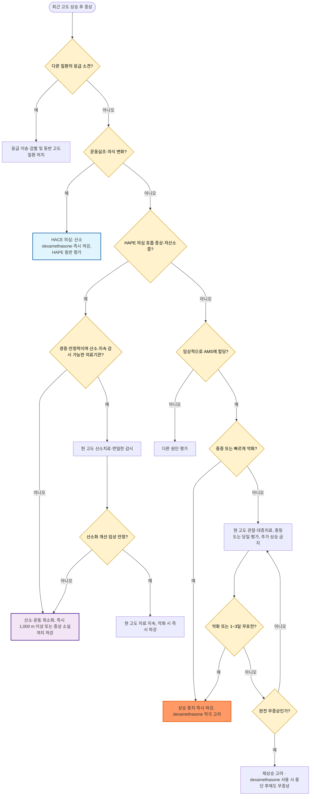

# 고소증 High Altitude Sickness (AMS/HACE/HAPE)

## <mark style="color:green;">일반 사항</mark>

* 고소증은 고도 상승에 따른 저산소성 환경에 충분히 순응하지 못해 발생하는 급성 고도질환임.
* 급성 고산병(acute mountain sickness, AMS), 고소뇌부종(high-altitude cerebral edema, HACE), 고소폐부종(high-altitude pulmonary edema, HAPE)을 포함함.
* 일반적으로 해발 2,500 m 이상에서 발생하지만 개인차가 크며 더 낮은 고도에서도 발생할 수 있음.
* 약 3,050 m에서 흡입 산소분압은 해수면의 약 69%이고, 급성 노출 시 산소포화도는 약 88\~91%까지 낮아질 수 있음.
* 저산소 스트레스는 도달 고도, 상승 속도, 수면 고도, 노출 기간 및 개인의 감수성에 영향을 받음.
* 운동능력이나 평소 체력이 좋다고 고소증이 예방되는 것은 아님. (WMS 2024)


조절된 고혈압·당뇨병·경증 만성폐질환 등이 AMS 자체의 독립 위험인자는 아닐 수 있지만, 고지대 여행의 안전성과는 별도 문제임. 중증 폐질환, 비대상성 심부전, 불안정 협심증, 중증 폐고혈압, 고위험 임신 등은 여행 전 전문 평가가 필요하거나 고지대 여행을 피해야 함.


## <mark style="color:green;">원인 및 위험 인자</mark>

### <mark style="color:orange;">주요 위험 결정요인</mark>

* 과거 고도질환의 종류와 중증도
* 첫날 수면 고도
* 해발 3,000 m 이상에서의 수면 고도 상승 속도
* 이전 고도 노출과 순응 상태
* 빠른 상승과 고지대 도착 직후의 격렬한 활동

낮은 고도 거주, 젊은 연령 및 과거 고소증 병력은 위험 증가와 연관될 수 있으나, 성별과 평소 체력은 예측력이 낮음. 기저 심폐질환은 AMS 위험인자 목록에 단순히 포함하기보다 고지대 여행의 안전성을 별도로 평가함.

### <mark style="color:orange;">WMS 2024 위험도</mark>

다음 표는 해발 1,200 m 미만에서 출발하는 비순응 여행자를 가정함(WMS 2024, Figure 1). 여러 항목이 해당하면 가장 오른쪽(가장 높은) 위험 범주를 적용함. 과거 AMS 병력이 있어도 이번 여행에서 상승 속도를 늦추면 반드시 고위험은 아니며, 반대로 과거 문제가 없었어도 빠른 상승·고고도 목표는 위험을 높일 수 있음.

<table><thead><tr><th>평가 항목</th><th>낮은 위험</th><th>중등도 위험</th><th>높은 위험</th></tr></thead><tbody><tr><td>과거 고도질환</td><td>없음 또는 경증 AMS</td><td>중등도\~중증 AMS</td><td>HACE 또는 HAPE</td></tr><tr><td>첫날 수면 고도</td><td>＜2,800 m</td><td>2,800\~3,500 m</td><td>＞3,500 m</td></tr><tr><td>3,000 m 이상에서 수면 고도 상승</td><td>하루 ≤500 m이고 1,000 m 상승마다 적응일</td><td>하루 ＞500 m이지만 1,000 m 상승마다 적응일</td><td>하루 ＞500 m이고 적응일 없음</td></tr></tbody></table>

* 낮은 위험: acetazolamide 예방투여는 일반적으로 필요하지 않음.
* 중등도 위험: acetazolamide 예방투여를 고려함.
* 높은 위험: acetazolamide 예방투여를 적극 권고하고, 응급용 dexamethasone 휴대를 고려함.
* 매우 빠른 상승(예: 킬리만자로를 7일 미만에 등정)은 높은 위험으로 봄.

## <mark style="color:green;">임상 양상</mark>

### <mark style="color:orange;">정상 순응 반응</mark>

고도 상승 초기에는 호흡수 증가, 운동 시 호흡곤란, 다뇨, 수면 중 주기호흡 등이 나타날 수 있음. 수면장애와 말초부종은 고지대에서 흔하지만 그 자체만으로 AMS를 진단하지 않음.

### <mark style="color:orange;">고소두통 High-altitude Headache</mark>

2,500 m 이상으로 상승한 뒤 새로 발생한 두통으로, 고도 상승과 시간적으로 관련되고 하강하면 호전됨. 흔히 다음 특징 중 2개 이상을 보임.

* 양측성
* 경증\~중등도
* 활동, 움직임, 힘주기, 기침 또는 몸을 굽힐 때 악화

고소두통만 있고 AMS를 구성하는 다른 증상이 없을 수 있음.

### <mark style="color:orange;">급성 고산병 Acute Mountain Sickness, AMS</mark>

* 비순응 여행자가 일반적으로 2,500 m 이상으로 상승한 뒤 수시간\~3일 이내에 발생함.
* 두통이 핵심 증상이며 식욕 저하, 구역·구토, 피로·쇠약, 어지럼이 동반됨.
* 전형적인 발현은 도착 또는 추가 상승 2\~12시간 후이며 첫날 밤이나 다음 날 아침에 흔함.
* 추가 상승을 중지하면 대개 1\~3일 이내에 호전됨.
* 같은 고도에 3일 이상 머물렀고 추가 상승도 없는데 새로 시작한 증상은 AMS로 단정하지 않음.

### <mark style="color:orange;">고소뇌부종 High-altitude Cerebral Edema, HACE</mark>

* HACE는 중증 AMS의 극단적인 형태로 볼 수 있으며 생명을 위협함. HAPE와 동반되기도 하므로 호흡 상태를 함께 평가함.
* 운동실조가 가장 이른 소견인 경우가 많음. 일직선 발꿈치-발가락 보행으로 확인할 수 있음.
* 심한 무기력, 무관심, 과민성, 판단력 저하, 혼돈, 졸림, 자기관리 불능 및 의식 저하가 나타날 수 있음.
* 국소 신경학적 결손이나 경련은 흔하지 않으므로 뇌졸중, 두개내 병변, 저나트륨혈증 등 다른 원인을 우선 감별함.

### <mark style="color:orange;">고소폐부종 High-altitude Pulmonary Edema, HAPE</mark>

* 저산소성 폐혈관수축과 불균등한 폐동맥압 상승으로 발생하는 비심인성 폐부종임. AMS나 두통 없이도 발생할 수 있음.
* 초기에는 같은 고도의 다른 사람보다 심한 운동 시 호흡곤란, 운동능력 저하, 마른기침, 피로, 흉부 울혈감이 나타남.
* 진행하면 가벼운 활동 또는 안정 시 호흡곤란, 수포음, 빈호흡, 빈맥, 청색증 및 분홍색 거품가래가 발생할 수 있음.
* 산소포화도가 같은 고도에서 예상되는 범위보다 현저히 낮으면 진단에 도움이 되지만, 저온·말초관류 저하와 80% 미만에서의 기기 정확도 저하를 고려함.

### <mark style="color:$danger;">🚩 Red Flags!</mark>

<mark style="color:$danger;">**즉각 조치**</mark>

* 운동실조, 혼돈, 졸림, 자기관리 불능 또는 의식저하  `HACE 의심`
* 안정 시 호흡곤란, 청색증, 현저한 저산소증 또는 분홍색 거품가래  `HAPE 의심`
* 같은 고도의 동행자보다 현저한 운동 시 호흡곤란·운동능력 저하에 기침이 동반됨. 안정 시 호흡곤란이 생길 때까지 기다리지 않고 즉시 산소·하강 및 응급평가 가능성을 확인함  `초기 HAPE 의심`
* 중증 AMS, 빠르게 악화되는 AMS 또는 스스로 안전하게 하강할 수 없는 상태  `중증·진행성 고도질환`
* 새 국소 신경학적 결손·경련, 급성관상동맥증후군·폐색전증·기흉 등이 의심되는 흉통·호흡곤란  `다른 응급질환`

해당 소견이 있으면 환자의 운동을 최소화하여 구조·이송을 요청함. 중증 고도질환이 의심되면 사용 가능한 산소를 투여하고 필요한 하강을 지연하지 않음. HACE·HAPE 또는 중증 AMS 환자는 혼자 하강시키지 않음. 충분한 산소·지속 감시·즉시 이송 수단이 확보된 의료기관에서만 선별적으로 현 고도 치료를 판단함.

<mark style="color:$warning;">**당일~수일 내 평가**</mark>

아래 급성 증상은 **당일 평가**하며, 위 즉각 조치 소견이 있으면 응급 대응을 우선함.

* 중등도 AMS, 반복 구토 또는 유의한 기능 저하  `중등도 AMS·탈수 위험`
* 발열 또는 편측성 폐소견 등 감염·기타 질환이 의심되지만 즉각 조치 기준에는 해당하지 않음  `감별 진단 필요`
* 고도 노출 후 증상이 발생한 환자에게 중요한 심폐질환, 중증 OSA, 임신 등 고위험 상태가 동반됨  `고위험 기저상태`

<mark style="color:$info;">**조기 평가 및 추적**</mark>

* HACE·HAPE나 중증 소견이 없는 경증 AMS, 또는 당일 평가 후 현 고도 관찰이 가능하다고 판단된 중등도 AMS  `관찰 가능한 AMS`
* 추가 상승을 중지하고 동행자가 면밀히 관찰할 수 있으며 하강 계획이 확보됨  `안전한 추적 조건`

관찰 중 언제든 악화하면 즉시 하강하며, 적절한 치료에도 1~3일 이내 호전되지 않으면 하강함. 이 기간은 악화하는 환자를 기다리라는 뜻이 아님.

## <mark style="color:green;">진단</mark>

### <mark style="color:orange;">2018 Lake Louise AMS Score</mark>

최근 고도 상승 후 4개 자가보고 증상을 각각 0\~3점으로 평가함. **총점 ≥3점이면서 두통 점수 ≥1점**이면 연구용 AMS 정의에 해당함. 연구에서는 고도 상승 후 최소 6시간이 지난 뒤 평가하도록 권고함. 임상 기능점수는 증상이 활동에 미치는 영향을 평가하는 별도 항목이며 0\~12점 총점에 포함하지 않음.

<table><thead><tr><th>점수</th><th>두통</th><th>위장관 증상</th><th>피로·쇠약</th><th>어지럼</th></tr></thead><tbody><tr><td>0</td><td>없음</td><td>식욕 정상</td><td>없음</td><td>없음</td></tr><tr><td>1</td><td>경증</td><td>식욕 저하 또는 구역</td><td>경증</td><td>경증</td></tr><tr><td>2</td><td>중등도</td><td>중등도 구역 또는 구토</td><td>중등도</td><td>중등도</td></tr><tr><td>3</td><td>중증으로 활동 불가</td><td>중증 구역·구토로 활동 불가</td><td>중증으로 활동 불가</td><td>중증으로 활동 불가</td></tr></tbody></table>

#### <mark style="color:$primary;">임상 중증도 분류 [WMS 2024]</mark>

<table><thead><tr><th>분류</th><th>증상·징후</th></tr></thead><tbody><tr><td>경증 AMS</td><td>두통과 하나 이상의 동반 증상(구역·구토, 피로·쇠약, 어지럼); 증상이 모두 경증이며 특징적인 신경학적 징후는 없음</td></tr><tr><td>중등도~중증 AMS</td><td>두통과 하나 이상의 동반 증상이 중등도~중증이며 기능 저하가 동반될 수 있음. 점수만으로 판단하지 않음</td></tr><tr><td>HACE</td><td>운동실조, 중증 무기력, 의식·정신상태 변화 또는 뇌병증. AMS 점수와 별도로 판정함</td></tr></tbody></table>

연구에서 Lake Louise 점수의 중증도를 구분하려면 3~5점 경증, 6~9점 중등도, 10~12점 중증으로 제안되었으나, 이 경계의 검증 근거는 부족함. WMS의 임상 중증도 분류와 일대일로 대응시키지 않음.


Lake Louise 점수는 연구용 도구이며 독립적인 임상 진단·치료 기준으로 사용하지 않음. 연구 정의상 중증 두통 3점만으로도 기준을 충족할 수 있고, 반대로 두통이 없다고 임상적으로 AMS가 완전히 배제되는 것은 아님. 위 임상 중증도 표는 WMS 2024를 참고하였으며 연구용 점수 범위와 분리함. 실제 하강 여부는 증상 강도, 기능 저하, 진행 양상, 하강 가능성 및 동반 HACE·HAPE 여부를 함께 판단하며, 응급처치를 점수 평가나 6시간 경과까지 미루지 않음.


### <mark style="color:orange;">진찰·검사</mark>

* AMS는 최근 상승력과 증상·기능 저하를 바탕으로 판단하며 확진 혈액검사는 없음. 고도에 비해 정상 범위의 SpO₂라도 AMS·HACE를 배제하지 못함.
* 호흡수·맥박·혈압·체온, 정신상태, 안전하게 가능한 경우 보행, 폐 청진 및 SpO₂를 확인함. 맥박산소측정은 손을 따뜻하게 하고 움직임·신호 상태를 확인하여 반복 측정하며, 측정값 하나로 판단하지 않음.
* HAPE가 의심되는 의료기관에서는 흉부 X선·심전도로 폐부종과 다른 원인을 평가함. 폐초음파 B-line은 민감하지만 비특이적인 보조 소견이며 확진 개수 기준은 확립되지 않았음. 영상검사를 기다리느라 산소·필요한 하강을 지연하지 않음.

### <mark style="color:orange;">감별 진단</mark>

<table><thead><tr><th width="130">주요 증상</th><th width="260">감별질환</th><th>감별 단서</th></tr></thead><tbody><tr><td>두통·구역·피로</td><td>편두통, 숙취, 탈수, 저나트륨혈증, 저혈당, 일산화탄소 중독, 약물중독, 감염</td><td>발열·근육통·콧물, 노출력, 수분 과다섭취, 혈당, 동행자의 동시 증상</td></tr><tr><td>운동실조·의식 변화</td><td>뇌졸중, 두부외상, 저체온증, 저혈당, 저나트륨혈증, 일산화탄소·약물중독</td><td>국소 신경학적 결손, 외상력, 체온, 혈당</td></tr><tr><td>호흡곤란·저산소증</td><td>폐렴, 천식·기관지연축, 폐색전증, 기흉, 심부전, 심근경색</td><td>발열, 국소 폐소견, 흉통, 심전도·영상검사, 기저질환</td></tr></tbody></table>

***



<p align="center"><strong>진단 및 치료 알고리듬</strong></p>

HAPE 의심 소견에는 안정 시 호흡곤란뿐 아니라 같은 고도의 다른 사람보다 현저한 운동 시 호흡곤란·운동능력 저하에 동반된 기침도 포함함. HACE와 HAPE는 함께 발생할 수 있으므로 어느 한 분기에 해당해도 다른 질환의 동반 여부를 확인함.

<p align="center"><em><mark style="color:$info;">Ref. Luks AM, et al. WMS Clinical Practice Guidelines for Acute Altitude Illness: 2024 Update. Wilderness Environ Med. 2024;35(1S):2S-19S.</mark></em></p>

***

## <mark style="background-color:$warning;">Management</mark>

### <mark style="color:orange;">공통 원칙</mark>

* 증상이 있는 동안 수면 고도를 더 높이지 않음.
* HACE·HAPE 또는 중증 AMS에서는 약물 때문에 하강을 지연하지 않음.
* 하강은 AMS/HACE의 가장 효과적인 치료임. 증상이 소실될 때까지 하강하며, 대개 300\~1,000 m 하강하면 호전되지만 개인차가 있음.
* 산소는 고정 유량보다 증상 완화 또는 SpO₂ ＞90%를 목표로 적정함.
* 휴대용 고압백은 하강이 불가능하거나 지연되고 산소를 사용할 수 없을 때 고려하되, 필요한 하강을 지연시키지 않음. 소형 일회용 산소캔은 지속적인 치료용 산소를 대신할 수 없음.
* 알코올, 오피오이드 및 호흡을 억제할 수 있는 진정제 사용을 피함.

### <mark style="color:orange;">고소두통</mark>

* 추가 상승 중지, 휴식 및 수분 상태 평가
* Ibuprofen 400 ㎎ q8h 필요시 단기간 고려함. WMS의 고소두통 용량표는 600 ㎎ q8h이나, 국내 부루펜의 경증·중등도 통증 허가 1회량은 200~400 ㎎이므로 600 ㎎을 국내 표준 통증 용량으로 일반화하지 않음. 약물 치료의 금기·주의사항을 확인함. <mark style="color:blue;">\[부루펜정]</mark>
* Acetaminophen 속방형 500~1,000 ㎎ q8h 필요시 <mark style="color:blue;">\[타이레놀정500밀리그램]</mark>. 이 예시의 1일량은 최대 3 g이며 감기약 등 모든 복합제의 성분을 합산함. 간질환·저체중·영양불량·상습 음주에서는 감량 여부를 평가하고 서방형 용법과 혼용하지 않음.
* 다른 AMS 증상이 동반되면 AMS로 평가함.

### <mark style="color:orange;">급성 고산병 AMS</mark>

#### <mark style="color:$primary;">경증\~중등도이며 중증 소견이 없는 경우</mark>

* 추가 상승을 중지하고 현재 고도에서 휴식하며 면밀히 관찰함.
* 두통에는 비오피오이드 진통제, 구역·구토에는 항구토제를 사용함.
* 경증 AMS에는 acetazolamide와 dexamethasone이 일반적으로 필요하지 않음.
* 관찰 중 언제든 악화하거나 적절한 치료에도 1\~3일 이내 호전되지 않으면 하강함.

#### <mark style="color:$primary;">중등도\~중증 AMS</mark>

* 하강을 적극 고려하며, 중증 AMS는 대기 없이 즉시 하강함.
* Dexamethasone 4 ㎎ PO/IM/IV q6h <mark style="color:blue;">\[유한덱사메타손정]</mark>
* Acetazolamide 250 ㎎ PO q12h <mark style="color:blue;">\[아세타졸]</mark>: dexamethasone과 함께 또는 dexamethasone을 사용할 수 없을 때 고려함.
* 산소를 사용할 수 있으면 SpO₂ ＞90% 또는 증상 완화를 목표로 투여함.
* Dexamethasone은 순응을 촉진하지 않음. 약을 중단한 상태에서도 무증상일 때만 재상승함.

### <mark style="color:orange;">고소뇌부종 HACE</mark>

* 산소를 투여하고 환자의 운동을 최소화하여 즉시 하강함. 혼자 하강시키지 않음.
* Dexamethasone 8 ㎎ PO/IM/IV 1회 후 4 ㎎ q6h
* Acetazolamide 250 ㎎ q12h는 dexamethasone의 보조요법으로 고려할 수 있으나, dexamethasone이 주 치료약임.
* 하강이 불가능하거나 지연되면 산소 또는 휴대용 고압백을 사용함.

### <mark style="color:orange;">고소폐부종 HAPE</mark>

#### <mark style="color:$primary;">원격·야외 환경</mark>

* 산소를 투여하면서 운동을 최소화하여 즉시 최소 1,000 m 또는 증상이 소실되는 고도까지 하강함.
* 환자가 짐을 지거나 걸어서 무리하게 하강하지 않도록 차량, 헬기 또는 동물 운송 등을 활용함.
* 하강이 불가능하거나 지연되면 산소 또는 휴대용 고압백을 지속함.

#### <mark style="color:$primary;">산소와 면밀한 감시가 가능한 의료기관</mark>

* 경증·안정적이며 HACE가 없고 충분한 산소·지속 관찰·악화 시 즉시 이송이 확보된 경우, 의료진 판단하에 현재 고도에서 산소치료를 할 수 있음. 산소 단독 반응이 부족하면 의식이 명료하고 마스크를 견딜 수 있는 환자에게 CPAP/EPAP를 보조요법으로 고려함.
* 산소화가 개선되지 않거나, SpO₂ ＞90%를 달성했음에도 임상 상태가 악화되거나, 적절한 치료에 반응하지 않으면 하강함.

#### <mark style="color:$primary;">제한적 약물치료</mark>

* Nifedipine ER 30 ㎎ q12h 또는 ER 20 ㎎ q8h: 하강이 불가능하거나 지연되고, 신뢰할 수 있는 산소 또는 휴대용 고압백도 사용할 수 없을 때 사용함.
* Tadalafil 10 ㎎ q12h 또는 sildenafil 50 ㎎ q8h: 위 조건에 더해 nifedipine도 사용할 수 없을 때만 고려함.
* <mark style="color:red;">Nifedipine과 tadalafil 또는 sildenafil을 병용하지 않음. 저혈압 위험이 있음.</mark>
* 즉시방출 nifedipine 10 ㎎ 부하용량은 전신 저혈압 위험 때문에 사용하지 않음.
* 이뇨제와 acetazolamide는 **HAPE 자체를 치료할 목적으로 사용하지 않음**. Acetazolamide의 동반 AMS/HACE 보조요법은 별도 적응 상황이며, 탈수·저혈압·신기능·전해질 상태를 함께 평가함.
* 단독 HAPE 치료에서 dexamethasone의 효과는 확립되지 않았음.


**HAPE 약물의 위치**: WMS 2024 개별 권고는 nifedipine의 사용을 하강·산소·고압백을 확보할 수 없는 상황으로 제한하지만, 같은 지침의 치료 접근 본문과 CDC Yellow Book 2026은 자원이 제한된 현장에서 하강·산소에 대한 보조 사용도 기술함. 본 챕터에서는 산소·하강을 우선하며 폐혈관확장제를 일률적으로 추가하지 않음. 산소 반응이 불충분한 예외적 환자의 추가 약물은 감시 가능한 환경에서 전문의가 판단하며, 약물을 시도하느라 필요한 하강을 미루지 않음.


### <mark style="color:orange;">HAPE와 HACE 병발</mark>

* 산소를 투여하고 즉시 하강함.
* HACE가 명백하거나, 산소화가 개선된 뒤에도 신경학적 기능 이상이 빠르게 해소되지 않으면 dexamethasone 8 ㎎ 1회 후 4 ㎎ q6h를 추가함. 산소를 구할 수 없고 의식 변화·HACE 병발이 의심되면 산소화 개선을 기다리지 말고 즉시 투여함.
* 폐혈관확장제를 사용하면 전신 저혈압에 주의함. 저혈압으로 인한 뇌관류압 저하 우려가 있으면 nifedipine보다 sildenafil·tadalafil을 우선 고려할 수 있음.
* 이 선택을 뒷받침하는 nifedipine과 PDE-5 억제제의 직접 비교 임상시험은 없음.

### <mark style="color:orange;">재상승 기준</mark>

* AMS: 무증상일 때만 재상승함. 재상승 시에는 예방 용량의 acetazolamide 사용을 고려함.
* HACE: 같은 여행에서의 재상승에 관한 자료가 부족하므로 피하는 것이 신중함.
* HAPE: 안정 시·경도 운동 시 산소포화도가 산소·혈관확장제 없이도 안정적으로 유지되고 완전히 무증상일 때만 재상승을 고려함. 재상승 시 nifedipine 등 혈관확장제 재개를 고려할 수 있음.

## <mark style="color:green;">비-약물 치료 및 예방</mark>

* 가능하면 낮은 고도에서 하루 만에 약 2,750 m 이상의 수면 고도로 직접 이동하지 않음(CDC Yellow Book 2026). 위 WMS 2024 위험도 표의 첫날 수면 고도 경계 2,800/3,500 m와 CDC 위험도 표의 2,750/3,400 m는 출처별 수치 차이가 있으므로 혼용하지 않음.
* 3,000 m 이상에서는 수면 고도를 하루 500 m 이하로 올리고 3\~4일마다, 또는 약 1,000 m 상승할 때마다 수면 고도를 높이지 않는 적응일을 둠.
* 지형상 하루 상승 폭이 클 수밖에 없으면 그 전후에 적응일을 추가함.
* 여행 전 14일 이내에 2,750 m 이상의 고도에서 2박 이상 노출되면 도움이 될 수 있으며, 여행 시점과 가까울수록 좋음.
* 고지대 도착 후 처음 48시간은 가벼운 활동만 하고 음주를 피함.
* 평소 카페인을 규칙적으로 섭취한 사람은 갑작스럽게 중단하지 않음. 금단 두통이 고소두통과 혼동될 수 있음.
* 강제적인 과다수분 섭취는 AMS를 예방하지 않으며 저나트륨혈증을 유발할 수 있음. 갈증과 활동량에 맞춰 섭취함.
* 증상이 나타나면 즉시 추가 상승을 중지함.

## <mark style="color:green;">약물 치료</mark>


아래 고도질환 관련 약물 용법 중 일부는 국내 허가사항에 포함되지 않는 허가 외 사용임. 특히 acetazolamide의 AMS/HACE 예방·치료, nifedipine·tadalafil·sildenafil의 HAPE 예방·치료 및 dexamethasone의 고도질환 관련 용법은 처방 전 최신 국내 허가사항, 금기, 제품 제형 및 급여 여부를 별도로 확인함. WMS 근거 용법과 국내 허가·급여 기준은 같은 개념이 아님.


### <mark style="color:orange;">AMS/HACE 예방 약물</mark>

<table><thead><tr><th width="140">약물</th><th width="230">용량</th><th>위치와 주의사항</th></tr></thead><tbody><tr><td>Acetazolamide</td><td>125 ㎎ q12h<br>고위험 상승 일정에서는 250 ㎎ q12h 고려<br>소아 1.25 ㎎/㎏ q12h, 1회 최대 125 ㎎</td><td>1차 선택. 상승 전날 밤부터 시작하며 당일 시작해도 효과가 있음. 순응을 촉진함.</td></tr><tr><td>Dexamethasone</td><td>2 ㎎ q6h 또는 4 ㎎ q12h</td><td>Acetazolamide를 사용할 수 없는 중등도\~고위험 성인의 대안. 순응을 촉진하지 않으며 소아 예방에는 권고하지 않음.</td></tr><tr><td>Ibuprofen</td><td>600 ㎎ q8h</td><td>Acetazolamide·dexamethasone을 원하지 않거나 사용할 수 없는 경우의 2차 대안. 장기간 사용의 신장·위장관 안전성은 불명확함.</td></tr></tbody></table>

* Acetazolamide·dexamethasone 예방요법은 목표 고도에 머무는 경우 권장 속도로 상승했다면 도착 후 2일, 더 빠르게 상승했다면 2~4일간 지속함. 계속 상승하면 투여를 연장함. 빠른 상승 후 2~4일 유지의 직접 근거는 제한적이며, ibuprofen을 이 기간에 맞춰 일률적으로 연장하지 않음.
* 목표 고도에 도달한 뒤 무증상인 상태에서 즉시 하강을 시작하면 예방약을 중단할 수 있음. 증상이 있는 환자의 치료약은 하강 시작만으로 자동 중단하지 않음.
* Acetazolamide 125 ㎎ 취침 전 1회는 표준 예방요법이 아니므로 125 ㎎ q12h로 처방함. 고위험 상승 일정에서는 250 ㎎ q12h를 고려할 수 있으나, 두 용량의 고위험군 직접 비교 근거는 없고 5,000 m 초과 상승에서 적정 용량은 확립되지 않았음.
* 기존 장기·반복 스테로이드 사용력이 없는 환자에서 dexamethasone을 5~7일 이내 사용하면 일반적으로 감량이 필요하지 않음. 더 오래 사용하거나 기존 스테로이드 사용력이 있으면 부신억제 위험을 고려하여 중단·감량 방법을 개별화함.


**2025~2026년 추가 근거**: 2025년 온라인 출판·2026년 정식 게재된 위약대조 3상 시험에서 건강한 중국 한족 성인의 acetazolamide **서방형 500 ㎎ 1일 1회** 예방 효과가 보고되었음. 일반정 125 ㎎ q12h와의 직접 비교시험은 아니며, 연구용 서방캡슐의 결과를 국내 아세타졸정(250 ㎎ 일반정)의 1일 1회 복용으로 대체 적용하지 않음. 본 챕터의 일반정 표준 예방 간격은 q12h로 유지함.


### <mark style="color:orange;">HAPE 예방 약물</mark>

약물 예방은 HAPE 병력이 있는 감수성 환자, 특히 반복 병력자에게 제한함. 점진적 상승이 우선임.

<table><thead><tr><th width="80">우선순위</th><th width="120">약물</th><th>용량과 조건</th></tr></thead><tbody><tr><td>1차</td><td>Nifedipine</td><td>ER 30 ㎎ q12h 또는 ER 20 ㎎ q8h</td></tr><tr><td>2차</td><td>Tadalafil</td><td>10 ㎎ q12h. Nifedipine을 사용할 수 없는 경우</td></tr><tr><td>대안</td><td>Sildenafil</td><td>50 ㎎ q8h. WMS 용량표에 제시된 대안이지만 독립적인 예방 권고와 직접 근거가 제한적이며, tadalafil과 동등한 우선순위로 보지 않음.</td></tr><tr><td>3차</td><td>Dexamethasone</td><td>8 ㎎ q12h. Nifedipine과 tadalafil을 모두 사용할 수 없는 HAPE 감수성 성인에게 제한적으로 고려</td></tr></tbody></table>

* 등반 전날 시작함. 목표 고도에 머물면 권장 속도 상승 시 도착 후 4일, 더 빠른 상승 시 4\~7일간 지속함. 무증상이며 하강을 시작하면 예방약을 중단할 수 있음.
* HAPE 예방에서 dexamethasone 8 ㎎ q12h는 단일 소규모 연구에서 사용된 용량임. 기전이 불명확하고 임상 경험이 매우 제한적이며 근거 수준이 낮음.
* 소아의 dexamethasone 예방투여는 권고되지 않으며 HAPE 예방 용량도 확립되지 않았음.
* 일반 HAPE 병력자에게 acetazolamide를 HAPE 예방 목적으로 사용하지 않음.
* Re-entry HAPE, 즉 고지대 거주자가 저지대에 체류한 뒤 거주지로 빠르게 재상승할 때 HAPE가 발생한 병력이 있는 경우에만 acetazolamide 예방을 고려할 수 있음.
* Salmeterol과 흡입 budesonide는 고도질환 예방에 사용하지 않음.

### <mark style="color:orange;">진통제·예방용 ibuprofen 주의</mark>

* 국내 부루펜 금기에는 위장관궤양·출혈 또는 그 병력, 기관지천식 또는 그 병력, NSAID 과민반응, 중증 신·간·심장기능장애·고혈압, CABG 전후 통증, 임신 말기 3개월 및 고용량 methotrexate 항암요법 병용 등이 포함됨. 제품별 허가사항을 우선함.
* 탈수·핍뇨·신손상이 있으면 피하며, 임신 20주 이후에는 원칙적으로 회피함. 다른 NSAID와 중복하지 않으며 항응고제·항혈소판제·dexamethasone 병용 시 출혈 위험을 평가함. PPI 병용이 금기를 해소하지는 않음.
* AMS **예방**을 위한 ibuprofen 600 ㎎ q8h는 국내 허가 외 용법임. 국내 진통 허가 최대량을 고산병 예방에 증량할 근거로 사용하지 않으며, 가장 짧은 기간으로 개별 판단함.

### <mark style="color:orange;">Acetazolamide 복약 주의</mark>

* 작용: 중탄산뇨와 대사성 산증을 유발하여 환기를 촉진하고 특히 수면 중 산소화를 개선함.
* 흔한 이상반응: 손발·입 주위 감각이상, 빈뇨, 탄산음료 미각 변화, 구역, 졸림
* 국내 아세타졸정 허가사항상 중증 신·간기능장애, 간경변, 무뇨, 부신기능부전·애디슨병, 저나트륨혈증·저칼륨혈증, 고염소성 산증 및 임신 제1삼분기에는 금기임.
* 임신 가능성에서는 사용을 피하는 것이 바람직하며, 임신 제2·3삼분기도 반드시 필요한 경우를 제외하고 사용하지 않음. 국내 허가사항상 소아 안전성·유효성은 확립되지 않았으므로 위 소아 용량은 WMS 권고와 국내 허가를 구분하여 전문적으로 판단함. 신기능 저하·이뇨제 복용·전해질 이상 위험이 있으면 투여 전후 신기능·전해질을 확인함.
* 고용량 aspirin 병용 시 중증 대사성 산증과 중추신경계 독성 위험이 있어 주의함. 국내 허가사항상 topiramate 등 다른 탄산탈수소효소억제제와 병용하지 않음(신장결석 위험).
* Penicillin 알레르기는 acetazolamide 금기와 무관함.
* WMS 2024에서는 sulfonamide 항균제와 acetazolamide의 교차과민반응 위험이 매우 낮다고 설명하되, sulfonamide에 의한 아나필락시스 또는 Stevens–Johnson syndrome 병력에는 사용하지 않도록 함. **국내 아세타졸정 허가사항은 설폰아미드계 약물(유도체 포함)에 과민반응 병력이 있는 환자 자체를 금기로 규정함.** 국내 처방 시 이 차이를 설명하고 허가사항을 우선 확인함.
* 단회 복용 후에도 수분~수시간 내 비심인성 폐부종이 보고되었음. 복용 직후 호흡곤란·저산소증이 새로 발생하면 HAPE와 약물 유발 폐부종을 함께 감별하고, 약물 유발이 의심되면 즉시 중단·산소·응급 평가를 시행함. 이전에 acetazolamide 유발 폐부종을 경험한 환자에게 재투여하지 않음.

### <mark style="color:orange;">폐혈관확장제 복약 주의</mark>

* Nifedipine과 tadalafil·sildenafil을 함께 사용하지 않으며, tadalafil과 sildenafil도 병용하지 않음.
* 국내 <mark style="color:blue;">\[아달라트오로스정30]</mark>의 금기는 임신·임신 가능성·수유, 심인성 쇼크, 수축기혈압 ＜90 mmHg, 중증 대동맥판협착증, 불안정형 협심증, 급성 심근경색 8일 이내, rifampicin 병용 및 Kock pouch 등임. 18세 미만 투여는 권장되지 않으며 자몽주스를 피함.
* Tadalafil·sildenafil은 질산염제제·NO 공여제 및 riociguat와 병용 금기임. 저혈압, 신·간기능장애, 알파차단제 및 강력한 CYP3A4 억제제 병용 여부를 확인함.
* 국내 아달라트오로스정은 고혈압·만성안정형협심증에 1일 1회 투여하는 제형임. WMS의 nifedipine ER 30 ㎎ q12h를 해당 제품에 적용하면 적응증뿐 아니라 투여 간격도 허가 외이며, 모든 서방제의 방출 특성이 같다고 간주하지 않음. HAPE 목적의 제품·간격 선택은 고산의학 경험이 있는 의료진이 확인함.
* 시알리스정10밀리그램의 국내 발기부전 허가사항상 최대 복용 빈도는 1일 1회임. HAPE 예방 10 ㎎ q12h는 적응증·투여 간격 모두 허가 외 사용임.
* <mark style="color:blue;">\[시알리스정10밀리그램]</mark>은 최근 90일 이내 심근경색, 최근 6개월 이내 뇌졸중, 불안정형 협심증, 최근 6개월 중 NYHA II 이상 심부전, 조절되지 않는 부정맥·고혈압 또는 혈압 ＜90/50 mmHg 등에서 국내 금기임. Nifedipine이 부적합하다고 자동 대체하지 않으며 제품별 금기를 확인함.

## <mark style="color:green;">특수 상황</mark>

* 소아: 성인과 유사하게 고소증이 발생함. 말을 못 하는 영유아에서는 식욕 저하, 보챔, 창백 및 활동 감소를 관찰함. Acetazolamide 예방 1.25 ㎎/㎏ q12h(1회 최대 125 ㎎), AMS 치료 2.5 ㎎/㎏ q12h(1회 최대 250 ㎎); Dexamethasone은 예방 목적으로 사용하지 않으며 치료 시 0.15 ㎎/㎏ q6h(1회 최대 4 ㎎)를 사용함. Nifedipine의 소아 용량은 확립되어 있지 않음.
* 임신: 저위험 임신이라도 여행 전 산과 평가가 필요함. 일반적으로 임신 중 수면 고도 3,050 m 초과 체류는 피하도록 권고할 수 있음.
* 당뇨병: 혈당을 자주 측정하고 케톤산증과 AMS를 감별함. 일부 혈당측정기는 고도에서 정확도가 낮아질 수 있음.
* OSA: 중증 OSA는 CPAP만으로 부족할 수 있으며 추가 산소가 필요할 수 있으므로 여행 전 평가함.
* 심폐질환: 불안정 협심증, 비대상성 심부전, 중증 폐질환, 중증 폐고혈압 등은 고지대 여행을 피하거나 전문 평가 후 결정함.
* 고령자: 나이 자체가 AMS 위험을 높이는 것은 아니지만, 동반 심폐질환·다약제 복용·낙상 위험 때문에 여행 전 평가가 특히 중요함. 이뇨제에 의한 탈수·전해질 이상·기립성 저혈압과 베타차단제에 의한 서맥·운동내성 저하 등을 확인함.
* COVID-19 병력자: 감염 또는 퇴원 후 2주 이상 지속되는 증상이 있거나 중환자실 치료·심근염·혈전색전증 병력이 있으면 여행 전 평가(안정 시·활동 시 산소포화도, 폐기능검사, 흉부 X선, 심전도, BNP, 고감도 트로포닌, 심초음파)를 고려함. 저산소혈증과 흉부 X선 이상이 함께 있으면 흉부 CT를, 고감도 트로포닌 상승 또는 심초음파 이상이 있으면 심장 MRI를 고려함. 현저한 운동 제한이 있거나 격렬한 활동을 계획하면 심폐운동부하검사를 추가할 수 있음. (WMS 2024)
* 항공여행: 상용 항공기 객실 고도(대개 1,500\~2,400 m 상당)에서도 저기압성 저산소 노출이 생기지만, 등반·트레킹보다 노출 고도·기간과 활동량이 다름. 심혈관질환자의 비행 가능 시점 등은 별도의 최신 항공의학 기준에 따라 평가함.

***

### <mark style="color:red;">질병코드</mark>

T70.2 고지의 기타 및 상세불명의 영향

***

## <mark style="color:purple;">처방례</mark>


아래 처방은 성인 예시임. 고도질환 관련 acetazolamide, nifedipine, tadalafil, sildenafil 및 dexamethasone 용법 중 일부는 국내 허가사항에 포함되지 않는 허가 외 사용임. 실제 처방은 고도 상승 일정, 중증도, 체중, 신·간기능, 전해질, 병용약물, 제품 제형, 최신 국내 허가사항 및 보험 기준을 확인하여 조정함. 약물은 필요한 하강을 대신하지 않음.


> **처방례 1.** 고소두통
>
> ```
> 부루펜정 400 ㎎/T  1T tid  필요시, 단기간
> ※ 또는 타이레놀정500밀리그램 1~2T tid 필요시(총량 최대 3 g/day 예시)
> ※ 부루펜의 궤양·출혈/천식 병력 등 국내 금기와 탈수·신기능 확인; 다른 NSAID 중복 금지
> ※ 다른 증상이 동반되면 AMS 중증도를 평가함; 경증에는 대증치료, 중등도~중증에는 처방례 2 고려
> ```

> **처방례 2.** 중등도\~중증 AMS
>
> ```
> 유한덱사메타손정 0.5 ㎎/T  8T q6h (4 ㎎/회, 국내 허가 외)
> ※ 필요시 아세타졸정 250 ㎎/T  1T q12h 추가 고려
> ※ 이 제품 8정이 1회 4 ㎎임. 0.75 ㎎ 등 다른 함량으로 바꿀 때 정수를 그대로 적용하지 않음
> ※ 정제 복용이 어려운 경우 의료진에 의한 표준 IM/IV 주사로 대체 가능; 주사제의 경구 음용은 권장하지 않음
> ※ 중증 AMS는 처방 후 관찰하지 말고 즉시 하강
> ```

> **처방례 3.** AMS 예방 - 일반적인 중등도 위험
>
> ```
> 아세타졸정 250 ㎎/T  0.5T bid
> ※ 상승 전날 밤부터 시작; 목표 고도 도착 후 2일까지 지속(빠른 상승 시 2~4일)
> ```

> **처방례 4.** AMS 예방 - 고위험 상승 일정에서 고려하는 선택 용량
>
> ```
> 아세타졸정 250 ㎎/T  1T bid
> ※ 표준 예방은 125 ㎎ q12h. 고위험 상승 일정에서 250 ㎎ q12h를 선택적으로 고려
> ※ 예: 과거 HACE/HAPE 병력, 첫날 수면고도 ＞3,500 m, 적응일 없는 급격한 상승
> ※ 5,000 m 초과에서 적정 용량 미확립; 125/250 ㎎ 고위험군 직접 비교 없음
> ※ 목표 고도 도착 후 2일까지 지속(빠른 상승 시 2~4일); 무증상이며 하강을 시작하면 중단 가능
> ※ HAPE 병력자에서 이 처방은 AMS 예방용이며 HAPE 예방을 대신하지 않음
> ※ 응급용 덱사메타손을 별도 처방하는 경우 사용 시점과 하강 원칙을 함께 교육
> ```

> **처방례 5.** HAPE 예방 - 과거 HAPE 병력
>
> ```
> Nifedipine ER 30 ㎎/T  1T q12h (WMS 권고 용법, 허가 외)
> ※ 국내 제품 예: 아달라트오로스정30. 1일 1회 제형이므로 q12h 적용 전 방출 특성·혈압·투여 간격을 개별 확인
> ※ 등반 전날부터 시작; 혈압·기립성 저혈압 증상 확인
> ※ 목표 고도 도착 후 4일간 지속(빠른 상승 시 4~7일); 무증상이며 하강을 시작하면 중단 가능
> ※ 임신·임신 가능성·수유, 저혈압 등 국내 금기와 자몽주스·rifampicin 확인
> ※ Nifedipine 사용 불가 시 시알리스정10밀리그램 1T q12h 고려(허가 외, 두 약 병용 금지)
> ※ Tadalafil 선택 전 질산염·NO 공여제·riociguat, 다른 PDE-5 억제제 및 심혈관계 금기 확인
> ```

***

### <mark style="color:$success;">핵심 복약 지도</mark>

> **Acetazolamide, 이렇게 복용하세요**
>
> * 등반 시작 전날 밤부터 복용을 시작하는 것이 원칙이나, 당일 아침부터 시작해도 일부 효과가 있습니다.
> * 목표 고도에 도착한 뒤 2일(빠르게 상승했다면 2\~4일)까지 유지합니다. 계속 더 높이 올라가는 일정이면 투여를 연장하므로 처방 지시를 따르십시오.
> * 손발 저림, 소변량 증가, 탄산음료 맛 변화는 흔하며 대개 경미하고 일시적입니다. 증상이 심하거나 지속되거나, 심한 무력감·의식 변화·발진·호흡곤란이 동반되면 복용을 중단하고 진료받으십시오.
> * 설파계 약물 알레르기 병력을 반드시 알리십시오. 국내 아세타졸정 허가사항에서는 설폰아미드계 약물에 대한 과민반응 병력을 금기로 규정하므로 다른 예방방법을 상담해야 합니다.
> * 복용 직후 갑자기 숨이 차면 약물 유발 폐부종 가능성도 있으므로 복용을 중단하고 즉시 응급 진료를 받으십시오.

> **Dexamethasone, 주의해서 사용하세요**
>
> * Dexamethasone은 순응을 돕지 않으므로 복용 중에는 증상이 가려져 있을 수 있습니다. 약을 중단한 뒤에도 무증상일 때만 재상승하도록 안내합니다.
> * 장기 또는 반복 스테로이드 사용력이 없는 경우 5~7일 이내 사용은 대개 감량이 필요하지 않습니다. 장기·반복 사용자는 중단 방법을 의료진과 정하십시오.
> * HACE 치료 후 같은 여행에서의 재상승은 자료가 부족하므로 권장하지 않습니다.

> **Nifedipine, 병용 약물을 확인하세요**
>
> * 서방형 제제만 사용하며, 즉시방출형 부하용량은 저혈압 위험 때문에 사용하지 않습니다.
> * 아달라트오로스정은 나누거나 씹거나 분쇄하지 말고 통째로 삼키십시오. 다른 서방형으로 바꿀 때에도 제품별 복용법과 방출 특성을 확인해야 합니다. 자몽주스를 피하십시오.
> * 임신 중이거나 임신 가능성이 있거나 수유 중이면 반드시 알리십시오. 국내 아달라트오로스정은 이 경우 금기입니다.
> * 복용 후 어지럼·기립성 저혈압 증상이 있는지 혈압 반응을 확인합니다.
> * Tadalafil, sildenafil과 병용하지 않습니다. 저혈압 위험이 커집니다.

> **언제 다시 병원을 방문해야 하나요?**
>
> * 적절한 대증치료에도 1\~3일 이내 증상이 호전되지 않는 경우
> * 걸음이 휘청거리거나 의식이 흐려지는 경우 - 즉시 하강 및 응급 평가
> * 안정 시에도 숨이 차거나 입술이 파래지는 경우 - 즉시 하강 및 응급 평가
> * 고지대 여행 전 중증 심폐질환, 고위험 임신 또는 HAPE/HACE 병력이 있는 경우 - 사전 전문과 평가 고려

***

## <mark style="color:blue;">환자 안내서</mark>


**고소증, 높은 곳에 너무 빨리 올라가서 생기는 병입니다**

해발 2,500 m 이상에서는 공기 중 산소가 부족해 누구나 어느 정도 적응 기간이 필요합니다. 너무 빨리 올라가면 두통, 메스꺼움, 어지럼 같은 고소증 증상이 생길 수 있고, 드물게는 뇌나 폐에 물이 차는 위험한 상태로 진행할 수 있습니다.


#### <mark style="color:$primary;">왜 고소증이 생기나요?</mark>

* 높이 올라갈수록 공기가 희박해져 들이마시는 산소의 양이 줄어듭니다.
* 몸이 여기에 적응하는 데는 시간이 걸리는데, 며칠 만에 너무 높이 올라가면 적응할 시간이 부족합니다.
* 평소 체력이 좋다고 고소증을 피할 수 있는 것은 아닙니다.

#### <mark style="color:$primary;">일상생활에서 어떻게 예방하나요?</mark>

* **3,000 m 이상에서는 잠자는 고도를 하루 500 m 이하로 높이고, 3~4일마다 또는 약 1,000 m 상승할 때마다 잠자는 고도를 높이지 않는 적응일을 두십시오.**
* 낮에 더 높은 곳에 다녀온 뒤 낮은 수면 고도로 돌아오는 "높이 오르고 낮게 자기"도 순응에 도움이 될 수 있습니다. 가장 중요한 원칙은 잠자는 고도를 서서히 높이는 것입니다.
* 도착 후 첫 이틀은 무리한 운동을 피하십시오.
* 평소 커피를 마시던 분은 여행 중에도 끊지 마십시오. 갑자기 끊으면 금단 두통이 고소두통과 헷갈릴 수 있습니다.
* 술, 호흡을 억제하는 수면제·진정제 및 마약성 진통제는 피하십시오. 평소 복용약은 여행 전 의료진과 조정하십시오.
* 물을 억지로 많이 마신다고 고소증이 예방되지는 않습니다. 갈증에 맞게 드십시오.

#### <mark style="color:$primary;">약은 어떻게 써야 하나요?</mark>

* 처방받은 예방약(Acetazolamide 등)은 증상이 없어도 상승 전날 밤부터 복용을 시작합니다. 계속 상승 중이면 임의로 중단하지 말고 처방받은 기간과 간격을 지키십시오.
* 증상이 생기면 그 자리에서 더 높이 올라가지 말고 쉬십시오.
* 약을 먹고 증상이 좋아졌다고 해서 곧바로 더 높이 올라가면 안 됩니다.

#### <mark style="color:$primary;">이럴 때는 즉시 하강하고 도움을 요청하세요</mark>

* 걸음이 휘청거리거나 술 취한 사람처럼 걷습니다.
* 말이나 행동이 평소와 다르고 판단력이 흐려집니다.
* 가만히 있어도 숨이 차거나 입술·손톱이 파랗게 보입니다. 동행자보다 유난히 숨이 차고 걷기 어려워지면서 기침이 생기는 초기 증상도 즉시 알리십시오.
* 분홍빛 거품 섞인 가래가 나옵니다.
* 같은 고도에서 쉬거나 치료해도 두통·구토·쇠약이 더 심해집니다.
* 위 증상이 있으면 혼자 내려가지 말고, 가능하면 동행자와 함께, 짐을 지지 않고 내려가십시오.

🧭 **간단 자가 확인**: 넘어지지 않도록 평탄하고 안전한 곳에서 동행자가 지켜보는 가운데 일직선 위를 발꿈치와 발가락이 닿게 걸어보세요. 술 취한 듯 휘청거리면 즉시 하강하고 도움을 요청해야 합니다. 정상적으로 걸어도 고소증이 배제되는 것은 아닙니다.

***

## 참고자료

### 임상 근거

* Luks AM, et al. [Wilderness Medical Society Clinical Practice Guidelines for the Prevention, Diagnosis, and Treatment of Acute Altitude Illness: 2024 Update](https://doi.org/10.1016/j.wem.2023.05.013). Wilderness Environ Med. 2024;35(1S):2S–19S.
* Roach RC, et al. [The 2018 Lake Louise Acute Mountain Sickness Score](https://ismm.org/wp-content/uploads/2020/04/ham.2017.pdf). High Alt Med Biol. 2018;19(1):4–6. 연구용 정의·점수와 임상 중증도 판단을 구분함.
* CDC. [High-Altitude Travel and Altitude Illness](https://www.cdc.gov/yellow-book/hcp/environmental-hazards-risks/high-altitude-travel-and-altitude-illness.html). CDC Yellow Book 2026. 웹 게시 2025-04-23. 예방·치료 및 기저질환 위험평가 참고.
* Danzeng Z, et al. [Efficacy and Safety of Extended-Release Acetazolamide Capsules for the Prevention of Acute Mountain Sickness: A Randomized, Double-Blind, Placebo-Controlled Phase III Trial](https://doi.org/10.1177/15578682251375409). High Alt Med Biol. 2026;27(1):1–7. 2025-09-16 온라인 출판. 연구용 서방캡슐 500 ㎎ qd 결과이며 국내 일반정 qd 대체 근거가 아님.

### 허가·급여 확인 자료

* 식품의약품안전처 [의약품안전나라](https://nedrug.mfds.go.kr/). 아세타졸정(250 ㎎), 아달라트오로스정30, 시알리스정10밀리그램, 부루펜정400밀리그램, 유한덱사메타손정(0.5 ㎎)의 성분·함량·허가 적응증·용법·금기 확인(2026-10-23). 지침 권고와 국내 허가·급여는 구분하며, 허가 외 사용의 급여를 일률적으로 보장하지 않음. 실제 처방 시 제품별 최신 허가사항·유통·급여 기준을 확인함.
