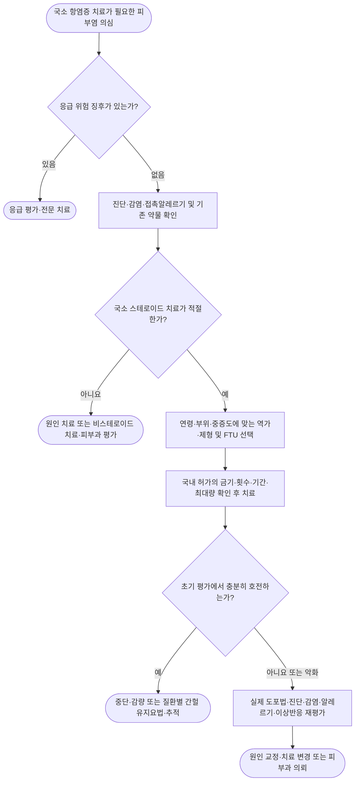

# 국소 스테로이드 Topical Corticosteroids

## <mark style="color:green;">일반 사항</mark>

* 국소 스테로이드는 아토피피부염, 접촉피부염, 건선 등 염증성 피부질환의 핵심 치료제임.
* 정확한 진단을 바탕으로 병변의 중증도·부위·연령에 맞는 역가와 제형을 선택하고, 충분한 양을 필요한 기간 동안 사용한 뒤 감량·중단 또는 간헐적 유지요법으로 전환함.

## <mark style="color:green;">치료 전 평가와 감별</mark>

* 병변의 분포·두께·삼출·피부장벽 손상과 체표면적, 가려움·수면 장애, 연령, 임신·수유 여부를 확인함. 기존 외용제의 성분·역가·빈도·실제 사용량·기간과 경구·흡입·비내·주사 스테로이드 노출도 함께 파악함.
* 치료 불응 또는 도포 후 악화 시 도포량 부족·지속적 자극/알레르겐 노출 외에 피부백선, 옴, 주사·입주위피부염, 약제·기제 접촉알레르기를 감별함. 단순히 역가만 높이지 않음.
* 백선이 의심되면 KOH 직접검사, 접촉알레르기가 의심되면 피부과 첩포검사를 고려함. 비전형적·지속적 병변은 피부림프종 등 다른 질환을 배제하기 위한 조직검사 필요성을 평가함.

### <mark style="color:$danger;">🚩 Red Flags!</mark>

<mark style="color:$danger;">**즉각 조치**</mark>

* 갑자기 발생한 통증성·단형성 수포 또는 punched-out erosion(발열 유무와 무관): 헤르페스성 습진을 의심하여 전신 항바이러스 치료를 지연하지 않고 당일 피부과 평가를 연결함. 눈 주위 병변·안구 증상에는 당일 안과 평가도 필요함  `헤르페스성 습진·안구 침범 의심`
* 갑작스러운 시력 소실 또는 심한 안통을 동반한 급성 시력저하: 즉시 안과 응급 평가함  `안과 응급질환 의심`
* 장기간·대량 사용 후 감량·중단한 환자의 저혈압·실신·반복 구토·심한 쇠약: 응급 평가함  `부신위기 의심`

<mark style="color:$warning;">**당일~수일 내 평가**</mark>

* 퍼지는 홍반·열감·통증·농포 또는 발열: 당일 감염 평가함  `연조직염·이차감염 의심`
* 새로 발생한 시야흐림·점진적 시력저하 또는 지속되는 안구 불편감: 당일 안과 평가함  `안압상승·안구 질환 감별`

<mark style="color:$info;">**조기 평가 및 추적**</mark>

* 적절한 양·용법으로 사용해도 호전이 없거나 도포 부위가 반복적으로 악화함: 진단·접촉알레르기·지속 노출을 재평가함  `치료 불응`
* 피부위축·선조·멍, 소아의 성장속도 저하 또는 쿠싱양 변화: 총 스테로이드 노출과 전신 흡수를 평가함  `국소·전신 이상반응 의심`
* 중단 후 기존 병변을 넘어서는 심한 홍반·작열감·박리: 질환 재발·접촉피부염·감염·금단 반응을 감별함  `중단 후 악화`

***

_응급 위험 징후 외에도 당일~수일 내 평가가 필요한 항목은 해당 시점에 평가함. 초기 반응은 보통 1\~2주에 확인하되 얼굴·소아 또는 더 짧은 허가 제한이 있는 제품은 앞당겨 평가함._

***

## <mark style="background-color:$warning;">Management</mark>

* 진단 → 부위·연령·중증도와 제형에 맞는 역가 선택 → FTU로 충분량 처방 → 조기 반응 평가 → 중단·감량 또는 질환별 유지요법 순으로 적용함.
* **처방 시 최신 품목정보/급여기준 조회**. 제품의 허가 여부·금기·용법과 실제 급여 적용을 각각 확인함.
* 적절한 단기 사용의 이득과 부작용을 함께 설명함. 과도한 steroid phobia로 도포량·기간이 부족해지지 않도록 교육함.

## <mark style="color:green;">비-약물 치료 및 예방</mark>

* 매일 충분한 보습을 유지하고, 향료·세정제·마찰·습식 작업 등 확인된 악화 요인을 줄임. 손습진에서는 접촉물질과 작업환경을 함께 교정함.
* 도포 방법을 직접 시연하고 부위별 치료 계획을 문서로 제공함. 치료가 반복되면 실제 사용량·이상반응·노출 요인을 재확인함.

## <mark style="color:green;">사용 빈도와 기간</mark>

* 제품 허가사항과 질환에 따라 보통 1일 1\~2회 환부에 얇고 고르게 도포함.
  * 습진에서 강한(potent) 제제를 1일 1회 사용하는 방법은 1일 2회 이상과 효과가 비슷할 가능성이 높음. 모든 성분·역가에 동일한 근거가 있다는 뜻은 아니며 제품별 허가 용법을 따름. <mark style="color:$info;">[Cochrane Database Syst Rev 2022]</mark>
  * mometasone furoate, methylprednisolone aceponate 등 1일 1회 사용 제제는 허가 용법을 따름.
  * 효과가 충분한데 도포 횟수를 늘려도 추가 이득은 적고 사용량과 부작용 위험이 증가할 수 있음.
* 일반적인 최대 연속 사용기간의 참고 기준(1일 1\~2회 도포, AAFP 2021)
  * 초고역가(super-high potency): 해외 문헌상 최대 약 3주이나 **국내 제품의 더 짧은 제한이 우선**함. 예를 들어 clobetasol propionate 0.05% 제제인 <mark style="color:blue;">\[베타베이트크림]</mark>·<mark style="color:blue;">\[더모베이트액]</mark>은 2주 이상의 연속 치료와 주당 50 g(액제 50 mL) 이상 사용을 피하도록 허가되어 있음; 24개월 미만은 금기임
  * 고역가·중간 역가(high/medium potency): 최대 약 12주
  * 저역가(low potency): 일률적으로 정해진 최대 사용기간은 없음
* 위 기간은 모든 부위·환자에서 안전을 보장하는 절대 기준이 아님. 소아·고령자, 얼굴·눈꺼풀·외음부·간찰부, 넓은 면적, 손상된 피부 또는 밀폐 부위에서는 더 낮은 역가와 짧은 기간을 사용하고 주기적으로 재평가함.
* 해외 문헌의 12주를 국내 모든 중·고역가 제제의 허가 기간으로 적용하지 않음. 예를 들어 prednicarbate <mark style="color:blue;">\[티티베크림]</mark>은 **4주 이상(소아 3주 이상) 연속 투여하지 않으며 1세 이하 영아는 금기**. <mark style="color:blue;">\[모리코트크림]</mark>은 **소아에서 3주 이상 연용하지 않으며 2세 이하 영아는 금기**, 밀봉붕대법을 삼가도록 허가되어 있음.
* 얼굴·간찰부는 보통 5\~7일 내 반응을 확인하고, 몸통·사지 습진은 대개 1\~2주에 초기 반응을 확인함. 손습진은 2\~4주 내 재평가하되 제품의 더 짧은 제한을 우선함. 지루피부염의 얼굴 병변에는 저역가를 보통 5\~7일 정도 단기 병용하며 항진균 치료를 기본으로 함.
* 2026년 국제 합의에서는 약 **14일**을 초기 치료 반응 평가 시점으로 제안하고, 병변뿐 아니라 가려움·환자 보고 증상의 상대적 호전을 함께 평가하도록 함. 이는 전문가 합의이며 국내 허가 제한을 연장하거나, 7\~14일의 반응 부족만으로 전신치료로 자동 전환하는 기준은 아님. <mark style="color:$info;">[World Allergy Organ J 2026]</mark>
* 치료 목표에 도달하면 중단하거나 역가·빈도를 낮춤. 예상 기간 내 호전이 없으면 순응도뿐 아니라 진단 오류, 접촉알레르기, 감염(tinea incognito 포함)을 재평가함.

### <mark style="color:orange;">Proactive therapy(간헐적 유지요법)</mark>

* 아토피피부염 등에서 급성 병변을 먼저 충분히 조절한 뒤, 자주 재발하는 부위에 적절한 중간 역가 제제를 **주 2\~3회** 간헐 도포하는 유지요법을 고려함(주 2일 주말 요법 등). 도포일의 횟수는 제품·연구 요법에 따르며, 국내 허가 용법·기간과 차이가 있으면 허가 외 사용 여부를 구분함. <mark style="color:$info;">[Ann Dermatol 2025; Cochrane Database Syst Rev 2022]</mark>
* 보습제는 스테로이드 도포일을 포함하여 **매일** 충분히 사용함. 유지요법 시작 후에는 효과·재발 빈도·피부위축·총사용량을 확인하며, 소아에서는 3\~6개월 내 유지 필요성을 재평가함.
* 모든 만성 피부질환에 일률적으로 적용하지 않으며, 제제·역가·연령·부위에 따라 피부위축과 총사용량을 정기적으로 평가함.

## <mark style="color:green;">사용량</mark>

* 영아·소아·성인의 월 사용량을 하나의 고정된 수치로 제한하지 않음. 병변 면적과 FTU로 필요한 양을 계산하고, 제품별 주당 최대량·연속 사용기간 제한을 함께 확인함.
* 실제 안전성은 제제의 역가, 도포 면적·부위, 피부장벽 손상, 밀폐 여부, 사용기간과 연령에 따라 달라짐.
* 처방량은 FTU(fingertip unit)를 이용하여 계산함.

### <mark style="color:orange;">FTU</mark>

* 출구 지름 5 ㎜ 튜브에서 성인 검지 끝부터 원위지절주름(distal interphalangeal crease)까지 짜낸 양임.
* 1 FTU는 약 0.5 g이며 성인 체표면적 약 2%(손가락을 포함한 성인 손의 손바닥 쪽 면적 두 개)에 도포할 수 있음. 로션·액제·샴푸에 같은 길이의 FTU를 그대로 적용하지 않고 제품별 계량·사용법을 따름.

<table>
<thead><tr><th>부위</th><th>3~6개월</th><th>1~2세</th><th>3~5세</th><th>6~10세</th><th>성인</th></tr></thead>
<tbody>
<tr><td>얼굴과 목 전체</td><td>1</td><td>1.5</td><td>1.5</td><td>2</td><td>2.5</td></tr>
<tr><td>한쪽 팔과 손</td><td>1</td><td>1.5</td><td>2</td><td>2.5</td><td>4</td></tr>
<tr><td>한쪽 다리와 발</td><td>1.5</td><td>2</td><td>3</td><td>4.5</td><td>8</td></tr>
<tr><td>가슴과 배 앞면</td><td>1</td><td>2</td><td>3</td><td>3.5</td><td>7~8</td></tr>
<tr><td>등과 엉덩이</td><td>1.5</td><td>3</td><td>3.5</td><td>5</td><td>7~8</td></tr>
</tbody>
</table>

_표의 수치는 해당 부위 전체에 바를 때 필요한 성인 손가락 기준의 1회 FTU 수임(Long & Finlay 기준). **영아의 FTU 수치는 해당 연령에서 모든 제제의 사용이 허가되었다는 뜻이 아님**. 제품의 연령 금기를 먼저 확인함. 체격과 실제 병변 면적에 맞추어 조정하며, 병변이 없는 피부 전체에 일률적으로 도포하지 않음. 재발 부위에 시행하는 proactive therapy는 별도의 유지요법임._

* 예: 성인의 한쪽 팔·손 전체를 1일 1회 7일 치료하면 약 4 FTU × 0.5 g × 7일 = **14 g**이 필요함. 1일 2회이면 약 28 g이며, 실제 병변 면적·제품별 최대량에 맞추어 조정함.

## <mark style="color:green;">강도에 따른 국소 스테로이드 분류</mark>

국소 스테로이드의 역가는 성분·농도·제형·기제 및 augmented formulation 여부에 따라 달라짐. 국내 관련 챕터와의 일관성을 위해 **KADA 2025의 7단계 표를 우선 참고**하고 AAFP 2021을 보완 자료로 사용함. 아래에서는 Class I(초고역가), II(고역가), III\~V(중간 역가), VI\~VII(저역가)로 묶음. 역가표는 제품별 허가·급여·현재 유통을 대신하지 않음.

<table>
<thead><tr><th>분류</th><th>대표 성분·농도·제형</th><th>국내 제품 예 또는 확인 사항</th></tr></thead>
<tbody>
<tr><td><strong>Class I — 초고역가</strong></td><td>clobetasol propionate 0.05% 크림·연고·액제 diflucortolone valerate 0.3% 연고 halobetasol propionate 0.05% 크림·연고</td><td>clobetasol: <mark style="color:blue;">[베타베이트크림]</mark>, <mark style="color:blue;">[더모베이트액]</mark> diflucortolone: <mark style="color:blue;">[디푸코연고0.3%]</mark> halobetasol은 역가 참고 성분이며 국내 제품을 제시한 것은 아님</td></tr>
<tr><td><strong>Class II — 고역가</strong></td><td>betamethasone dipropionate 0.05% 연고 desoximetasone 0.25% 크림·연고 fluocinonide 0.05% 크림·액제 halcinonide 0.1% 크림·연고 <strong>mometasone furoate 0.1% 연고</strong></td><td>fluocinonide: <mark style="color:blue;">[스테파론액]</mark> halcinonide는 성분·역가 참고용이며 현재 처방용 상품 예를 제시하지 않음 mometasone <strong>연고와 크림을 구분함</strong>; 연고 제품의 현재 허가·공급을 별도 확인</td></tr>
<tr><td><strong>Class III~V — 중간 역가</strong></td><td>methylprednisolone aceponate 0.1% 크림 <strong>mometasone furoate 0.1% 크림</strong> triamcinolone acetonide 0.1% 크림·연고 <strong>hydrocortisone butyrate 0.1% 크림·연고</strong> fluticasone propionate 0.05% 크림</td><td>methylprednisolone aceponate: <mark style="color:blue;">[아드반탄크림]</mark> mometasone: <mark style="color:blue;">[모리코트크림]</mark>, <mark style="color:blue;">[에로콤크림]</mark> hydrocortisone butyrate: <mark style="color:blue;">[로코이드연고]</mark> fluticasone은 성분·역가 참고용이며 현재 처방용 상품 예를 제시하지 않음</td></tr>
<tr><td><strong>Class VI~VII — 저역가</strong></td><td>alclometasone dipropionate 0.05% 크림·연고 desonide 0.05% 크림·로션 fluocinolone acetonide 0.01% 크림·액제 triamcinolone acetonide 0.025% 크림·로션 hydrocortisone 1% 또는 2.5% 크림·연고·로션 hydrocortisone acetate 0.5~1% 크림·연고</td><td>alclometasone은 성분·역가 참고용이며 현재 처방용 상품 예를 제시하지 않음 desonide: <mark style="color:blue;">[데스오웬로션0.05%]</mark> hydrocortisone 계열: <mark style="color:blue;">[락티케어에취씨로션]</mark> 등; 제품의 성분·농도를 구분</td></tr>
</tbody>
</table>

* **분류체계 차이**: AAFP 2021은 mometasone 연고·크림·로션을 중간 역가로 묶지만, KADA 2025는 **0.1% 연고를 Class II, 크림을 Class III\~IV**로 구분함. 본 장은 후자를 따르며 같은 농도라는 이유로 두 제형을 동일하게 사용하지 않음. 로션을 연고와 자동으로 같은 class로 간주하지 않음. <mark style="color:$info;">[Ann Dermatol 2025; Am Fam Physician 2021]</mark>
* **역가와 연령 허가는 별개임**: 디푸코연고0.3%는 **4세 이하 및 얼굴에 금기**임. 저역가라도 영아·기저귀발진에 자동으로 사용할 수 있는 것은 아니며 제품별 금기를 확인함.
* **단순 hydrocortisone과 hydrocortisone butyrate는 다름**: <mark style="color:blue;">\[로코이드연고]</mark>는 저역가 hydrocortisone 1%와 같은 제제가 아님.
* Betamethasone dipropionate는 제형·기제 및 augmented 여부에 따라 class가 달라짐. 베타베이트크림은 이름과 달리 **clobetasol propionate 0.05%** 제제임.

### <mark style="color:orange;">국내 사용 제제의 추가 확인</mark>

아래 제제는 위 기준표에 해당 농도·제형이 없거나 자료별 class가 달라 별도로 제시함. 표의 인접 위치만으로 동일 역가로 간주하지 않음.

<table>
<thead><tr><th>성분·농도·제형</th><th>국내 제품 예</th><th>처방 시 확인점</th></tr></thead>
<tbody>
<tr><td>clobetasone butyrate 0.05% 크림·연고</td><td>현재 국내 허가·공급이 확인된 상품을 별도 조회</td><td>clobetasol과 구분; 이름이 비슷해도 초고역가 clobetasol과 같은 성분이 아님</td></tr>
<tr><td><strong>prednicarbate 0.25% 크림·로션</strong></td><td><mark style="color:blue;">[티티베크림]</mark>, <mark style="color:blue;">[락티케어제마지스로션0.25%]</mark></td><td>티티베크림은 <strong>2.5 ㎎/g = 0.25%</strong>임. KADA 표의 prednicarbate <strong>0.1% 크림</strong>과 농도가 다르므로 그 class를 그대로 옮기지 않음</td></tr>
<tr><td>prednisolone valeroacetate 0.3% 크림·로션</td><td><mark style="color:blue;">[리도멕스크림·로션]</mark>, <mark style="color:blue;">[보송크림]</mark></td><td>농도·제형별 제품정보 확인; 단순 prednisolone 제제와 구분</td></tr>
<tr><td><strong>desoximetasone 0.25% 로션</strong></td><td><mark style="color:blue;">[데라파손로션]</mark></td><td>AAFP·KADA의 0.25% <strong>크림·연고</strong> Class II를 로션에 그대로 적용하지 않음. 제조사 허가 용법은 1일 1~3회이며 호전 시 감량</td></tr>
</tbody>
</table>


**제품 현황 확인(2026-11-03)**: 큐티베이트크림은 2025-01-24 허가취소, 나이드크림은 2024-05-10 허가취소·2025-01-01 급여삭제, 락티코트크림1%는 2024-12-04 허가취소·2025-07-01 급여삭제가 표시되어 현재 처방용 예에서 제외함. 기존에 제외한 더모베이트연고(허가취소 2025-10-22), 트리코트크림0.1%·모리코트연고(2026-07-01)도 복원하지 않음. 베로단연고·알타손크림·유모베이트 제형·데스오웬크림은 현재 허가·공급 확인이 충분하지 않아 상품 예에서 제외함. 성분 자체가 국내에서 모두 유통되지 않는다고 단정하지 않음. 허가취소·급여삭제·실제 공급 종료는 같은 개념이 아니며, 제조사 홈페이지나 과거 복약안내문이 남아 있다는 이유만으로 현재 유통을 판단하지 않음. <mark style="color:$info;">[국내 품목별 허가정보·급여이력]</mark>


> **복합제 주의**
>
> <mark style="color:blue;">\[실크론지크림]</mark>은 betamethasone dipropionate 0.064%(640 ㎍/g; betamethasone으로서 0.05%)와 gentamicin 복합제이며 단일 국소 스테로이드가 아님. 감염이 확인되거나 강하게 의심되지 않는 피부염에 항생제 복합제를 관행적으로 사용하지 않음.

_동일 class라도 임상 효과와 부작용이 완전히 같다고 볼 수 없음. 역가표는 대략적인 선택 도구이며 제품별 허가사항을 대신하지 않음._

## <mark style="color:green;">국소 스테로이드 선택</mark>

### <mark style="color:orange;">질환과 병변</mark>

* 초고역가: 다른 치료로 호전되지 않는 심한 국소 병변, 두꺼운 건선판·태선화·손발바닥 과각화 병변 등에 단기간 사용
* 고역가: 두꺼운 몸통·사지 병변, 심한 손습진, 원반모양루푸스, 원형탈모증(☞ [원형탈모증](187_-alopecia-areata.md)) 등에서 질환별 지침에 따라 사용
* 중간 역가: 몸통·사지의 아토피피부염, 접촉피부염, 동전습진, 정체피부염(☞ [습진](159_-eczema.md)) 등에 흔히 사용
* 저역가: 얼굴·외음부·간찰부 등 얇고 흡수가 높은 부위 및 영유아에서 우선 고려. 다만 외음부 경화태선 등 질환별 지침에서 강한 역가를 권고하는 예외는 전문적 진단과 추적 아래 치료
* 두피가 털이 있는 부위라는 이유만으로 고역가가 필요한 것은 아님. 병변의 두께와 중증도에 따라 역가를 선택하고 액제·로션·폼 등 순응도가 좋은 제형을 고름.
* 옴 자체의 치료제로 사용하지 않음. 적절한 살충 치료 후 남은 소양증이나 습진성 염증에 한하여 저·중간 역가를 단기간 보조적으로 고려함.

### <mark style="color:orange;">피하거나 특히 주의할 상황</mark>

* 진단·치료되지 않은 세균·진균·바이러스 피부감염
* 주사(rosacea), 입주위피부염, 여드름
* 피부궤양·현저히 위축된 피부
* 눈꺼풀 및 눈 주위의 장기간·고역가 사용
* 얼굴·외음부·간찰부·기저귀 부위에 고역가 사용
* 영유아의 넓은 체표면적 또는 밀폐요법

감염이 의심되면 원인 감염을 진단하고 적절한 항감염 치료를 시행함. 이차 세균감염이 동반된 습진에서는 감염의 중증도·제품 허가사항을 확인하여 기저 염증의 국소 스테로이드 병행 여부를 개별 판단함. 진물·딱지만으로 감염을 확진하거나 항생제를 일률적으로 추가하지 않음. 감염이 있다는 이유만으로 특정 제형의 국소 스테로이드를 선호하지 않으며, 피부백선에 국소 스테로이드 단독 또는 불필요한 스테로이드-항진균제 복합제를 사용하지 않음.

## <mark style="color:green;">제형 선택</mark>

* 제형은 병변의 건조·삼출 정도, 부위, 털의 유무와 환자 선호도를 고려하여 선택함. 실제 성분과 첨가제는 제품별로 확인함.
* 연고: 폐쇄성과 윤활성이 높아 건조하거나 과각화된 병변에 유용함. 털이 많은 부위·간찰부·삼출성 병변에서는 끈적임, 침연 또는 모낭염 때문에 피하는 경우가 많음.
* 크림: 연고보다 덜 기름지고 미용적 수용성이 좋음. 물과 기름의 비율 및 방부제 함유 여부는 제품마다 다름.
* 로션·액제: 넓은 부위나 털이 있는 부위, 두피에 바르기 편함. 모든 제품이 알코올을 함유하는 것은 아니며, 알코올 함유 제품은 갈라지거나 짓무른 피부에서 자극을 일으킬 수 있음.
* 겔·폼·무스·샴푸: 털이 있는 부위와 두피에서 사용하기 편하지만 제품별 기제와 허가 부위를 확인함.
* 도포 전후 손을 씻음. 단, 손이 치료 부위라면 도포 직후 씻지 않음.
* 더모베이트액 등 가연성 액제는 도포 중·직후 화기·흡연·헤어드라이기 열을 피함.

## <mark style="color:green;">수화와 밀폐요법</mark>

* 수화된 피부에서는 국소 스테로이드 흡수가 증가할 수 있음.
* 비닐 등을 이용한 밀폐요법은 흡수를 크게 증가시키므로 제한된 만성 과각화 병변에서 의료진 지시에 따라 단기간 시행함. 제품에서 밀봉붕대법을 제한하면 해당 제한을 우선함.
* 감염, 침연·미란, 피부위축이 있거나 얼굴·간찰부·기저귀 부위에는 피함. 영유아의 기저귀도 밀폐 효과를 낼 수 있음.
* 밀폐요법을 시행할 때에는 낮은 역가·적은 양·짧은 기간을 사용하고 모낭염, 침연과 감염을 관찰함.

### <mark style="color:orange;">Wet wrap therapy(습포요법)</mark>

* 심한 아토피피부염의 급성 악화·난치성 병변에 단기간 고려하는 치료이며, 비닐 밀폐와 방법을 구분함(☞ [아토피피부염](158_-atopic-dermatitis.md)).
* 보습제 또는 의료진이 선택한 국소 스테로이드 위에 젖은 면·거즈의 안쪽 층과 마른 바깥 층을 적용함. 소아·광범위 병변에서는 전신 흡수와 감염에 특히 주의하며 의료진 감독이 필요함.
* 제제·용량·희석 여부와 적용 시간을 의료진이 정하고 환자가 임의로 희석하지 않음. 제품별 밀봉붕대법 제한을 확인하며 감염된 병변에는 적용하지 않음. <mark style="color:$info;">[Ann Dermatol 2025]</mark>

## <mark style="color:green;">부작용</mark>

* 피부위축, 모세혈관확장, 자반, 피부취약성, 선조(striae)
  * 경도의 표피·진피 위축은 중단 후 호전될 수 있으나 회복에 수개월이 걸릴 수 있음.
  * 선조와 심한 진피 위축은 비가역적일 수 있음.
* 모낭염, 여드름양 발진, 입주위피부염, steroid rosacea
* 저색소·과색소침착, 다모증, 상처 치유 지연
* 국소 스테로이드 또는 기제·방부제에 의한 알레르기접촉피부염
* 감염의 악화·비전형화, tinea incognito, 이차감염
* 눈 주위 장기간 사용 시 안압상승, 녹내장·백내장 가능성; 시야흐림이 생기면 중심장액맥락망막병증 등도 감별
* 드물게 HPA축 억제, 쿠싱증후군, 고혈당; 소아에서는 성장속도 감소 가능성
  * 경구·흡입·비내·주사 스테로이드를 함께 사용하면 총 노출을 확인함. Ritonavir·cobicistat 등 강한 CYP3A 억제제 병용 중 고역가·광범위·장기 도포 시 전신 부작용 위험도 검토함. 단기 소범위 도포 전체를 일률적인 병용금기로 해석하지 않음.
* 얼굴·굴곡부·외음부 등에 중간 이상 역가 제제를 장기간·고빈도로 사용한 뒤 중단할 때 심한 홍반·작열감·박리·부종·구진 또는 농포를 동반한 topical steroid withdrawal이 보고됨. 정확한 빈도는 알 수 없으나 드문 것으로 추정되며, 모든 중단 후 악화를 금단 반응으로 진단하지 않음. <mark style="color:$info;">[MHRA 2024]</mark>

부작용 위험은 고역가, 장기간·고빈도 사용, 넓은 도포 면적, 얇거나 손상된 피부, 밀폐요법, 영유아와 고령자에서 증가함. 장기 치료 중에는 피부위축과 감염 여부를 주기적으로 평가함. 고역가 제제를 장기간 사용한 경우에는 갑작스러운 중단 후 반동 악화가 나타날 수 있으므로, 질환·사용 부위·기간에 따라 역가 또는 도포 빈도의 단계적 감량을 고려함. 통상적인 단기·소범위 치료 뒤에는 일률적인 단계적 감량이 필요하지 않음. Proactive therapy는 병변이 조절된 아토피피부염의 재발 예방을 위한 전략이며, topical steroid withdrawal을 예방하는 방법으로 확립된 것은 아님. 고역가·광범위·밀폐 장기 사용 등 HPA축 억제 위험이 있으면 제품 허가사항에 따라 아침 코르티솔·ACTH 자극시험 등의 필요성을 판단하며, 모든 단기 사용자에게 일률적으로 검사하지 않음.

## <mark style="color:green;">임신 중 사용</mark>

* 의학적으로 필요한 경우 국소 스테로이드를 사용할 수 있으며 저·중간 역가를 우선함. **국내 제품별 임신 관련 제한을 함께 확인**함. 예를 들어 티티베크림은 국내 첨부문서에서 임신 첫 3개월에는 투여하지 않도록 기재되어 있어 계열 전체의 관찰연구만으로 이 제한을 무시하지 않음.
* 고·초고역가는 넓은 면적, 장기간 또는 밀폐 사용을 피하고 필요한 최소량을 짧게 사용함.
* 기존 관찰연구·체계적 고찰에서 주요 선천성기형·조산·태아사망의 뚜렷한 증가 신호는 확인되지 않았음. 과거에는 강력·매우 강력한 제제의 대량 사용과 저체중출생의 연관 가능성이 보고되었으나, 약 110만 건의 임신 원자료에서 국소 스테로이드 노출 임신 60,497건을 비노출군과 비교한 대규모 코호트에서는 고·초고역가 및 누적 처방량 200 g 초과 하위군 분석에서도 SGA 또는 저체중출생의 유의한 위험 증가가 확인되지 않았음. 관찰연구 결과이므로 모든 제제·용량의 무위험을 보장하지 않음. <mark style="color:$info;">[MotherToBaby 2026; JAMA Dermatol 2021]</mark>
* 스테로이드-항생제 복합제의 태아 위험을 하나의 class effect로 단정하지 않음. 각 성분의 필요성과 안전성을 개별 평가하고, 감염 근거가 없으면 항생제 복합제를 사용하지 않음.

## <mark style="color:green;">수유 중 사용</mark>

* 필요한 최소 역가·최소량을 사용하고 영아가 도포 부위에 직접 접촉하지 않도록 함.
* 유두·유륜에 사용해야 한다면 저역가의 수용성 크림·겔을 수유 직후 소량 도포하고 다음 수유 전에 깨끗이 제거함. 고·초고역가 제제와 영아가 핥아 섭취할 수 있는 광물성 파라핀 함유 연고는 피함.
* 도포 후 손을 씻어 영아에게 약물이 묻지 않도록 함.

## <mark style="color:green;">보습제와 병용</mark>

* 보습제는 피부장벽을 회복하고 국소 스테로이드 필요량을 줄이는 데 도움이 됨.
* 보습제와 국소 스테로이드는 한 제품씩 도포하고 다음 제품은 수분 정도 간격을 둘 수 있음(NICE). 일부 지침은 20\~30분 간격을 안내하므로 제품·진료 지침에 맞추어 설명하되, 모든 환자가 반드시 15\~30분을 기다려야 하는 것으로 제시하지 않음. 순서는 환자 선호에 따라 정할 수 있으며 손바닥에서 임의로 섞어 바르지 않음. TCI·delgocitinib의 별도 병용 지침과 구분함. <mark style="color:$info;">[NICE CG57; BAD 2026]</mark>

***

## <mark style="color:green;">국소 칼시뉴린 억제제 Topical Calcineurin Inhibitors</mark> {#calcineurin-inhibitor}

### <mark style="color:orange;">적용</mark>

* 피부위축을 유발하지 않는 비스테로이드성 항염증제로, 국내 허가상 면역기능이 정상인 아토피피부염 환자의 2차 치료제임.
* 국소 스테로이드에 충분히 반응하지 않거나 내약성이 없고, 장기 국소 스테로이드 사용의 위험이 큰 눈꺼풀·얼굴·목·간찰부 등에 유용함.
* **지루피부염·접촉피부염·비아토피성 손습진에 사용하는 경우 허가 외 사용**임. 손등에는 도움이 될 수 있으나 두꺼운 손바닥에서는 효과가 제한적이며 pimecrolimus의 손습진 근거는 일관되지 않음.
* 급성 악화를 국소 스테로이드로 먼저 조절한 뒤 전환하거나 부위별·시기별로 순차 사용할 수 있음. 같은 부위에서 두 약제를 임의로 섞어 바르지 않음.

### <mark style="color:orange;">부작용과 주의</mark>

* 일시적인 작열감, 따가움, 가려움, 발적이 흔하며 대개 치료를 지속하면서 감소함. 치료 초기 며칠간 가장 흔하며 일부 환자에서 치료 중단의 원인이 될 수 있음.
  * 작열감이 심하거나 지속되면 단순한 초기 반응인지 자극·접촉알레르기·감염인지 재평가함. 제품별 보관조건을 준수하며 냉장·냉동 보관을 일률적으로 권하지 않음.
  * 염증이 심한 초기에는 국소 스테로이드로 먼저 염증을 완화한 뒤 TCI로 전환하는 순차치료를 고려할 수 있음.
* 활동성 세균·바이러스·진균 감염 부위, 점막 및 명백한 면역저하 환자에는 사용하지 않음. 눈꺼풀 **피부**에는 사용할 수 있으나 안구·결막·점막에 들어가지 않도록 함. Netherton 증후군과 홍피증 등 피부장벽 장애는 단순한 주의사항으로만 다루지 않고 아래의 제품별 금기를 확인함.
* **Tacrolimus 국내 허가상 금기**: 미란·궤양면, 중증 신장애·중증 고칼륨혈증, 임부 또는 임신할 가능성이 있는 여성, PUVA 등 자외선 치료 중인 환자, Netherton 증후군 및 성분 과민증. 국소제라는 이유로 이러한 제한을 생략하지 않음.
* **Pimecrolimus 국내 허가상 금기**: 홍피증, Netherton 증후군 또는 전신 흡수 증가 가능성이 있는 다른 피부질환, 활동성 피부 바이러스 감염 부위, 눈·점막 및 성분/마크로락탐계 과민증. **임부에게 투여하지 않음**. 두 제제 모두 면역저하 환자와 만 2세 미만에게 사용하지 않음.
* TCI의 임신·수유 안내를 국소 스테로이드의 안내와 구분함. Pimecrolimus는 수유 지속 또는 약물 중단 여부를 이득·위험에 따라 결정하며 **유방에 도포하지 않음**. Tacrolimus도 수유 중 사용 여부는 국내 제품의 해당 주의사항에 따라 별도 판단함. <mark style="color:$info;">[국내 품목별 허가사항]</mark>
* 치료 중 과도한 자연광·인공 자외선 노출을 피하고 노출 부위에는 자외선 차단을 권고함.
* 치료 초기에 음주 후 얼굴의 홍조·화끈거림이 나타날 수 있음.
* FDA 등의 악성종양 경고(boxed warning)가 있으며 국내 첨부문서에도 관련 경고가 있음. 2023년 체계적 문헌고찰·메타분석에서는 전체 암 위험의 의미 있는 증가가 확인되지 않았음. JOELLE 연장 연구에서는 일부 성인 암종의 위험 신호가 관찰되었으나 질환 중증도, 감시 편향 및 초기 피부림프종을 피부염으로 오인한 역인과성 등의 영향을 배제하기 어려웠고 소아 결과는 사건 수가 적어 불확실했음. 위험이 전혀 없다고 단정하지 않으며, 악성 또는 전암성 병변에는 사용하지 않고 지속되는 림프절병증·비전형 병변을 평가함.

### <mark style="color:orange;">용법과 유지요법</mark>

* **Tacrolimus 급성기**
  * **만 16세 이상**: 0.1%를 1일 2회로 시작하고 병변 소실 시까지 치료함. 임상 상태가 허용하면 도포 빈도를 줄이거나 0.03%로 낮춤.
  * **만 2\~15세**: 0.03%만 사용하며 **1일 2회 최대 3주**, 이후 병변 소실 시까지 **1일 1회**로 줄임. 유지요법 도입 기준의 “최대 6주”를 소아의 1일 2회 연속 치료 허용 기간으로 해석하지 않음.
* **Pimecrolimus 급성기**: 활동성 병변에 1일 2회 얇게 도포하고 증상 소실 시 중단함. 매일 무기한 연속 사용하지 않음.
* **Tacrolimus는 치료 2주 후 개선 징후가 없으면** 진단과 다음 치료를 검토함. **Pimecrolimus는 6주 내 호전이 없거나 악화되면** 아토피피부염 진단과 감염·접촉피부염을 재평가함.
* **Tacrolimus 유지요법**: 초기 치료(최대 6주 이내)에 반응한 중등증\~중증 아토피피부염에서 흔히 재발하는 부위에 **주 2일, 해당일 1일 1회**, 도포 사이에 2\~3일을 두고 사용함(예: 월·목). 2\~15세는 0.03%, 16세 이상은 0.1% 제품을 사용하며 12개월 후 지속 필요성을 재평가함. 재발하면 연령별 급성기 용법으로 전환함. <mark style="color:$info;">[프로토픽 국내 허가사항]</mark>
* Pimecrolimus는 국내 첨부문서에 **1년을 넘는 간헐적 사용의 안전성이 확립되지 않았음**이 기재되어 있으므로 장기 반복 처방 시 재평가함.
* Pimecrolimus는 증상의 첫 징후에 다시 시작하는 간헐적 치료가 허가되어 있음. Tacrolimus의 고정된 주 2회 유지요법을 그대로 적용하지 않음.
* Tacrolimus와 보습제를 같은 부위에 사용할 때에는 적어도 2시간 간격을 두도록 하는 해외 제품 지침을 참고함. Pimecrolimus는 도포 후 보습제 사용이 가능하므로 두 약제의 복약지도를 구분함. 밀폐요법은 피함.

### <mark style="color:orange;">종류와 국내 허가</mark>

<table>
<thead><tr><th>성분·제품</th><th>국내 허가 대상</th><th>임상적 위치</th></tr></thead>
<tbody>
<tr><td>
pimecrolimus 1% 크림 <mark style="color:blue;">[엘리델크림]</mark>
</td><td>면역기능이 정상인 2세 이상 소아·청소년·성인의 경증~중등증 아토피피부염 2차 치료</td><td>주로 경증~중등증 병변, 특히 얼굴·간찰부에 사용</td></tr>
<tr><td>
tacrolimus 0.03% 연고 <mark style="color:blue;">[프로토픽연고0.03%]</mark>
</td><td>면역기능이 정상인 만 2세 이상 환자의 중등증~중증 아토피피부염 2차 치료</td><td>pimecrolimus보다 평균적으로 항염 효과가 강함</td></tr>
<tr><td>
tacrolimus 0.1% 연고 <mark style="color:blue;">[프로토픽연고0.1%]</mark>
</td><td>면역기능이 정상인 만 16세 이상(성인·청소년)의 중등증~중증 아토피피부염 2차 치료</td><td>국소 calcineurin 억제제 중 항염 효과가 강한 편</td></tr>
</tbody>
</table>

_0.03%는 만 2세 이상, 0.1%는 만 16세 이상부터 사용 가능함. 만 2\~15세 소아는 0.03% 제품만 사용함._

국소 calcineurin 억제제와 국소 스테로이드의 역가를 일대일로 대응시키지 않음. tacrolimus, 특히 0.1%는 pimecrolimus보다 평균적으로 효과가 강하지만 병변 부위, 중증도와 내약성을 함께 고려함.

### <mark style="color:orange;">급여</mark>

허가사항과 급여기준은 같은 개념이 아님. 엘리델·프로토픽은 허가범위 내 적응증·연령·농도·용법을 확인하고, 실제 처방 시점의 건강보험심사평가원 급여기준과 전산심사 조건을 별도로 확인함.

***

## <mark style="color:green;">기타 국소 비스테로이드 제제</mark>

### <mark style="color:orange;">Delgocitinib</mark>

* 국소 도포형 pan-JAK 억제제로 스테로이드나 calcineurin 억제제가 아님.
* 국소 스테로이드 치료에 반응하지 않거나 국소 스테로이드 치료가 적절하지 않은 성인의 중등증\~중증 만성 손습진에는 delgocitinib 20 ㎎/g 크림 <mark style="color:blue;">\[앤줍고크림]</mark>을 고려할 수 있음.
* **국내 허가 대상은 만 18세 이상 성인**임. 손·손목의 환부에 1일 2회 약 12시간 간격으로 도포하고, 병변이 깨끗해지거나 거의 소실되면 중단하며 재발 시 다시 사용함. 12주 후 개선이 없으면 중단을 고려함. 임신 중에는 예방적으로 사용을 피하며, 감염·악성 피부병변과 소아 적용은 제품별 주의사항을 따름. 실제 급여 적용 여부는 처방 시점에 확인함(☞ [습진](159_-eczema.md)).
* 다른 치료용 국소제와 같은 부위에 병용하는 것은 평가되지 않아 권장되지 않음. 도포 직전·직후 다른 국소제품을 바르지 않으며 **도포 전후 2시간 이내 보습제 병용은 연구되지 않음**. 손·손목 외 부위, 눈·입·점막에 적용하지 않음.
* 도포 부위를 정기적으로 피부 검진함. 수유 중에는 치료의 이득과 영아 위험을 평가하고 도포한 손·손목이 유두·영아 피부에 직접 닿지 않도록 함. <mark style="color:$info;">[앤줍고 국내 허가사항]</mark>

### <mark style="color:orange;">해외 최신 권고와 국내 적용</mark>

2025년 AAD 성인 아토피피부염 집중 개정에서는 비스테로이드 외용제인 tapinarof(AhR 작용제)와 roflumilast(PDE-4 억제제) 크림을 새로 강하게 권고함. 이는 국소 스테로이드의 역가 분류나 TCI의 국내 허가를 변경하는 내용이 아니며, **국내 허가·연령·공급·급여가 확인된 경우에만 해당 조건에 맞추어 적용**함. 본 장에는 국내 처방례로 추가하지 않음. <mark style="color:$info;">[J Am Acad Dermatol 2025]</mark>

***

## <mark style="color:green;">질병코드</mark>

국소 스테로이드의 사용 자체에 진단코드를 부여하지 않으며, 실제 진단된 피부질환을 가장 구체적인 코드로 기재함. 아래는 대표 예이며, 부위·원인·중증도가 확인되면 해당 세부코드를 우선함. 저장된 **KCD9_251216(6).xlsx**의 전체·완전코드 시트와 대조함(2026-11-03).

<table>
<thead><tr><th>코드</th><th>KCD-9 한글명</th><th>적용 시 유의점</th></tr></thead>
<tbody>
<tr><td>L20.9</td><td>상세불명의 아토피성 피부염</td><td>아토피피부염의 세부 유형이 확인되지 않은 경우</td></tr>
<tr><td>L23.9</td><td>상세불명 원인의 알레르기성 접촉피부염</td><td>알레르기성으로 진단했으나 원인이 미상인 경우</td></tr>
<tr><td>L24.9</td><td>상세불명 원인의 자극물접촉피부염</td><td>자극성으로 진단했으나 원인이 미상인 경우</td></tr>
<tr><td>L30.9</td><td>상세불명의 피부염</td><td>습진의 세부 유형이 확정되지 않은 경우; 만성 손습진 전체에 자동 적용하지 않음</td></tr>
<tr><td>L40.00</td><td>중증 보통건선</td><td>중증도로 구분; L40.0은 불완전코드임</td></tr>
<tr><td>L40.01</td><td>중등증 보통건선</td><td>중증도로 구분</td></tr>
<tr><td>L40.02</td><td>경증 보통건선</td><td>중증도로 구분</td></tr>
<tr><td>L40.08</td><td>기타 및 상세불명의 보통건선</td><td>다른 건선 유형을 모두 이 코드로 묶지 않음</td></tr>
<tr><td>E24.2</td><td>약물유발 쿠싱증후군</td><td>임상적으로 진단된 이상반응에 사용</td></tr>
<tr><td>E27.3</td><td>약물유발 부신피질부전</td><td>임상적으로 진단된 이상반응에 사용; 검사상 HPA축 억제만으로 자동 부여하지 않음</td></tr>
<tr><td>Y56.0</td><td>치료용으로 사용시 유해작용을 나타내는 달리 분류되지 않은 국소 항진균제, 항감염제 및 항염증제</td><td>치료적 사용에 의한 유해작용의 추가 외인코드; 엑셀상 주상병 사용 불가</td></tr>
</tbody>
</table>

_이상반응의 임상 진단을 먼저 코딩하고 필요한 외인코드를 추가함. 정상적인 치료적 사용 중 유해작용과 과량·오용 등에 의한 중독은 구분함. 단지 약제를 처방했다는 이유로 이상반응 코드를 부여하지 않음._

### <mark style="color:$success;">핵심 복약 지도</mark>

* 약 이름·강도·바를 부위·1회 FTU·하루 횟수·사용 종료일 또는 재평가일을 함께 적어 줌. 서로 다른 부위에 처방한 약을 바꾸어 쓰지 않음.
* 얇고 고르게 필요한 양을 바름. 두려움 때문에 지나치게 적게 바르거나, 효과를 높이려고 임의로 횟수·기간을 늘리지 않음.
* 보습제는 매일 사용하되 약과 손바닥에서 섞지 않음. 국소 스테로이드·tacrolimus·pimecrolimus·delgocitinib은 보습제 병용 간격이 다르므로 각각 안내함.
* 손이 치료 부위이면 도포 직후 씻지 않음. 의료진 지시 없이 비닐·밀폐 장갑·붕대로 덮지 않음.
* 갑자기 아픈 물집·패인 상처, 급격히 번지는 홍반·발열, 새 시력 증상은 즉시 연락함. 과량 장기 사용 후 심한 쇠약·실신·반복 구토가 생기면 응급 평가를 받음.
* 증상 조절 후 중단·감량·간헐 유지요법 중 어느 계획인지 확인함. 남은 약을 가족에게 나누거나 다음 발진에 임의로 재사용하지 않음.

***

## <mark style="color:blue;">주요 참고문헌 및 확인 자료</mark>

### <mark style="color:orange;">임상 근거</mark>

1. Ko HC, et al. [Consensus-Based Guidelines for the Treatment of Atopic Dermatitis in Korea (Part I): Basic Therapy, Topical Therapy, and Conventional Systemic Therapy](https://doi.org/10.5021/ad.24.153). *Ann Dermatol*. 2025;37(4):201–215. 역가 분류(Table 2), 간헐적 유지치료·습포요법.
2. Stacey SK, McEleney M. [Topical Corticosteroids: Choice and Application](https://www.aafp.org/pubs/afp/issues/2021/0315/p337.html). *Am Fam Physician*. 2021;103:337–343. 해외 일반 사용기간·도포량 참고; 국내 허가 제한과 구분.
3. Lax SJ, et al. [Strategies for using topical corticosteroids in children and adults with eczema](https://doi.org/10.1002/14651858.CD013356.pub2). *Cochrane Database Syst Rev*. 2022;3:CD013356. 강한 제제의 도포 빈도와 주말 유지요법 근거.
4. [NICE CG57. Atopic eczema in under 12s: diagnosis and management](https://www.nice.org.uk/guidance/cg57/chapter/Recommendations). 외용제 도포 간격·감염 위험 징후와 헤르페스성 습진 관리.
5. Andersson NW, Skov L, Andersen JT. [Evaluation of Topical Corticosteroid Use in Pregnancy and Risk of Newborns Being Small for Gestational Age and Having Low Birth Weight](https://pubmed.ncbi.nlm.nih.gov/33950165/). *JAMA Dermatol*. 2021;157:788–795.
6. Devasenapathy N, et al. [Cancer risk with topical calcineurin inhibitors, pimecrolimus and tacrolimus, for atopic dermatitis: a systematic review and meta-analysis](https://pubmed.ncbi.nlm.nih.gov/36370744/). *Lancet Child Adolesc Health*. 2023;7:13–25.
7. Arana A, et al. [Long-Term Risk of Skin Cancer and Lymphoma in Users of Topical Tacrolimus and Pimecrolimus: Final Results from the Extension of the JOELLE Cohort Study](https://pmc.ncbi.nlm.nih.gov/articles/PMC8721027/). *Clin Epidemiol*. 2021;13:1141–1153.
8. National Library of Medicine. [LactMed: Hydrocortisone, Topical](https://www.ncbi.nlm.nih.gov/books/NBK501276/). 수유·유두 도포 시 제형 및 영아 직접 노출.
9. British Association of Dermatologists. [Topical corticosteroids](https://www.bad.org.uk/pils/topical-corticosteroids). 보습제 병용 등 환자 교육 자료(2026).
10. Zuberbier T, et al. [The definition of response and inadequate response to topical corticosteroid treatment in atopic dermatitis and related skin inflammatory diseases: A GA²LEN ADCARE statement paper](https://pubmed.ncbi.nlm.nih.gov/42028244/). *World Allergy Organ J*. 2026;19(5):101380. 초기 반응 평가의 국제 전문가 합의; 국내 허가사항과 구분함.
11. Davis DMR, et al. [Focused update: Guidelines of care for the management of atopic dermatitis in adults](https://pubmed.ncbi.nlm.nih.gov/40531067/). *J Am Acad Dermatol*. 2025. doi:10.1016/j.jaad.2025.05.1386. 해외 신규 외용제 권고.
12. [NICE NG190. Secondary bacterial infection of eczema and other common skin conditions: antimicrobial prescribing](https://www.nice.org.uk/guidance/ng190/chapter/Recommendations). 감염 동반 습진의 기저 염증 치료와 항생제 사용 구분.
13. MotherToBaby. [Topical Corticosteroids](https://www.ncbi.nlm.nih.gov/books/NBK582987/). 2026-03. 임신 중 사용의 관찰자료와 한계.

14. Elliott ER, et al. [Iatrogenic Cushing’s syndrome due to drug interaction between glucocorticoids and the ritonavir or cobicistat containing HIV therapies](https://pmc.ncbi.nlm.nih.gov/articles/PMC6297313/). *Clin Med (Lond)*. 2016;16:412–418. 국소 스테로이드와 강한 CYP3A 억제제의 병용 시 전신 부작용 검토.

### <mark style="color:orange;">허가·급여 확인 자료</mark>

* [식품의약품안전처 의약품안전나라](https://nedrug.mfds.go.kr/). 국내 성분·함량·연령·용법·사용기간·허가 상태 확인. 실제 처방 전 최신 정보를 확인함.
* [약학정보원](https://www.health.kr/). 국내 허가정보 전재본 확인: 티티베크림(A11ABBBBB1640), 모리코트크림(2017040300036), 더모베이트액(2018032700006), 베타베이트크림(A11A1590B0021), 프로토픽연고0.03%(2018040900041), 엘리델크림(2018040900040), 앤줍고크림(2025090900005). 더모베이트연고(2017020100030), 트리코트크림(A11A0130A0207), 모리코트연고(A11AOOOOO0864), 나이드크림(A11AGGGGA4737), 락티코트크림1%(A11A2190A0207), 큐티베이트크림(A11A0040A0125)의 허가·급여이력도 대조함. 일부 원문 접근 제한 시 식약처 자료 전재본으로 보완함(2026-11-03).
* [태극제약 데라파손로션 제품정보](https://www.taiguk.co.kr/product/view.jsp?pid=AHG72474). 성분·제형·1일 1\~3회 허가 용법.
* [건강보험심사평가원](https://www.hira.or.kr/). 허가사항과 별개로 품목별 급여기준·등재·시행일 확인.
* European Medicines Agency. [Protopic: product information](https://www.ema.europa.eu/en/medicines/human/EPAR/protopic). 국외 허가자료; 보습제와 2시간 간격 등 국내 안내와 구분하여 참고함.
* MHRA. [Topical steroids: new labelling and a reminder of severe side effects, including topical steroid withdrawal reactions](https://www.gov.uk/drug-safety-update/topical-steroids-introduction-of-new-labelling-and-a-reminder-of-the-possibility-of-severe-side-effects-including-topical-steroid-withdrawal-reactions). 2024-05-29. 금단 반응·장기 과량 사용의 위험.

* 저장된 KCD9_251216(6).xlsx. 「상병분류기호(전체)」·「상병분류기호(완전코드)」의 코드·한글명·완전코드구분·주상병사용구분 대조(2026-11-03).

***

## <mark style="color:green;">환자 안내서</mark>

**바르는 스테로이드, 이렇게 사용하세요**

1. 처방받은 부위에 정해진 양과 횟수로 바르세요. 얼굴에 바르는 약과 몸에 바르는 약은 강도가 다를 수 있습니다.
2. 손가락 끝마디 길이로 짠 양은 손가락을 포함한 성인 손의 손바닥 쪽 두 개 넓이에 바를 수 있는 대략적인 양입니다. 실제 바를 양은 진료 시 확인하세요.
3. 보습제를 꾸준히 사용하세요. 약과 보습제를 섞지 말고, 약별로 안내받은 간격을 지키세요.
4. 눈에 들어가지 않게 주의하고, 지시 없이 비닐이나 붕대로 덮지 마세요. 기저귀도 약의 흡수를 늘릴 수 있습니다.
5. 좋아진 뒤에는 안내받은 중단·감량 또는 재발 예방 계획을 따르세요. 오래 많이 사용했다면 혼자 조절하지 말고 상의하세요.
6. 아픈 물집이나 패인 상처가 갑자기 생기거나, 피부가 빠르게 붉어지고 열이 나거나, 시력이 달라지면 바로 진료를 받으세요.
