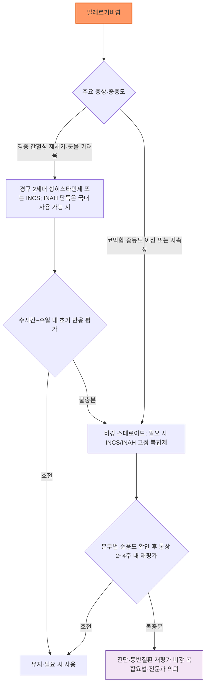
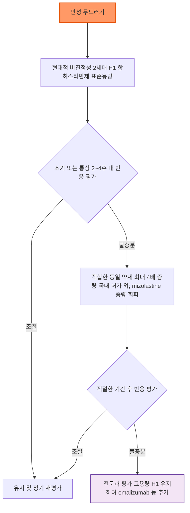

# 항히스타민제 Antihistamines

## <mark style="color:green;">일반 사항</mark>

* histamine H1 수용체의 역작용제(inverse agonist)로 작용하여 재채기, 콧물, 코·눈 가려움, 팽진(wheal) 및 소양증을 완화하는 약물군
* 분류 : 1세대(진정성) — 혈액뇌장벽 통과, 항콜린 작용 큼 / 2세대(비진정성 또는 저진정성) — 혈액뇌장벽 통과 적음, 항콜린 작용 적음
* 주요 적응증 : 알레르기비염, 알레르기결막염, 급성·만성 두드러기, 아나필락시스의 피부 증상 보조 치료(기도 점막부종·호흡기·순환기 증상에는 효과 없음)
* 일부 성분은 항히스타민제 본래 목적이 아닌 멀미·현훈(dimenhydrinate, meclizine), 수면유도(doxylamine), 수면유지 불면증(저용량 doxepin) 목적으로도 사용됨 — 이 챕터에서는 이를 알레르기 치료제와 구분하여 별도 표로 제시함
* 경구 항히스타민제는 코막힘에 대한 효과가 제한적임. 비강 항히스타민제는 경구제보다 코막힘을 포함한 코 증상 개선이 우수할 수 있으나, 지속성·중등증 이상 비염에서는 비강 스테로이드(INCS) 또는 INCS/비강 항히스타민제(INAH) 고정 복합제가 우선임
* 항히스타민제는 천식성 기관지수축 및 아나필락시스의 기도폐쇄·저혈압·쇼크를 치료하지 못함. 아나필락시스에서는 epinephrine과 초기 소생 처치 후 남은 피부 증상에만 보조적으로 사용함
* 두드러기와 같은 히스타민성 가려움에는 효과적이나 아토피피부염·접촉피부염·건조피부·요독성·담즙정체성·신경병성 가려움 전체에 같은 효과를 기대하지 않음. **허가 적응증의 존재와 해당 질환에서의 임상적 효과·권고 수준을 구분함**

***

### <mark style="color:$danger;">🚩 Red Flags!</mark>

<mark style="color:$danger;">**즉각 조치**</mark>

* 혀·인후 부종, 협착음, 천명·호흡곤란, 저혈압·실신 등 아나필락시스 의심 — 즉시 IM epinephrine과 응급 처치·이송; 항히스타민제 투여로 지연하지 않음. 피부 증상이 없어도 가능함  `아나필락시스`
* 복용 후 실신, 심한 심계항진 또는 다형성 심실빈맥(torsades de pointes) 의심 — 원인 약물 중단 및 응급 평가  `심실부정맥`
* 과량복용 또는 소아 투여 후 호흡억제, 깨우기 어려운 의식저하, 경련 — 기도·호흡 평가 및 응급 이송  `중독·중증 중추신경계 이상반응`
* 팽진 없이 혀·인후 부종이 진행함(특히 ACEI 복용 또는 유전성 혈관부종 병력 동반) — 응급 기도 평가와 원인별 치료; 아나필락시스가 배제되지 않으면 IM epinephrine을 지연하지 않음  `Bradykinin 매개 혈관부종 감별`

<mark style="color:$warning;">**당일~수일 내 평가**</mark>

* 2세 미만 소아에게 promethazine이 투여되었거나 소아에게 진정성 항히스타민제를 수면 유도 목적으로 임의 사용 — 중단하고 당일 소아·응급 평가; 호흡억제·의식저하·경련 또는 과량복용 의심 시 즉각 조치  `소아 약물 안전`
* 심한 역설적 흥분·혼돈 또는 지속되는 배뇨곤란 — 약제 중단 및 당일 평가  `중추신경계·항콜린성 이상반응`
* 24시간 이상 지속되는 통증성 두드러기 병변에 발열·관절통·자반이 동반 — 당일~수일 내 원인 평가; 전신상태가 나쁘면 당일 평가  `두드러기혈관염 등 감별`

<mark style="color:$info;">**조기 평가 및 추적**</mark>

* Hydroxyzine·mizolastine 처방 전 QT 위험인자·병용약 확인 — 금기이면 대체; 위험인자만 있고 무증상이면 그 자체로 응급 의뢰를 결정하지 않음  `QT 연장 위험`
* 적절한 비강 스테로이드 치료 후에도 중등증 이상 비염이 지속 — 진단·순응도·분무법·동반질환을 재평가하고 필요 시 전문과 의뢰  `불응성 비염`
* 2세대 H1 항히스타민제의 적절한 증량에도 만성 두드러기가 조절되지 않거나 증량을 견디지 못함 — 전문과 평가 및 추가 치료 검토  `불응성 두드러기`
* Cetirizine·levocetirizine 장기 복용 중단 후 수일 내 심한 전신 가려움 — 원래 질환의 재발 및 다른 원인을 감별하고 대처를 결정  `중단 후 가려움`

***

***



<p align="center"><strong>알레르기비염 치료 알고리듬</strong></p>



<p align="center"><strong>만성 두드러기 치료 알고리듬</strong></p>

<p align="center"><em><mark style="color:$info;">Ref. The International Guideline for Urticaria. Allergy. 2026. doi:10.1111/all.70210</mark></em></p>

***

## <mark style="background-color:$warning;">Management</mark>

### <mark style="color:orange;">알레르기비염</mark>

<table><thead><tr><th width="90">단계</th><th width="280">핵심 치료</th><th>대상·재평가</th></tr></thead><tbody><tr><td>Step 1</td><td>재채기·콧물·가려움이 주된 경증 간헐성 비염: 경구 2세대 H1 항히스타민제 또는 INCS; INAH 단독은 국내 사용 가능한 품목·공급을 확인한 경우</td><td>증상 발생 양상과 환자 선호에 따라 선택. 수시간~수일 내 초기 반응 확인</td></tr><tr><td>Step 2</td><td>비강 스테로이드</td><td>코막힘이 뚜렷하거나 중등증 이상 또는 지속성 비염. 중등증 이상에서 빠른 조절이 필요하면 처음부터 INCS/INAH 고정 복합제도 고려. 정확한 분무법·순응도 확인 후 통상 2~4주 내 재평가</td></tr><tr><td>Step 3</td><td>INCS/INAH 고정 복합제 또는 전문과 평가</td><td>적절한 비강 스테로이드에도 불충분하면 진단·동반질환을 재평가하고 복합요법, 면역치료 등을 고려</td></tr></tbody></table>

### <mark style="color:orange;">만성 두드러기</mark>

<table><thead><tr><th width="90">단계</th><th width="280">핵심 치료</th><th>대상·재평가</th></tr></thead><tbody><tr><td>Step 1</td><td>현대적 비진정성 2세대 H1 항히스타민제 표준용량</td><td>1차 치료. 증상 중증도에 따라 조기에 또는 통상 2~4주 내 평가. 만성 자발성 두드러기는 필요시에만 복용하기보다 규칙적으로 복용</td></tr><tr><td>Step 2</td><td>고용량 근거·안전성을 확인한 동일 약제를 최대 표준용량의 4배까지 단계적으로 증량</td><td>Step 1 반응 불충분. 국내 허가사항을 벗어난 용법</td></tr><tr><td>Step 3</td><td>고용량 H1 치료를 유지하며 omalizumab 등 추가 치료 — 전문과 평가</td><td>충분한 증량에도 조절되지 않는 경우</td></tr></tbody></table>


**두드러기 4배 증량 요법은 국내 허가사항을 벗어난 용법**\
2026년 국제 두드러기 지침은 만성 자발성 두드러기에서 표준용량의 현대적 비진정성 2세대 H1 항히스타민제에 반응하지 않으면 동일 성분을 최대 4배까지 증량할 것을 권고하지만, 이는 국내 허가사항을 벗어난 용법임. 약제별 고용량 유효성·안전성 근거는 서로 다르므로 국내 허가사항, 신·간기능, 진정 가능성, 상호작용 및 성분별 심장 위험을 평가함. 서로 다른 항히스타민제를 임의로 병용하기보다 한 약제를 단계적으로 증량하며, 4배를 초과하지 않음. Hydroxyzine 등 1세대 및 ketotifen은 이 증량 원칙의 대상이 아님. Mizolastine은 2026 지침의 고용량 근거에 언급되지만, 본 가이드에서는 QT 위험·상호작용을 고려하여 증량을 회피함(156장과 통일). 이 원칙을 비염이나 피부염의 가려움에 그대로 적용하지 않음. 소아·임신·수유 및 신·간장애 환자에게 성인 정상 장기기능 환자의 증량표를 그대로 적용하지 않음.


* 비염에서 경구 항히스타민제의 반복 증량·같은 계열 중복은 권하지 않음. INCS에 경구제를 일률적으로 추가하기보다 코 증상에는 INCS/INAH 고정 복합제를, 눈 증상에는 적절한 점안제를 고려함. 국내 대표 INCS/INAH 복합제는 azelastine/fluticasone <mark style="color:blue;">[딜라스틴]</mark>, olopatadine/mometasone <mark style="color:blue;">[리알트리스]</mark>, azelastine/mometasone <mark style="color:blue;">[모테손플러스]</mark>이며, 적응증·허가연령·분무량은 051장을 따름.
* 만성 자발성 두드러기의 고용량 H1 불응에서는 omalizumab이 강한 권고의 추가 치료임. 2026 지침은 dupilumab·remibrutinib도 추가 옵션으로 제안함. 각 약제의 국내 허가·급여·공급과 연령은 156장에서 확인하며, 만성 유발성 두드러기에 CSU 허가를 그대로 적용하지 않음.
* 1세대 H1 항히스타민제나 H2 차단제를 만성 두드러기에 관행적으로 추가하지 않음. 반응 불충분·내약성 문제에는 다른 적합한 2세대 성분으로 교체를 고려함.

### <mark style="color:orange;">피부염·만성 가려움 및 혈관부종에서의 적용 범위</mark>

| 임상 상황 | 항히스타민제의 역할 |
| --- | --- |
| 아토피피부염·접촉피부염 | 보습·피부장벽 회복과 국소 항염증 치료가 우선임. 경구 H1 제제는 선택적 보조요법이며 일상적 장기 투여나 두드러기식 4배 증량을 권하지 않음. 동반 두드러기·알레르기비염에는 2세대 제제를 고려함 |
| 심한 야간 가려움·수면장애 | 선택된 환자에서 진정성 제제를 단기간 고려할 수 있으나, 수면 보조와 가려움 원인 치료의 효과를 구분함. 고령자에서는 원칙적으로 회피함 |
| 건조피부·요독성·담즙정체성·신경병성 가려움 | 효과가 제한적임. 무반응만으로 신경병성 가려움으로 단정하지 않고 원인·기전을 재평가함 |
| Bradykinin 매개 혈관부종 | HAE/AAE·ACEI 유발 혈관부종은 H1 제제·steroid·epinephrine 반응이 불량함. 원인별 치료가 필요하며 응급 기도 위험은 Red Flags를 따름 |

* **국소 항히스타민제는 아토피피부염·접촉피부염에서 접촉감작 위험 때문에 권하지 않음.** 허가된 항알레르기 점안제와 피부 도포제를 구분함.
* 지르텍정은 피부가려움증 및 **하이드로코티손 외용제와 병용하는 습진·피부염**에 국내 허가가 있으나, 이 사실이 피부염의 일상적 장기 항히스타민제 치료를 권한다는 뜻은 아님. 클라리틴정 및 알레그라정180 ㎎의 접촉피부염 소양증 사용은 허가 외임.

<p align="center"><em><mark style="color:$info;">Ref. ARIA–EAACI 2024–2025 revision (Part I·II); International Urticaria Guideline 2026; European Guideline on Chronic Pruritus 2025; 국내 제품별 허가사항. 관련: 051·156·157·158·161장.</mark></em></p>

***

## <mark style="color:green;">약물 치료</mark>

성인 대표 용량을 기준으로 함. 용량 조절이 없는 성인 예시이며, 표 안의 성분끼리 모든 적응증을 공유하지 않음. 소아의 허가연령·용량은 성분만으로 결정하지 말고 **제품·제형·적응증별 국내 허가사항**을 반드시 확인함. 정제·시럽·점적액의 허가연령이 서로 다를 수 있음.

### <mark style="color:orange;">경구 2세대 H1 항히스타민제(일부 저진정성·진정성 성분 포함)</mark>

<table><thead><tr><th width="190">성분명 [대표 상품명]</th><th width="60">진정</th><th width="140">성인 대표 용량</th><th>주요 복약지도·주의</th></tr></thead><tbody>
<tr><td>cetirizine <mark style="color:blue;">[지르텍]</mark></td><td>+</td><td>10 ㎎ qd</td><td>졸음 가능. 주로 신배설 — 신기능에 따라 감량. 지르텍정은 6세 이상 용법을 사용하며, 더 어린 소아의 액제 용량을 정제에 적용하지 않음</td></tr>
<tr><td>levocetirizine <mark style="color:blue;">[씨잘]</mark></td><td>+</td><td>5 ㎎ qd</td><td>졸음 가능. 씨잘정은 eGFR 기준으로 용량·간격 조절. <span style="color:red">eGFR ＜15 mL/min 또는 혈액투석 환자 금기</span>. 국내 습진·피부염 허가는 하이드로코티손 외용제 병용 조건을 명시하며 지르텍정의 별도 피부가려움증 적응증과 구분</td></tr>
<tr><td>loratadine <mark style="color:blue;">[클라리틴]</mark></td><td>-</td><td>10 ㎎ qd</td><td>진정 적음. 간·신장애는 별도 평가. 국내 클라리틴정은 임부·수유부 금기. Cimetidine·erythromycin·ketoconazole·quinidine·fluconazole·fluoxetine 병용 제한 확인. 클라리틴정은 만 6세 이상·체중 30 ㎏ 이상 소아의 10 ㎎/day 용법. 어린 소아는 제품·제형별 허가 확인</td></tr>
<tr><td>desloratadine <mark style="color:blue;">[에리우스]</mark></td><td>-</td><td>5 ㎎ qd</td><td>진정 적음. 중증 간·신기능 저하 시 제품 허가사항 확인. 에리우스정 5 ㎎은 12세 이상. 해외 시럽의 영유아 허가연령을 국내 정제에 적용하지 않음</td></tr>
<tr><td>fexofenadine <mark style="color:blue;">[알레그라]</mark></td><td>-</td><td>120 ㎎ qd 또는 180 ㎎ qd<sup>1)</sup></td><td>진정 매우 적음. 물과 함께 공복 복용 (☞ 복약지도 참고)</td></tr>
<tr><td>ebastine <mark style="color:blue;">[에바스텔]</mark></td><td>±</td><td>10 ㎎ qd</td><td>일부 환자에서 졸음. 간기능 및 QT 위험 약물 확인</td></tr>
<tr><td>epinastine <mark style="color:blue;">[알레지온]</mark></td><td>+</td><td>20 ㎎ qd</td><td>졸음 가능. 국내 10 ㎎·20 ㎎ 제제가 있어 제품별 용법 확인</td></tr>
<tr><td>rupatadine <mark style="color:blue;">[루파핀]</mark></td><td>±</td><td>10 ㎎ qd</td><td>CYP3A4 기질 — 자몽주스·강력한 CYP3A4 억제제 병용을 피함; 중등도 억제제는 주의. 국외 SmPC는 신·간장애에서 비권장. 국내 제품 허가사항 확인. 심장 위험을 hydroxyzine과 같은 수준으로 간주하지 않음</td></tr>
<tr><td>olopatadine <mark style="color:blue;">[알레락]</mark></td><td>±</td><td>5 ㎎ bid</td><td>졸음 가능. 경구제와 점안·비강 제제는 용량·근거가 다르므로 구분</td></tr>
<tr><td>bepotastine <mark style="color:blue;">[타리온정]</mark></td><td>±</td><td>10 ㎎ bid</td><td>졸음 가능. 신기능 저하 시 제품 허가사항 확인. 속방정 10 ㎎ bid와 서방정의 1일 1회 용법을 구분</td></tr>
<tr><td>mizolastine <mark style="color:blue;">[미졸렌]</mark></td><td>±</td><td>10 ㎎ qd</td><td><span style="color:red">QT 연장 위험</span> — 기존 QT 연장, 심질환, 전해질 이상 및 QT 연장 약물 병용 여부 확인. 12세 이상 용법. 유의한 간기능 저하·심질환·부정맥/서맥·QT 연장·전해질 이상 및 macrolide·전신 imidazole 항진균제·QT 연장 약물 병용은 금기 확인. 본 가이드에서는 증량 회피</td></tr>
<tr><td>ketotifen <mark style="color:blue;">[자디텐]</mark></td><td>+</td><td>1 ㎎ bid</td><td>mast-cell stabilizing 작용 동반. 현대적 비진정성 2세대 약제와 성격이 다르며 만성 두드러기의 4배 증량 원칙에 포함하지 않음. 증량은 해당 제품 허가사항 확인</td></tr>
<tr><td>azelastine 경구 <mark style="color:blue;">[아젭틴]</mark></td><td>+</td><td>비염·피부 알레르기: 1 ㎎ bid</td><td>아침 식후 및 취침 전 복용. 국내 2 ㎎ bid는 기관지천식의 허가 용량이며 비염·피부질환 용량과 구분; 급성 천식발작 완화제는 아님. 졸음 가능. 경구 정제이며 azelastine 비강분무제와는 용량·근거가 다름 — 혼동 주의</td></tr>
</tbody></table>

✽진정의 − 표시는 위험이 없다는 뜻이 아니라 상대적으로 낮다는 의미임. 모든 성분에서 개인별 졸음·운전 능력을 확인함.

<sup>1)</sup> fexofenadine은 국내 함량별 허가 적응증이 다를 수 있음. 대표적으로 120 ㎎은 알레르기비염, 180 ㎎은 알레르기성 피부질환(만성 특발성 두드러기) 관련 증상에 사용되므로 처방 전 해당 제품 허가사항을 확인함.

> **Fexofenadine 복약지도**
>
> * 자몽·오렌지·사과주스는 흡수를 감소시키므로 물과 함께 복용함.
> * 알루미늄·마그네슘 함유 제산제와는 최소 2시간 간격을 둠.
> * 국내 알레그라정120·180 ㎎은 식전 물과 함께 복용하는 용법임. Bilastine의 “식전 1시간/식후 2시간” 규칙을 그대로 적용하지 않음.

#### <mark style="color:$primary;">국외 참고 성분</mark>

* bilastine : 성인 20 ㎎ qd, 음식·과일주스 섭취 1시간 전 또는 2시간 후 공복 복용. 국내 처방 가능한 품목·공급을 확인하지 못했으므로 국내 대표 처방표와 구분함.
* acrivastine : 성인 8 ㎎ tid(1일 3회), 국외 참고 용량. 국내 허가·공급 확인 전 국내 처방 가능 성분으로 간주하지 않음.

### <mark style="color:orange;">1세대 및 진정성 H1 항히스타민제</mark>


**⚠️ 고령자 원칙적 회피**\
2023 AGS Beers Criteria는 아래 표의 다수 성분을 고령자에서 피해야 할 강한 항콜린성 약물로 분류함. 급성 중증 알레르기 반응 등 제한된 상황의 단기 사용 외에는, 고령자의 일상적 알레르기 치료에 1세대 항히스타민제를 사용하지 않음.


상품명이 없는 1세대 성분의 용량은 국외 참고가 포함되어 있으므로 국내 제품·제형·공급을 확인한 뒤 적용함.

<table><thead><tr><th width="190">성분명 [대표 상품명]</th><th width="200">성인 대표 용량</th><th>주요 주의사항</th></tr></thead><tbody>
<tr><td>brompheniramine</td><td>속방형 4 ㎎ q4~6h; 서방형 12 ㎎ bid</td><td>제형 구분 필요. 졸음·항콜린 부작용</td></tr>
<tr><td>chlorpheniramine <mark style="color:blue;">[페니라민]</mark></td><td>1회 2~6 ㎎, 1일 2~4회; 최대 24 ㎎/day</td><td>페니라민정 2 ㎎ 기준. 소아는 제형별 용량 사용, 감기 복합제 중복 성분 확인</td></tr>
<tr><td>clemastine <mark style="color:blue;">[마스질]</mark></td><td>1 ㎎ bid</td><td>졸음·항콜린 부작용</td></tr>
<tr><td>cyproheptadine</td><td>4 ㎎ tid</td><td>졸음, 식욕·체중 증가, 항콜린 부작용</td></tr>
<tr><td>diphenhydramine</td><td>적응증·제형별 용법 확인</td><td>강한 진정·항콜린 작용. 소아 수면 유도 목적 사용 금지</td></tr>
<tr><td>hydroxyzine <mark style="color:blue;">[아디팜]</mark></td><td>피부과 영역 30~60 ㎎/day, 2~3회 분할<sup>2)</sup></td><td><span style="color:red">QT 연장</span>. 가능한 최단 기간·최소 유효용량 (☞ 심장 안전성 참고)</td></tr>
<tr><td>mequitazine <mark style="color:blue;">[프리마란]</mark></td><td>5 ㎎ bid</td><td>페노티아진 유도체 — 진정·항콜린 작용 및 QT 위험인자 확인</td></tr>
<tr><td>promethazine</td><td>적응증·제형별 용법 확인</td><td><span style="color:red">2세 미만 금기</span> — 치명적 호흡억제 위험</td></tr>
<tr><td>triprolidine</td><td>성인 2.5 ㎎, 1일 3~4회</td><td>국내에서는 복합 감기약이 많으므로 중복 성분 확인</td></tr>
</tbody></table>

<sup>2)</sup> 국내 아디팜정 허가사항 : 정신과 영역은 50 ㎎/day를 3회 분할하며 성인 최대 100 ㎎/day임. 피부과 영역은 30\~60 ㎎/day를 2\~3회 분할함. 고령자에게는 권장하지 않으며, 투여가 불가피하면 성인 권장량의 절반으로 시작하고 최대 50 ㎎/day로 제한함. 간장애는 1일 용량의 2/3, 중등도 신장애는 1/2, 중증 신장애는 1/4로 감량함. 아디팜정에는 소아 용법이 제시되어 있지 않으므로 "전 연령"으로 간주하지 않음.

#### <mark style="color:$primary;">Hydroxyzine의 심장 안전성</mark>

다음에 해당하면 hydroxyzine을 투여하지 않음.

* 선천성 또는 후천성 QT 간격 연장
* 심혈관질환, 유의한 저칼륨혈증·저마그네슘혈증, 유의한 서맥
* 급성 심장사 가족력
* QT 연장 또는 torsades de pointes를 유발할 수 있는 약물과의 병용

심계항진, 실신 또는 부정맥 의심 증상이 발생하면 즉시 투여를 중단하고 평가함. EMA PRAC(2015)은 유사한 근거로 hydroxyzine의 1일 최대용량을 성인 100 ㎎, 고령자(불가피한 경우) 50 ㎎으로 제한할 것을 권고한 바 있음 — 국내 제품 허가사항(위 각주 2 참고)이 우선함. Ebastine·rupatadine 등의 조건부 주의를 hydroxyzine의 명확한 금기·용량 제한과 같은 수준의 위험으로 해석하지 않음.

### <mark style="color:orange;">다른 목적으로 사용하는 H1 차단제</mark>

다음 약물은 H1 차단 작용이 있으나 일반적인 알레르기비염·만성 두드러기의 장기 치료제와는 목적이 다르므로 구분함.

<table><thead><tr><th width="190">성분명 [대표 상품명]</th><th width="220">주된 용도·용법</th><th>비고</th></tr></thead><tbody>
<tr><td>dimenhydrinate <mark style="color:blue;">[보나링에이]</mark></td><td>멀미·구역·구토 : 제품 허가 용법에 따라 투여</td><td>진정·항콜린 부작용. 일반 알레르기 치료와 분리</td></tr>
<tr><td>meclizine</td><td>멀미 예방과 현훈은 용법이 다르므로 적응증별 확인</td><td>작용시간이 길며 졸음·항콜린 부작용</td></tr>
<tr><td>doxylamine</td><td>단일제 수면유도제 : 통상 25 ㎎, 취침 30분 전</td><td>단기간 사용. doxylamine/pyridoxine 임신오조 복합제와 구분</td></tr>
<tr><td>doxepin <mark style="color:blue;">[사일레노]</mark></td><td>수면유지 불면증 : 성인 6 ㎎ qhs; 고령자 3 ㎎ qhs로 시작</td><td><span style="color:red">최대 6 ㎎/day</span>. TCA 항우울제 용량(25~300 ㎎/day)과 절대 혼동하지 않음</td></tr>
</tbody></table>


**⚠️ Doxepin 용량 오류 주의**\
doxepin은 TCA이며 H1 차단 작용이 있으나 일반적인 알레르기 치료용 H1 항히스타민제로 분류하지 않음. 저용량 <mark style="color:blue;">\[사일레노]</mark> 3\~6 ㎎은 수면유지 불면증 치료 용량이며, 항우울제 용량 범위(25\~300 ㎎/day)와 자릿수가 다름. 처방 시 적응증(불면증 vs 우울증)과 제품(저용량 정제 vs 일반 doxepin)을 반드시 확인함.


***

## <mark style="color:green;">특수 환자</mark>

### <mark style="color:orange;">소아</mark>

* 소아 용량은 반드시 성분·제품·제형·적응증별 국내 허가사항을 확인함. 성인 용량 옆의 최저연령만으로 투여량을 결정하지 않음.
* 영유아의 감기·기침 또는 수면 유도 목적으로 진정성 항히스타민제를 임의 사용하지 않음.
* 소아에서는 졸음뿐 아니라 역설적 흥분, 불면, 초조, 환각 또는 경련이 나타날 수 있음.
* promethazine은 치명적 호흡억제 위험 때문에 2세 미만에서 금기임.

### <mark style="color:orange;">고령자</mark>

2023 AGS Beers Criteria는 brompheniramine, chlorpheniramine, cyproheptadine, dimenhydrinate, diphenhydramine, doxylamine, hydroxyzine, meclizine, promethazine 등 1세대 항히스타민제를 강한 항콜린성 약물로 분류함. 고령자에서는 섬망, 인지저하, 변비, 요폐 및 낙상 위험 때문에 원칙적으로 피하고 비진정성 2세대 약제를 우선함. 2세대 중에서도 cetirizine·levocetirizine은 loratadine·desloratadine·fexofenadine 등에 비해 상대적으로 진정 위험이 있으나, 실제 임상에서는 고령자에서도 비교적 안전하게 사용되는 경우도 있음. 성분을 획일적으로 배제하기보다 환자 개별 평가(낙상력, 인지기능, 병용약물) 후 사용함.

### <mark style="color:orange;">신장·간기능 저하</mark>

* cetirizine·levocetirizine은 주로 신배설되어 신기능에 따른 용량·간격 조절이 필요하지만, **국내 지르텍정과 씨잘정의 평가 지표·구간·금기를 구분함**
* **지르텍정(cetirizine)** : CrCl 기준. 성인은 CrCl 30~49 mL/min에서 5 ㎎ qd, 10~29 mL/min에서 5 ㎎을 2일마다 1회 투여하며 **CrCl ＜10 mL/min에서 금기**임. 신장애 소아는 체중·신기능에 따라 개별 조절함
* **씨잘정(levocetirizine)** : 국내 허가사항은 eGFR(mL/min) 기준임

| 씨잘정의 신기능 구간 | 용량·투여간격 |
| --- | --- |
| eGFR ≥60 mL/min | 5 ㎎ 1일 1회 |
| eGFR 30~＜60 mL/min | 5 ㎎을 2일마다 1회 |
| eGFR 15~＜30 mL/min, 투석을 요하지 않음 | 5 ㎎을 3일마다 1회 |
| eGFR ＜15 mL/min 또는 혈액투석 | 금기 |

* 위 씨잘정 기준을 지르텍정에 그대로 적용하거나, CrCl과 eGFR 수치를 같은 지표로 간주하지 않음 <mark style="color:$info;">[지르텍정·씨잘정 국내 허가사항; 2026-10-24 확인]</mark>
* fexofenadine은 국내 알레그라 120·180 ㎎ 제품 허가사항에서 경증\~중증 신부전 성인의 시작용량을 **60 ㎎ 1일 1회**로 제시함. 신기능이 감소한 환자에게 해당 120·180 ㎎ 단회용량을 그대로 투여하지 않음.
* loratadine·desloratadine은 중증 간·신기능 저하에서 제품별 투여간격을 확인함.
* hydroxyzine은 간장애에서 1일 용량의 2/3, 중등도 신장애에서 1/2, 중증 신장애에서 1/4로 감량함.
* 일부 성분은 투석으로 충분히 제거되지 않을 수 있으므로 개별 제품 허가사항을 확인함.

### <mark style="color:orange;">임신·수유</mark>

* 과거 FDA 임신 알파벳 등급(A/B/C/D/X)은 2015년 Pregnancy and Lactation Labeling Rule 시행으로 폐지됨. 필요하면 "구 FDA B등급(현재 폐지)"처럼 역사적 정보로만 표시하고, 현행 안전성 평가를 대신하는 분류로 사용하지 않음.
* 국제 임신·수유 자료에서는 사용 경험이 많은 cetirizine·loratadine 등을 고려하지만, 이를 국내 모든 제품의 허가로 해석하지 않음. 국내 클라리틴정은 임부·수유부 금기이며, 지르텍정은 임신·수유 시 주의하도록 규정함. 개별 제품의 최신 문서에 따라 약제를 선택함.
* 수유 중에는 loratadine, cetirizine 또는 fexofenadine 등이 흔히 선호되지만 국내 첨부문서와 국제 수유자료가 다를 수 있으므로 개별 제품을 확인함.
* 1세대 제제는 영아 진정, 수유량 감소 및 산모의 각성도 저하 가능성에 주의함.
* 국내 아디팜정(hydroxyzine)은 임신부·수유부 금기이며, 투여가 불가피하면 수유를 중단하도록 허가되어 있음. 국내 허가사항은 금기이나, 해외 자료에서는 제한적 사용 경험이 보고되어 있음 — 국내 처방은 국내 허가사항을 우선함.
* doxylamine/pyridoxine 복합제의 임신오조 적응증을 doxylamine 단일 수면유도제와 혼동하지 않음.

***

## <mark style="color:green;">부작용 및 상호작용</mark>

* **진정·인지 및 정신운동 기능 저하** : 주로 1세대에서 발생하지만 cetirizine·levocetirizine·ketotifen 등 일부 2세대에서도 가능하다. 최초 복용 후 개인 반응을 확인하기 전에는 운전·위험한 기계조작을 피함.
* **항콜린 작용** : 입마름, 안구건조, 흐린 시야, 변비, 배뇨곤란·요폐, 녹내장 악화, 인지저하 — 주로 1세대에서 발생함.
* **역설적 중추신경 자극** : 특히 소아와 고령자에서 초조, 불면, 착란, 환각 또는 경련이 나타날 수 있음.
* **식욕·체중 증가** : cyproheptadine, ketotifen 등에서 상대적으로 중요하다.
* **QT 연장·심실부정맥** : 모든 항히스타민제의 동일한 계열효과가 아니다. Hydroxyzine·mizolastine은 QT 연장 위험과 금기·병용약물을 적극 확인함. Ebastine·rupatadine 등은 고용량, 기존 QT 연장, 전해질 이상 및 CYP3A4 억제제 병용 등 제품별 조건부 위험을 확인함.
* **제품별 대사 상호작용** : 경구 azelastine의 시메티딘 병용 주의와 loratadine의 국내 병용 제한을 확인함. Cetirizine·levocetirizine처럼 같은 계열·대사 관계인 성분이나 감기 복합제의 H1 성분을 중복하지 않음.
* **중추신경 억제 증가** : 알코올, 수면제, benzodiazepine, opioid, 항정신병약 등과 병용하면 졸음과 호흡·정신운동 기능 저하가 증가할 수 있음.
* **Cetirizine·levocetirizine 중단 후 심한 가려움** : 장기간 매일 사용한 뒤 중단하면 드물게 수일 내 심한 전신 가려움이 발생할 수 있다(FDA, 2025). 원래 알레르기 증상의 재발과 구분하고, 중증이면 의료진이 재투여·감량 등 대처를 개별 결정함. 확립된 표준 감량법은 없음. 모든 장기 복용자에게 일률적인 감량 중단을 요구할 근거는 부족함.
* **알레르기 검사 간섭** : 피부단자·즉시형 피부검사는 H1 차단으로 위음성이 가능하므로 제품별 허가사항과 검사기관 지침에 따라 중단함(2세대 경구제는 통상 3~7일; 국내 지르텍정은 3~5일, 클라리틴정은 약 48시간을 명시). 국내 아디팜정은 알레르기 피부시험 또는 methacholine 기관지유발검사 전 최소 5일 중단하도록 규정함. 이를 모든 항히스타민제·모든 기관지유발검사에 일반화하지 않음.
* **첩포검사와 구분** : 접촉피부염의 지연형 첩포검사에 즉시형 피부검사의 중단 규칙을 그대로 적용하지 않음. ESCD 2026은 항히스타민제의 반응 감소 가능성에 대한 연구와 임상적 영향이 작다는 전문가 의견을 함께 제시하므로, 복용 내역을 알리고 검사기관과 중단 여부를 결정함. 혈청 특이 IgE 검사는 H1 항히스타민제의 영향을 받지 않음.

***

## <mark style="color:purple;">처방례</mark>

> **처방례 1. 계절성 알레르기비염, 경증·간헐적 — 신기능 정상 성인**
>
> ```
> 지르텍정 10 mg  1T  취침 전  qd
> ```
>
> _✽재채기·콧물·가려움이 주 증상인 경증·간헐적 비염의 예시임. 지속성·중등증 이상 또는 코막힘 우세이면 INCS를 우선 고려함. 취침 전 복용해도 다음 날 졸음이 남을 수 있음_

> **처방례 2. 만성 두드러기, 표준용량 무반응 — 신기능 정상 성인**
>
> ```
> 지르텍정 10 mg  1T  bid（1일 총 20 mg, 표준용량의 2배）
> ※ 국내 허가사항을 벗어난 용법 — 환자에게 설명하고 졸음·운전, 신기능, 고령·낙상 위험 및 알코올·진정제 병용 여부 평가
> ※ 통상 2~4주 내 재평가(심한 증상은 조기 평가). 불충분하고 내약성이 허용되면 최대 4배(1일 40 mg)까지 단계적 증량 고려; 졸음이 심하거나 증량이 부적합하면 교체·전문과 평가
> ```
>
> _✽서로 다른 항히스타민제를 임의로 병용하기보다 동일 약제를 단계적으로 증량 (국제 두드러기 지침 2026)_

> **처방례 3. 고령 환자의 두드러기·히스타민성 소양증 — 1세대 대신 2세대로 대체**
>
> ```
> 클라리틴정 10 mg  1T  qd
> ※ 기존 hydroxyzine·chlorpheniramine 등 1세대 항히스타민제 복용 중이었다면 낙상·섬망 위험 설명 후 대체
> ```
>
> _✽2023 AGS Beers Criteria — 고령자에서 1세대 항히스타민제 회피 원칙. 건조피부·담즙정체·요독성·신경병성 소양증은 원인 치료가 우선이며 항히스타민제 효과가 제한적일 수 있음_

> **처방례 4. 수면유지 불면증**
>
> ```
> 사일레노정 6 mg  1T  취침 30분 전
> ※ 고령자는 3 mg으로 시작
> ※ 1일 최대 6 mg. 취침 30분 이내 복용하며, 다음날 잔류 진정 위험을 줄이기 위해 식후 3시간 이내에는 복용하지 않음
> ```
>
> _✽알레르기 치료용 H1 제제와 구분하는 저용량 TCA 계열 수면제로 별도 관리. 일반 doxepin 항우울제 용량과 혼동 금지_

> **처방례 5. 멀미 예방**
>
> ```
> 보나링에이정 50 mg  1T  출발 30분\~1시간 전
> ※ 추가 복용은 처방한 용법에 따르며, 원칙적으로 1일 총 200 mg(50 mg 4정)을 초과하지 않음
> ```
>
> _✽알레르기 치료 목적이 아니므로 장기·정기 복용 대상이 아님을 설명_

***

### <mark style="color:$success;">핵심 복약 지도</mark>

> **항히스타민제 복용 원칙**
>
> 1. 2세대 항히스타민제라도 처음 복용하거나 용량을 늘린 뒤에는 개인별 진정 반응을 확인하기 전까지 운전이나 위험한 기계 조작을 피하도록 안내함.
> 2. 알코올, 수면제, benzodiazepine 등 중추신경억제제와 병용하면 진정·호흡억제 위험이 증가함을 설명함.
> 3. 감기약·멀미약·수면유도제에 동일 계열 성분이 중복 포함될 수 있으므로 중복 복용 여부를 확인함.

> **소아에게 1세대 항히스타민제 처방 시**
>
> * 항콜린 부작용 외에도 역설적 중추신경 자극(초조, 불면, 비정상적 보챔, 드물게 환각·경련)이 나타날 수 있음을 보호자에게 미리 설명함.
> * 이런 반응이 나타나면 즉시 복용을 중단하고 내원하도록 안내함.
> * 감기·수면 목적의 임의 사용은 권장하지 않음.

> **QT 연장 위험 약물 처방 시**
>
> * hydroxyzine·mizolastine은 심질환, 전해질 이상 병력 및 QT 연장 병용약물 여부를 적극 확인하고, 위험인자가 있으면 회피·대체함.
> * ebastine·rupatadine 등은 고용량, 기존 QT 연장, 전해질 이상 및 CYP3A4 억제제 병용 등 제품별 조건부 위험을 확인함.
> * 심계항진, 실신, 어지럼 발생 시 즉시 복용을 중단하고 내원하도록 설명함.
> * hydroxyzine은 고령자에게 권장하지 않으며, 불가피한 경우 최소 유효용량으로 제한함.

> **언제 다시 병원을 방문해야 하나요?**
>
> * 적절한 기간 동안 복용해도 증상이 조절되지 않는 경우 — 비염은 진단·분무법·동반질환을, 두드러기는 통상 2\~4주 내 치료 단계를 재평가
> * 두근거림, 실신 또는 심한 어지럼이 나타나는 경우 — 즉시 내원
> * 숨이 차거나 목이 붓고 혈압이 떨어지는 등 아나필락시스가 의심되는 경우 — 처방받은 epinephrine 자가주사기가 있으면 즉시 사용하고 119 신고; 없으면 항히스타민제만 복용하고 기다리지 말고 즉시 119 신고 및 응급진료
> * 두드러기와 함께 발열, 관절통 또는 병변이 24시간 이상 지속되는 경우

***

### <mark style="color:blue;">환자 안내서</mark>


**항히스타민제, 알레르기 증상을 가라앉히는 약입니다**

콧물, 재채기, 눈·피부 가려움은 우리 몸이 알레르기 물질에 반응해 히스타민이라는 물질을 내보내면서 생깁니다. 항히스타민제는 이 히스타민의 작용을 막아 증상을 가라앉힙니다.


#### <mark style="color:$primary;">왜 콧물·가려움이 생기나요?</mark>

* 꽃가루, 집먼지진드기 등 알레르기 물질에 노출되면 우리 몸의 비만세포에서 히스타민이 분비됩니다.
* 히스타민이 코·눈·피부의 수용체에 작용하면 재채기, 콧물, 가려움, 두드러기가 나타납니다.

#### <mark style="color:$primary;">일상생활에서 어떻게 관리하나요?</mark>

* **알레르기 유발 물질을 파악하고 피하세요.** 꽃가루가 많은 날은 외출을 줄이고, 귀가 후 세안·샤워를 합니다.
* **실내 환경을 청결하게 유지하세요.** 침구류를 자주 세탁하고 집먼지진드기·반려동물 털 노출을 줄입니다.

#### <mark style="color:$primary;">약은 어떻게 써야 하나요?</mark>

* **처방받은 용법·용량을 지켜 복용하세요.** 두드러기가 심해 용량을 늘려야 할 때는 반드시 의료진과 상의 후 조정합니다.
* **졸릴 수 있는 약(1세대 항히스타민제, 일부 2세대)은 운전·기계 조작 전 반응을 먼저 확인하세요.**
* **술이나 다른 수면제·진정제와 함께 복용하지 마세요.** 심하게 졸리거나 위험할 수 있습니다.
* **fexofenadine을 복용 중이라면 과일주스 대신 물로 복용하세요.** 흡수가 줄어들 수 있습니다.

#### <mark style="color:$primary;">이럴 때는 즉시 병원을 방문하세요</mark>

* 숨이 차거나 목이 붓고 어지러우며 혈압이 떨어지는 느낌이 들면 항히스타민제만 먹고 기다리지 마세요. 처방받은 epinephrine 자가주사기가 있으면 즉시 사용하고 119에 신고하세요. 자가주사기가 없으면 즉시 119에 신고하고 응급진료를 받으세요.
* 입이 심하게 마르거나 시야가 흐리거나 소변을 보기 어렵거나, 두근거림·실신이 나타나면 진료를 받으세요.
* 임신·수유 중이거나 심장질환, 녹내장, 전립선비대, 간·신장질환이 있으면 복용 전에 반드시 의료진에게 알리세요.

***

### <mark style="color:red;">질병코드</mark>

J30.1 꽃가루에 의한 알레르기비염

J30.2 기타 계절성 알레르기비염

J30.3 기타 알레르기비염

J30.4 상세불명의 알레르기비염

L50.0 알레르기두드러기

L50.1 특발성두드러기

L50.8 기타두드러기

T78.2 상세불명의 아나필락시스 쇼크

✽아나필락시스는 원인과 임상 상황에 따라 다른 코드가 우선 적용될 수 있으므로 T78.2를 모든 경우에 일률적으로 사용하지 않음.

***

## 참고문헌

### 임상 근거

1. Zuberbier T, et al. [The International Guideline for the Definition, Classification, Diagnosis and Management of Urticaria](https://doi.org/10.1111/all.70210). *Allergy*. 2026;81(8):2582–2632.
2. [ARIA–EAACI Guidelines—2024–2025 Revision: Part I—Guidelines on Intranasal Treatments](https://pubmed.ncbi.nlm.nih.gov/41324154/).
3. Vieira RJ, et al. [ARIA–EAACI Guidelines—2024–2025 Revision: Part II—Guidelines on Oral and Ocular Treatments](https://doi.org/10.1111/all.70305). *Allergy*. 2026.
4. [European Guideline on Chronic Pruritus: In cooperation with the European Dermatology Forum](https://pmc.ncbi.nlm.nih.gov/articles/PMC12529596/). 2025.
5. Uter W, et al. [European Society of Contact Dermatitis Guideline for Diagnostic Patch Testing—Recommendations on Best Practice (Update 2026)](https://doi.org/10.1111/cod.70195). *Contact Dermatitis*. 2026;95:237–275. §8.1.
6. American Geriatrics Society. [2023 updated AGS Beers Criteria®](https://doi.org/10.1111/jgs.18372). *J Am Geriatr Soc*. 2023;71:2052–2081.

### 허가·급여 확인 자료

* [식품의약품안전처 의약품안전나라](https://nedrug.mfds.go.kr/) — 국내 제품별 적응증·연령·용법·금기 확인. 지르텍정(200610765), 클라리틴정(200905692), 아디팜정, 페니라민정, 알레그라정120·180 ㎎, 부광아젭틴정, 부광미졸렌정 등. 주요 쟁점 확인일: 2026-10-24. 허가와 현재 공급·급여는 별개이며, 보험 처방은 최신 급여기준을 별도 확인함.
* 국내 제조사 제품정보: 태극제약 아디팜정, 유한양행 페니라민정, 부광약품 아젭틴정·미졸렌정 및 알레그라 국내 제품정보. 문구가 다른 경우 현행 국내 허가사항을 우선함.
* 국외 안전성 보완: [EMA hydroxyzine referral](https://www.ema.europa.eu/en/medicines/human/referrals/hydroxyzine)(2015); [FDA cetirizine·levocetirizine 중단 후 심한 가려움 경고](https://www.fda.gov/drugs/drug-safety-communications/fda-requires-warning-about-rare-severe-itching-after-stopping-long-term-use-oral-allergy-medicines)(2025-05-16); SILENOR(doxepin) 미국 제품설명서; [Mizollen(mizolastine) 국외 SmPC](https://mohpublic.z6.web.core.windows.net/IsraelDrugs/Rishum01_6_988106522.pdf); [Rupatadine 국외 SmPC](https://www.medicines.org.uk/emc/product/2501/smpc). 국외 용량·안전성 자료를 국내 허가로 해석하지 않음.
