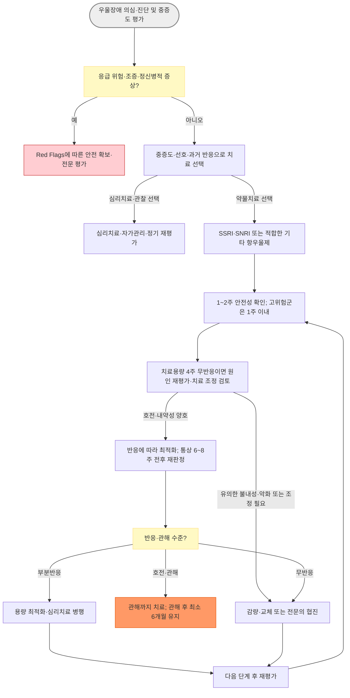
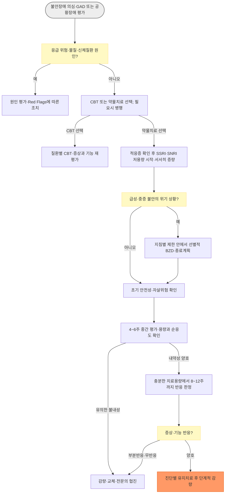

# 항우울제, 항불안제 Antidepressants & Anxiolytics

## <mark style="color:green;">일반 사항</mark>

> 이 장은 성인 외래 진료의 약물 선택과 안전한 처방을 위한 요약임. 처방 시 최신 품목정보/급여기준 조회를 원칙으로 하며, 해당 제품의 국내 허가사항, 환자의 진단·동반질환·병용약·간신기능을 확인함. 소아·청소년, 임신·수유, 양극성장애, 정신병적 우울증 및 치료저항성 우울증은 정신건강의학과와 협진함.

> 관련 질환별 평가·치료 : ☞ 025 범불안장애 / 026 공황장애 / 027 우울증 / 028 산후우울증.

### <mark style="color:$danger;">🚩 Red Flags!</mark>

<mark style="color:$danger;">**즉각 조치**</mark>

* 구체적인 자살 계획·수단·의도, 최근 자살시도, 타해 위험 또는 안전 확보 불가 → 즉시 안전을 확보하고 응급 평가  `고위험 자살·타해 위기`
* 심한 초조·공격성, 중증 정신병적 증상·긴장증, 음식·수분 섭취 불가 또는 중증 자기방임 → 즉시 응급 평가  `중증 정신·신체 상태`
* 조증·혼재성 상태와 판단력 저하·위험행동, 산후 정신병·조증 또는 모자 안전 확보 불가 → 즉시 정신건강의학과·응급 평가  `조증·산후 정신증`
* serotonergic 약물 노출 후 clonus·hyperreflexia·떨림과 초조·발한·고체온 등 발생 → 원인 약물을 중단하고 응급 평가  `세로토닌 증후군 의심`
* 항우울제 과량복용, 발작, 실신·중증 부정맥, 의식저하 또는 호흡억제 → 즉시 응급실 의뢰  `약물독성·중증 이상반응`
* 지속발기증, 중증 출혈 또는 증상성 중증 저나트륨혈증 의심 → 즉시 응급 평가  `중증 약물이상반응`
* benzodiazepine 급중단 후 발작·섬망 또는 중증 자율신경 항진 → 즉시 응급 평가  `중증 BZD 금단`
* 광범위한 수포·피부 박리·점막 미란, 얼굴 부종과 전신 증상 → 의심 약물을 중단하고 즉시 응급 평가  `중증 피부약물이상반응`

<mark style="color:$warning;">**당일~수일 내 평가**</mark>

* 자살사고가 새로 생기거나 악화되었으나 즉각적인 계획은 불명확하고 안전이 확보된 경우 → 당일 자살위험 평가; 안전 확보가 어려우면 즉각 조치 단계 적용  `자살사고 악화`
* 항우울제 시작·증량 후 현저한 activation·akathisia·충동성 또는 경조증 의심 → 당일 평가  `항우울제 유발 활성화`
* 안전은 확보되어 있으나 새로 발생한 정신병적 증상·경조증 또는 산후 급격한 기분·행동 변화 → 당일 정신건강의학과 평가  `정신병적 증상·주산기 변화`
* 중증 우울증의 빠른 악화 또는 현저한 기능 저하 → 당일~수일 내 중증도에 맞춰 평가  `우울증 악화`
* Mirtazapine 복용 중 원인불명의 발열·인후통·구내염 등 감염 징후 → 약물을 중단하고 당일 CBC·백혈구 감별계산 등 평가  `호중구감소·무과립구증 의심`
* Agomelatine 복용 중 황달·짙은 소변·우상복부 통증 또는 AST/ALT ＞3×ULN → 즉시 중단하고 당일 간기능·전신 상태 평가  `약물유발 간손상 의심`

<mark style="color:$info;">**조기 평가 및 추적**</mark>

* 치료 시작·증량·교체·감량 후 부작용 또는 중단 증상 → 약제·위험도별 조기 추적  `치료 변경 후 모니터링`
* 고령, 낙상 위험, 심혈관질환, 간·신장애 또는 다약제 복용 → 용량·검사·상호작용을 조기에 재평가  `약물이상반응 고위험`
* 부분반응·잔류 증상·순응도 저하 또는 성기능·체중·수면 부작용 → 치료 계획 재평가  `불충분 반응·내약성`
* 안전이 확보된 양극성장애·물질사용장애 의심, 반복 치료 실패·복잡한 병용 또는 임신·수유 중 약물 선택 → 조기 정신건강의학과 협진  `복합·특수 환자군`


**⚠️ 항우울제 자살위험 경고(FDA Boxed Warning 및 국내외 안전성 경고)**\
FDA는 항우울제 라벨에 소아·청소년 및 18\~24세 젊은 성인에서 치료 초기·증량 시 자살사고·행동 위험이 증가할 수 있다는 Boxed Warning을 요구함. NICE NG222는 우울증에서 18\~25세 또는 자살위험이 있는 환자에게 치료 시작·증량 1주 후 평가를 권고함. NICE CG113의 GAD 권고는 SSRI/SNRI를 시작하는 30세 미만 환자에게 1주 이내 첫 평가와 첫 1개월간 매주 자살사고·자해 위험 확인을 권고함. 두 기준을 구분하고 연령과 관계없이 activation·자살사고를 관찰함. <mark style="color:$info;">[NICE NG222·CG113]</mark>


***

## <mark style="color:green;">처방 전 평가</mark>

* 진단, 증상 지속기간, 기능 손상 및 중증도를 평가함. PHQ-9, GAD-7 등은 보조 도구이며 임상 진단을 대신하지 않음.
* 자살·자해·타해 위험, 정신병적 증상, 긴장증 및 안전하게 지낼 수 있는 환경인지 확인함.
* 과거 조증·경조증, 항우울제 유발 활성화, 양극성장애 가족력을 확인함. 양극성 I형 우울증·조증·혼재성 상태가 의심되면 항우울제 단독치료를 시작하지 않고 정신건강의학과와 협진함.
* 음주, stimulant·opioid·benzodiazepine 및 기타 물질 사용을 확인함.
* 기존 약물, 건강기능식품, 임신 가능성·수유, 체중·혈압, 간·신장질환 및 출혈 위험을 확인함.
* 필요에 따라 CBC, 전해질(특히 Na), 간·신기능, TSH 등을 시행함. 고령자·이뇨제 복용자는 저나트륨혈증 위험이 높음.
* TCA 또는 QT 연장 위험 약물을 고려하거나 심질환·실신·전도장애·QT 연장 가족력·전해질 이상이 있으면 ECG를 고려함.

## <mark style="color:green;">치료 알고리듬</mark>

### <mark style="color:orange;">주요우울장애</mark>

***



<p align="center"><strong>주요우울장애 치료 알고리듬</strong></p>

***

### <mark style="color:orange;">불안장애</mark>

***



<p align="center"><strong>불안장애 치료 알고리듬</strong></p>

***

> 이 알고리듬은 주요우울장애·범불안장애·공황장애의 일반적인 외래 치료를 중심으로 함. 강박장애·외상후 스트레스장애는 권장 심리치료, 치료용량과 치료기간이 다르므로 별도로 평가하고 필요 시 정신건강의학과와 협진함.

## <mark style="color:$warning;">Management</mark>

## <mark style="color:green;">비-약물 치료 및 예방</mark>

* 우울증에서는 CBT·행동활성화·대인관계치료 등 근거가 있는 심리치료를 중증도·선호에 맞춰 선택함. GAD·공황장애는 질환별 CBT를 제공하거나 의뢰함.
* 규칙적인 수면·기상, 가능한 범위의 운동·활동 계획, 과도한 음주·카페인 감소와 지지체계 확보를 함께 다룸. 생활요법만으로 중증 우울·불안의 전문 치료를 지연하지 않음.
* 재발의 조기 신호와 대처·추적 계획을 정하고, 자살위험이 있으면 환자와 안전계획을 수립하며 위험한 약물·수단에 대한 접근을 줄임.

## <mark style="color:green;">약물 치료</mark>

### <mark style="color:orange;">약물 선택 원칙</mark>

* 약물치료를 선택한 성인 주요우울장애에서는 SSRI, SNRI, bupropion, mirtazapine, vortioxetine 등이 1차 선택지가 될 수 있음. 약제 간 평균 효능 차이보다 과거 반응, 부작용, 동반 증상, 상호작용 및 환자 선호를 우선함.
* 경한 우울증에서는 심리치료·자가관리·능동적 관찰을 우선 고려하며, 중증도·환자 선호·과거 반응에 따라 약물치료를 선택함. <mark style="color:$info;">[NICE NG222]</mark>
* 불안장애에서는 CBT 등 심리치료 또는 SSRI/SNRI를 중증도·선호에 따라 선택함. 약물별 GAD·공황장애 국내 허가 여부를 구분함. 초기 불안·초조가 악화될 수 있어 낮은 용량에서 시작함.
* TCA는 항콜린성 부작용, 심독성 및 과량복용 위험 때문에 일반 외래의 1차 선택이 아님.
* Benzodiazepine은 우울증 치료제가 아님. 범불안장애·공황장애에서 항우울제 효과를 기다리기 위한 일률적 병용은 피함. 급성·중증 불안의 위기 상황에서 선별적으로 최단기간 사용하며, 아래의 지침별 제한을 따름.
* 항우울제는 처방한 약물의 치료용량에 도달한 후 충분한 기간 사용하고, 반응이 없으면 진단·복약 순응도·물질사용·양극성장애·동반질환을 재평가함.


KMAP-GAD 2024·KMAP-DD 2025는 국내 전문가 합의이며 국제 근거기반 지침과 권고 순위가 다를 수 있음. KMAP-GAD에서 초기 항우울제+항불안제 병용이 선호되었다는 결과를 모든 환자의 BZD 병용 권고로 해석하지 않음. 질환별 상세 전략은 025~028을 참조함.


## <mark style="color:green;">항우울제</mark>

### <mark style="color:orange;">SSRI</mark>

* 구역·설사, 두통, 불면 또는 졸림, 성기능 장애, 발한이 흔함. 치료 초기에는 불안·초조가 일시적으로 악화될 수 있음.
* 항혈소판제, NSAID 및 항응고제 병용 시 위장관 및 기타 출혈 위험이 증가할 수 있음. 출혈 증상을 관찰하고 warfarin 병용 시 필요에 따라 INR을 확인함.
* 고령자, 이뇨제 복용자 및 저체중 환자에서는 SIADH·저나트륨혈증에 주의함.
* 보통 1일 1회 투여함. 활성화가 두드러지면 아침, 진정이 두드러지면 저녁 투여를 고려하되 환자 반응에 맞춤.

<table><thead><tr><th>성분명 [대표 제품]</th><th>일반 성인 시작용량</th><th>통상 치료용량</th><th>일반 최대용량</th><th>주요 특징·주의</th></tr></thead><tbody>
<tr><td>citalopram (국내 가용 제품 확인)</td><td><p>20 ㎎ 1일 1회<br>고령·간장애 등 10 ㎎</p></td><td>20~40 ㎎/day</td><td><p>40 ㎎/day<br>위험군 20 ㎎/day</p></td><td>용량 의존 QT 연장. 고령(＞60세; FDA 기준), 간장애, CYP2C19 poor metabolizer 또는 강한 CYP2C19 억제제 병용 시 20 ㎎/day 이하</td></tr>
<tr><td>escitalopram <mark style="color:blue;">[렉사프로]</mark></td><td><p>우울증·GAD 10 ㎎ 1일 1회<br>공황장애 첫 1주 5 ㎎ → 10 ㎎<br>내약성이 우려되면 저용량 시작 고려</p></td><td>10~20 ㎎/day</td><td>20 ㎎/day</td><td>상호작용이 비교적 적음. 고령자는 5 ㎎/day로 시작하고 실무적으로 10 ㎎/day 이내 사용을 원칙으로 함. 이는 QT 위험을 고려한 보수적 기준으로, 영국 MHRA는 65세 초과에서 최대 10 ㎎/day로 제한함. 국내 렉사프로 허가는 고령자에서 시작량 절반·더 낮은 최대용량을 고려하도록 하며 수치 상한은 명시하지 않음. 간장애·CYP2C19 poor metabolizer는 처음 2주 5 ㎎/day 후 최대 10 ㎎/day. 선천성·기존 QT 연장 및 QT 연장약 병용은 국내 허가상 금기</td></tr>
<tr><td>fluoxetine <mark style="color:blue;">[푸록틴캡슐]</mark></td><td><p>20 ㎎ 1일 1회<br>불안장애에서는 더 낮게 시작 가능</p></td><td>20~60 ㎎/day</td><td>우울증 최대 80 ㎎/day; 적응증별 구분</td><td>활성화·불면, 긴 반감기, 강한 CYP2D6 억제. 중단 증상은 상대적으로 적음</td></tr>
<tr><td>paroxetine <mark style="color:blue;">[세로자트]</mark></td><td><p>20 ㎎/day<br>공황장애는 10 ㎎/day 시작; 고령자 저용량 고려</p></td><td>20~40 ㎎/day</td><td>주요우울장애 최대 50 ㎎/day, 공황장애·강박장애 최대 60 ㎎/day; 그 밖의 적응증과 CR 제형은 국내 허가사항 확인</td><td>진정, 체중 증가, 성기능 장애, 항콜린성 부담과 중단 증상이 비교적 큼. 강한 CYP2D6 억제</td></tr>
<tr><td>sertraline <mark style="color:blue;">[졸로푸트]</mark></td><td><p>50 ㎎/day<br>공황·PTSD·사회불안은 25 ㎎/day 시작 → 1주 후 50 ㎎</p></td><td>50~200 ㎎/day</td><td>200 ㎎/day</td><td>설사·위장관 부작용이 비교적 흔함. 증량 간격은 최소 1주. 간장애 시 감량·간격 조절; PMDD는 연속 투여 최대 150 ㎎/day, 황체기 투여 최대 100 ㎎/day로 구분</td></tr>
</tbody></table>

> **Fluvoxamine 참고:** 국내 듀미록스정 50·100 ㎎은 모두 2022-08-23 허가 취하가 확인되어 현재 처방용 표에서 제외함. 과거 국내 허가는 우울증 시작 100 ㎎/day, 강박장애 시작 50 ㎎/day를 1주 이상 투여 후 증량하며 통상 100~200 ㎎/day, 최대 300 ㎎/day를 2~3회 분할하는 용법이었음. 기존의 모든 적응증을 50 ㎎/day 시작으로 표시한 문구를 바로잡음. 해외 처방·과거 복용력과 상호작용 확인을 위해 성분명은 본문에 유지하며, 재도입·대체품의 국내 허가·공급은 별도 확인함.


**불안장애의 국내 허가 여부를 질환별로 구분함**

* GAD : escitalopram, paroxetine IR, venlafaxine XR, duloxetine은 국내 허가 약물임. Agomelatine도 국내 GAD 허가가 있으나 간기능검사와 연령 제한을 별도로 적용함.
* Sertraline·fluoxetine·fluvoxamine·mirtazapine·vortioxetine의 국내 GAD 사용은 허가 외임. Vortioxetine을 GAD의 일반적인 대체약으로 간주하지 않음.
* 공황장애 : escitalopram·paroxetine·sertraline·venlafaxine XR 등의 해당 제품 허가사항을 확인함. Fluoxetine은 근거가 있으나 국내 공황장애 허가 외이며, 공황장애에서 60 ㎎/day 초과는 체계적으로 평가되지 않았음.
* 계열 전체의 유효성·해외 허가를 개별 약물의 국내 적응증으로 확대하지 않으며, 허가 외 사용의 필요성·대안과 급여 여부를 별도로 확인함.


> 용량은 성인 교육용 범위임. 국내 제품별 허가 적응증·제형, 고령자 및 간·신장애 용량을 별도로 확인함. 표의 대표 제품명은 예시이며, 실제 유통 여부·정확한 상품명은 최신 허가사항으로 재확인함.

### <mark style="color:orange;">SNRI</mark>

* SSRI와 유사한 부작용에 더해 혈압·맥박 상승, 발한, 입마름, 배뇨장애가 나타날 수 있음.
* Venlafaxine·desvenlafaxine은 갑작스러운 중단이나 복용 누락 때 중단 증상이 비교적 흔함.
* Duloxetine은 일부 신경병증성 통증과 섬유근육통 등에서 유용할 수 있으나 간질환·상당한 음주, 신기능 저하 및 국내 허가 적응증을 확인함.

<table><thead><tr><th>성분명 [대표 제품]</th><th>시작용량</th><th>통상용량</th><th>주요 특징·주의</th></tr></thead><tbody><tr><td>desvenlafaxine <mark style="color:blue;">[프리스틱]</mark></td><td>50 ㎎ 1일 1회</td><td>통상 50 ㎎/day; 일부 환자에서 100 ㎎/day 고려</td><td>50 ㎎ 초과 시 추가 효과는 제한적이고 부작용이 증가할 수 있음. 서방정을 통째로 복용. 국내 허가상 일반 성인 최대 200 ㎎/day이나 통상 50 ㎎/day를 우선함. 신장애·간장애는 아래 별도 기준 적용</td></tr><tr><td>duloxetine <mark style="color:blue;">[드록틴캡슐]</mark></td><td>30 ㎎/day 후 60 ㎎/day</td><td>60 ㎎/day; 적응증에 따라 최대 120 ㎎/day</td><td>혈압, 간기능·신기능, 요폐 주의. 60 ㎎ 초과의 추가 이득은 적응증별로 제한적. CrCl ＜30 ㎖/min의 중증 신장애·말기 신질환은 국내 허가상 금기. 간장애를 유발하는 간질환 및 조절되지 않는 고혈압도 금기. Fluvoxamine·ciprofloxacin 등 강한 CYP1A2 억제제 병용금기</td></tr><tr><td>venlafaxine XR <mark style="color:blue;">[이팩사 XR]</mark></td><td>우울증·GAD 75 ㎎/day; 적응을 위해 첫 4~7일 37.5 ㎎ 가능. 공황장애 첫 7일 37.5 ㎎ → 75 ㎎/day</td><td>우울증·GAD·공황장애 75~225 ㎎/day; 국내 XR 최대 225 ㎎/day</td><td>용량 의존 혈압 상승과 중단 증상. 우울증·GAD는 보통 2주 후 150 ㎎/day 증량을 검토하며 허가상 최소 증량 간격 4일, 공황장애 최소 7일; 1회 증량 폭 75 ㎎/day 이하. 간·신장애 감량. 음식물과 함께 복용하고 캡슐을 나누거나 분쇄·씹지 않음. 사회공포증은 75 ㎎/day이며 증량의 추가 이득 근거 없음. IR 제형과 용법을 혼용하지 않음</td></tr><tr><td>milnacipran <mark style="color:blue;">[익셀]</mark></td><td>우울증 25 ㎎/day로 시작 후 점차 증량</td><td>우울증 50 ㎎ bid(100 ㎎/day), 아침·저녁 식사 중 복용</td><td>국내 우울증·섬유근육통 허가. 고령자의 우울증은 25 ㎎/day를 2~3회 분할 시작, 최대 60 ㎎/day. 신장애는 CrCl에 따라 감량. 섬유근육통의 초기 적정·최대용량과 구분</td></tr></tbody></table>

> Levomilnacipran은 국내 허가·유통 여부를 확인하기 전 처방용 표에서 제외함. Milnacipran <mark style="color:blue;">[익셀]</mark>은 국내에서 우울증과 섬유근육통 모두 허가되어 있음. 미국 Savella는 섬유근육통 적응증만 있으므로 국가별 적응증과 질환별 용법을 구분함. 정확한 국내 적응증·보험기준은 최신 허가사항으로 확인함.


**세로토닌 증후군(Serotonin Syndrome) 주의**

* MAOI, linezolid, 정맥 methylene blue와의 병용은 금기 또는 원칙적 회피 (파킨슨병 치료용 MAO-B 억제제는 약제별 허가사항 확인)
* tramadol, meperidine, fentanyl, dextromethorphan, 성요한풀 등 다른 세로토닌성 약물을 병용하거나 증량한 뒤, 자발성·유발성·안구 clonus 또는 과반사·진전 등의 **신경근육 항진**과 초조·혼돈, 발한·고열 등의 **정신상태·자율신경 변화**가 함께 나타나면 세로토닌 증후군을 의심하여 세로토닌성 약물을 중단하고 응급 평가


### <mark style="color:orange;">기타 항우울제</mark>

<table><thead><tr><th>성분명 [대표 제품]</th><th>통상 시작용량</th><th>주요 특징</th><th>중요 주의사항</th></tr></thead><tbody>
<tr><td>bupropion <mark style="color:blue;">[웰부트린]</mark></td><td>국내 XL: 150 ㎎ 아침 1회, 최소 4일 후 내약성에 따라 300 ㎎/day; 국내 XL 1일 300 ㎎을 초과하지 않음</td><td>NDRI. 성기능 장애와 체중 증가가 상대적으로 적고 금연치료에도 사용</td><td>불면·불안·혈압 상승·발작 위험. XL은 분할·분쇄·씹기 금지, 투여 간격 최소 24시간. 비만치료용 naltrexone/bupropion 등 부프로피온 함유 약물과 중복 투여하지 않음. 발작장애, 현재 또는 과거 신경성 식욕부진증·폭식증, MAOI 병용 및 alcohol·benzodiazepine·항경련제 급중단 상황에서 금기 또는 회피. 국내 우울증 치료용 XL 제제와 금연치료용 SR 제제의 용법을 혼용하지 않으며, 제형별 1회 용량·투여 간격·1일 최대용량은 해당 제품 허가사항을 확인</td></tr>
<tr><td>mirtazapine <mark style="color:blue;">[레메론]</mark></td><td>15 ㎎ 취침 전</td><td>불면·식욕저하가 동반된 경우 고려. 성기능·위장관 부작용은 SSRI보다 적은 편</td><td>졸림, 식욕·체중 증가, 지질 이상. 용량에 따른 진정의 차이는 일정하지 않으므로 수면 효과만을 위해 임의 증량·감량하지 않음. 우울증 치료범위 15~45 ㎎/day; 증량 간격은 통상 1~2주 이상. 드문 무과립구증·SJS/TEN·DRESS에 주의하며 감염 징후·수포성 발진·점막 병변은 중단 후 즉시 평가</td></tr>
<tr><td>vortioxetine <mark style="color:blue;">[브린텔릭스]</mark></td><td><p>10 ㎎ 1일 1회<br>65세 이상 5 ㎎으로 시작</p></td><td>주요우울장애 치료. 치료범위 5~20 ㎎/day; 치매 치료 적응증과 구분</td><td>구역이 흔함. 강한 CYP2D6 억제제 또는 유도제 병용 시 조절 필요</td></tr>
<tr><td>trazodone <mark style="color:blue;">[트리티코]</mark></td><td>우울증 치료와 저용량 수면 목적을 구분</td><td>진정·수면 효과</td><td>기립저혈압, 낙상, 지속발기증, QT 연장·부정맥. 불면증만을 위한 저용량 사용은 국내 허가 외 용법이며 항우울 치료용량을 의미하지 않음</td></tr>
<tr><td>agomelatine <mark style="color:blue;">[아고틴]</mark></td><td>25 ㎎ 취침 시; 필요 시 최대 50 ㎎/day</td><td>국내 주요우울증·범불안장애 허가. 우울증은 2주, GAD는 4주 후 무반응 시 증량 고려</td><td>간기능검사를 치료 시작 전과 약 3·6·12·24주 및 임상적으로 필요할 때 시행함. 증량 후에도 시작 때와 같은 빈도로 검사를 반복함. 간장애, AST/ALT ＞3×ULN, 강한 CYP1A2 억제제(예: fluvoxamine·ciprofloxacin) 병용은 금기. 75세 이상 투여하지 않음; 65세 이상 GAD 치료에는 권장하지 않음. 황달·짙은 소변·우상복부 통증 등 간손상 의심 또는 치료 중 AST/ALT ＞3×ULN이면 즉시 중단·평가. 트랜스아미나제 상승 시 48시간 이내 재검하고 중단 후에도 정상화까지 추적</td></tr>
</tbody></table>

> Vilazodone, nefazodone 및 doxepin은 국내 허가 제품의 함량·적응증·유통 상태를 확인하기 전 국내 처방용 표에서 제외함. 특히 저용량 불면증용 doxepin 제품과 고용량 항우울 용법을 혼용하지 않음.

### <mark style="color:orange;">TCA 및 사환계 항우울제</mark>

* 일부 중증 우울증에서 효과적일 수 있으나 항콜린성 부작용, 기립저혈압, 낙상, 심장 전도장애 및 과량복용 시 치명적 심독성 때문에 일반 외래의 1차 선택이 아님.
* Nortriptyline 등 secondary amine이 일부 tertiary amine보다 항콜린성 부담이 낮을 수 있지만 고령자에서 안전한 약물로 간주해서는 안 됨.
* 녹내장, 요폐·전립선비대, 변비·장폐색 위험, 인지장애, 심장 전도장애, 발작 위험 및 자살·과량복용 위험을 평가함.
* 저용량에서 시작해 서서히 증량함. 적응증과 환자에 따라 혈압·맥박 및 혈중농도 모니터링을 고려함. 심질환·실신·전도장애 병력, QT 연장 가족력, 고령, 전해질 이상 또는 여러 QT 연장약 병용 등 위험요인이 있으면 투여 전 ECG를 시행하고, 증량 후 또는 임상적으로 필요할 때 반복함.

<table><thead><tr><th>성분명 [대표 제품]</th><th>특징</th><th>주요 주의사항</th></tr></thead><tbody>
<tr><td>amitriptyline <mark style="color:blue;">[에트라빌]</mark></td><td>진정·항콜린 작용이 강함; 일부 통증 질환에 저용량 사용</td><td>낙상, 인지저하, 체중 증가, 심독성</td></tr>
<tr><td>clomipramine <mark style="color:blue;">[그로민]</mark></td><td>serotonergic 작용이 강하며 OCD 등에 사용</td><td>serotonin syndrome, 발작, QT·전도장애, 항콜린 부작용</td></tr>
<tr><td>imipramine <mark style="color:blue;">[이미프라민]</mark></td><td>항우울·항불안 효과</td><td>기립저혈압, 항콜린 부작용, 심독성</td></tr>
<tr><td>nortriptyline <mark style="color:blue;">[센시발]</mark></td><td>상대적으로 항콜린·진정 부담이 적을 수 있음</td><td>여전히 낙상·부정맥·과량복용 위험 존재</td></tr>
</tbody></table>

> Amoxapine [아디센]은 현행 국내 공급을 확인하지 못하여 현재 처방용 표에서 제외함. 국내 미유통 또는 사용이 드문 desipramine, protriptyline, trimipramine, maprotiline 등은 국내 허가·공급을 확인한 경우에만 처방표에 포함함. 표의 대표 제품명 역시 실제 유통 여부를 재확인함.

## <mark style="color:green;">항불안제</mark>

### <mark style="color:orange;">Benzodiazepine</mark>


**⚠️ Benzodiazepine Boxed Warning (FDA 2020)**\
FDA는 미국 benzodiazepine 계열 허가문서에 오남용, 중독, 신체의존 및 중단 시 금단반응을 강조하는 Boxed Warning을 요구함. 국내 제품의 경고·금기도 함께 확인함. 최소 유효용량·최단기간 사용을 원칙으로 하며, opioid 등 다른 중추신경억제제와의 병용은 특히 위험함.


* 우울증 치료제가 아니며 장기 불안장애 치료의 기본 약제도 아님. **WHO mhGAP 2023은 성인 GAD·공황장애 치료에 권고하지 않으며, 급성·중증 불안의 응급 관리에서만 최대 3\~7일의 단기 사용을 고려**함. NICE는 GAD의 위기 상황에만 단기 사용을 허용하고 공황장애 치료에는 처방하지 않도록 권고함. 다른 지침·국내 진료에서 선택적 보조 사용을 고려하더라도 환자별 이유와 종료 계획을 명확히 함.
* 가능한 최소 유효용량·최단기간을 사용하고, 시작할 때부터 종료 계획을 설명함. 일부 지침의 2\~4주 제한을 모든 불안장애 환자에게 그 기간 동안 사용해도 된다는 의미로 적용하지 않음. 수일 사용 후 필요성을 재평가하고, 반복 처방으로 장기 사용이 되지 않도록 함.
* 졸림, 기억·인지 저하, 운동실조, 낙상·골절, 교통사고, 역설적 흥분, 내성·신체의존과 금단이 발생할 수 있음.
* Alcohol, opioid, gabapentinoid 및 다른 진정제와 병용하면 심한 진정·호흡억제·사망 위험이 증가함.
* 고령자는 단시간형을 포함한 모든 benzodiazepine의 낙상·인지저하 위험 때문에 원칙적으로 피함. 사용이 불가피하면 더 낮은 용량을 사용하며 긴 반감기·활성 대사체 약물의 축적에 특히 주의함. 간기능 저하에서는 glucuronidation으로 대사되는 lorazepam·oxazepam 등이 상대적으로 예측 가능할 수 있으나, 중증 간부전에서 안전하다는 뜻은 아님. 국내 아티반정은 중증 간부전·중증 신부전·중증 호흡부전·수면무호흡증후군·중증 근무력증·급성 폐쇄각녹내장 및 알코올·약물의존성 환자 등에 금기이므로 제품별로 확인함.

<table><thead><tr><th>성분명 [대표 제품]</th><th>작용 특성</th><th>주요 비고</th></tr></thead><tbody>
<tr><td>diazepam <mark style="color:blue;">[디아제팜]</mark></td><td>장시간; 활성 대사체 있음</td><td>고령·간장애에서 축적과 낙상 위험. 일부 감량 과정에 사용할 수 있으나 일률적 전환은 하지 않음</td></tr>
<tr><td>clorazepate</td><td>장시간; 활성 대사체</td><td>축적 주의</td></tr>
<tr><td>alprazolam <mark style="color:blue;">[자낙스]</mark></td><td>중간~짧은 작용</td><td>반동성 불안·금단과 오남용 위험. 급중단 금지</td></tr>
<tr><td>lorazepam <mark style="color:blue;">[아티반]</mark></td><td>중간 작용; glucuronidation</td><td>활성 대사체는 없으나 진정·의존·낙상 위험은 동일</td></tr>
<tr><td>oxazepam</td><td>중간~짧은 작용; glucuronidation</td><td>작용 발현이 비교적 느림. 국내 유통 여부 확인</td></tr>
<tr><td>clonazepam <mark style="color:blue;">[리보트릴]</mark></td><td>중간~장시간</td><td>국내 허가 적응증(뇌전증·공황장애 등)과 용법 확인</td></tr>
<tr><td>triazolam <mark style="color:blue;">[할시온]</mark></td><td>단시간 수면제</td><td>기억장애·반동성 불면·이상행동 주의; 불안장애 유지치료제로 사용하지 않음</td></tr>
<tr><td>etizolam <mark style="color:blue;">[데파스]</mark></td><td>thienodiazepine 유사체; 단시간 작용</td><td>Benzodiazepine과 유사한 의존·금단 위험. 국내 허가 용량과 투여기간 확인</td></tr>
</tbody></table>

#### <mark style="color:$primary;">Benzodiazepine 감량</mark>

* 신체의존은 처방대로 복용해도 수주 내 발생할 수 있으며 약물사용장애와 동일한 개념이 아님. 신체의존 가능성이 있는 환자에서 갑자기 중단하지 않음. <mark style="color:$info;">[J Gen Intern Med 2025]</mark>
* 초기에는 대체로 현재 용량의 5\~10%를 2\~4주마다 감량하는 방법을 고려하며, 통상 2주에 25%를 넘는 빠른 감량은 피함.
* 장기간·고용량 사용, 과거 심한 금단, 동반 정신질환이 있으면 더 느린 감량이 필요할 수 있음. 감량 말기에는 더 작은 폭으로 줄임.
* 금단 증상이 현저하면 현재 단계에서 유지하거나 감량 속도를 늦춤. 매 감량 단계에서 불안·불면·떨림·지각과민·발작 위험을 평가함.
* 긴 반감기 약제로의 전환은 선택지일 뿐 필수는 아님. 고령자·간장애에서는 diazepam 전환이 부적절할 수 있음.
* 장기간·고용량 사용자는 감량에 수개월에서 수년이 걸릴 수 있음. 과거 금단 발작·섬망 또는 외래에서 조절하기 어려운 중증 금단 위험이 있으면 입원·전문 치료를 검토함.
* 감량 중 불안·불면이 뚜렷하게 악화되면 감량 속도를 조정함. 감량 성공을 돕기 위해 기저 불안·불면에 맞는 CBT·CBT-I 등 행동중재를 제공하거나 이용할 수 있도록 의뢰함.

### <mark style="color:orange;">Buspirone</mark>

* Buspirone <mark style="color:blue;">[부스파]</mark> : 범불안장애에서 고려할 수 있는 비benzodiazepine 항불안제임. 국내 허가 효능은 불안장애의 치료 또는 불안증상의 단기 완화이며, 공황장애의 일반적 대체약으로 간주하지 않음.
* 국내 허가 용법 : 5 ㎎ tid로 시작하여 필요시 2~3일 간격으로 1일 총량을 5 ㎎씩 증량함. 통상 20~30 ㎎/day를 분할 투여하며 최대 60 ㎎/day. 중증 간·신장애, 뇌전증, 급성 폐쇄각녹내장, 중증 근무력증 및 MAOI 병용은 국내 보령부스파정 금기임. 유당 관련 유전질환 등 첨가제 금기도 확인함.
* 즉각적인 진정 효과가 없으며 효과 발현에 수주가 걸릴 수 있음. 공황발작의 즉시 완화나 benzodiazepine 금단 치료제로 사용하지 않음.
* 어지럼, 구역, 두통이 나타날 수 있음. MAOI 및 다른 serotonergic 약물 병용 시 serotonin syndrome 위험을 확인함.

### <mark style="color:orange;">Gabapentinoid</mark>

* Gabapentin과 pregabalin은 우울증 치료제가 아니며, 불안장애 치료는 국내 허가 외 사용으로 구분함. Pregabalin의 GAD 유효성 근거·해외 허가를 gabapentin에 그대로 적용하지 않음. 국내 보험 적용도 별도로 확인하고 허가 외 사용의 필요성을 설명함.
* 졸림, 어지럼, 운동실조, 부종, 체중 증가, 오남용·의존 및 중단 증상에 주의함.
* Opioid, benzodiazepine, alcohol 등 중추신경억제제와 병용하면 호흡억제 위험이 증가할 수 있음(FDA 2019 안전성 경고). COPD 등 기저 호흡기능 저하·고령·신장애에서도 위험을 평가하고 저용량 시작·진정 및 호흡 모니터링을 강화함.
* 과거 물질사용장애(알코올·약물사용장애) 병력이 있으면 오남용·의존 위험이 높아 처방·모니터링에 더 주의함.
* 신기능에 따라 감량함. 단일 최대용량으로 일률 표기하지 않고 적응증·제품 허가사항에 따라 개별화함.

## <mark style="color:green;">Serotonin syndrome</mark>

* 정신상태 변화, 자율신경 항진 및 신경근육 이상이 조합되어 나타나는 잠재적으로 치명적인 약물독성임. 세 영역의 증상이 모두 나타나거나 고열이 생길 때까지 기다리지 않음.
* Clonus와 hyperreflexia가 중요한 단서임. 중증에서는 고체온, 근육강직, 횡문근융해, 발작 및 장기부전이 생길 수 있음.
* 의심되면 serotonergic 약물을 즉시 중단하고 중증도에 따라 응급실로 의뢰함. 고체온·강직·의식변화가 있으면 즉시 응급조치함.

### <mark style="color:orange;">Hunter serotonin toxicity criteria</mark>

Serotonergic 약물 노출 후 다음 중 하나이면 serotonin toxicity를 강하게 의심함. 과량복용 환자군에서 개발된 기준으로, 감염·신경이완제 악성 증후군·항콜린성 독성 등 감별과 임상 판단을 함께 적용함.

* spontaneous clonus
* inducible clonus + (초조 또는 발한)
* ocular clonus + (초조 또는 발한)
* 떨림 + hyperreflexia
* hypertonia + 체온 38℃ 초과 + (ocular 또는 inducible clonus)

> Hunter 기준은 임상 판단을 보조하며, 기준을 충족하지 않는다는 이유만으로 초기 또는 비전형적 serotonin syndrome을 배제하지 않음.

### <mark style="color:orange;">임상적으로 중요한 위험 약물</mark>

* MAOI, linezolid, 정맥 methylene blue
* SSRI, SNRI, clomipramine을 포함한 serotonergic TCA 및 기타 serotonergic 항우울제
* tramadol, meperidine, methadone, fentanyl, dextromethorphan
* lithium, buspirone, amphetamine계 약물, triptan, tryptophan, St. John's wort

> Bupropion, carbamazepine 및 valproate를 serotonin 재흡수 억제제로 분류하지 않음. Ondansetron 등 5-HT3 수용체 길항제는 규제기관 경고가 있으나, 강한 serotonergic 약물과 동일한 위험도로 일괄 분류하지 않음.

## <mark style="color:green;">주요 부작용과 대처</mark>

<table><thead><tr><th>문제</th><th>우선 평가·대처</th><th>추가 고려</th></tr></thead><tbody>
<tr><td>구역·설사</td><td>초기 일시적 증상인지 확인, 식사와 함께 복용 가능 여부·감량·서서히 증량 고려</td><td>지속되면 약제 변경</td></tr>
<tr><td>불면·activation</td><td>자살위험·akathisia·경조증 평가, 아침 투여·감량 또는 변경</td><td>현저한 충동성·조증 의심 시 당일 평가</td></tr>
<tr><td>졸림</td><td>Alcohol·진정제 병용, 수면무호흡, 낙상·운전 위험 평가; 저녁 투여·감량·변경</td><td>자극제를 일률적으로 추가하지 않음</td></tr>
<tr><td>성기능 장애</td><td>기저 성기능과 우울 증상 영향 평가; 관찰·감량·부작용이 적은 약제로 교체 고려</td><td>우울증에서는 bupropion 교체·추가 또는 남성 발기부전에 PDE5 억제제를 고려함. GAD·공황장애는 해당 질환의 효과 근거·국내 허가를 확인하며 성기능 부작용만으로 bupropion·vortioxetine으로 일률 전환하지 않음; CBT 병행·기존 약제 조정·협진 고려. Drug holiday는 제한적 초기 연구가 있으나 순응도 저하·중단 증상 때문에 통상적인 1차 대처로 권고하지 않음</td></tr>
<tr><td>체중 증가·대사 이상</td><td>체중·식습관·활동 평가, 생활요법, 감량·약제 변경</td><td>항우울제 부작용만을 이유로 statin을 자동 추가하지 않음</td></tr>
<tr><td>기립저혈압·낙상</td><td>혈압, 탈수, 병용약 평가; 천천히 일어나기, 감량·변경</td><td>Fludrocortisone·고염식 등을 일률적으로 처방하지 않음</td></tr>
<tr><td>저나트륨혈증</td><td>혼돈·두통·구역·경련 평가, 혈청 Na 측정, 원인 약제 중단 여부 결정</td><td>증상성·중증이면 응급 평가</td></tr>
<tr><td>출혈</td><td>NSAID·항혈소판제·항응고제 병용과 출혈 부위 평가</td><td>중증 출혈은 응급실 의뢰</td></tr>
<tr><td>QT 연장·부정맥</td><td>용량·병용약·전해질·심질환 평가, ECG</td><td>실신·지속성 부정맥이면 응급 평가</td></tr>
<tr><td>지속발기</td><td>원인 약물 중단 및 즉시 응급실 의뢰</td><td>4시간 이상 지속되기 전이라도 진행 중이면 지체하지 않음</td></tr>
</tbody></table>

## <mark style="color:green;">중요한 약물 상호작용</mark>

<table><thead><tr><th>약물·효소</th><th>대표 항우울제</th><th>임상적 의미</th></tr></thead><tbody>
<tr><td>CYP2D6 강한 억제</td><td>fluoxetine, paroxetine, bupropion</td><td>Tamoxifen의 활성 대사체(endoxifen) 농도를 낮춰 효과를 감소시킬 가능성이 있음. 임상적 재발·사망 위험에 관한 연구 결과는 일관되지 않지만, 가능하면 강한 CYP2D6 억제제를 피하고 venlafaxine, escitalopram, desvenlafaxine 등 CYP2D6 억제가 적은 대체약을 환자별로 고려함. 일부 beta-blocker·항정신병약·TCA 등과도 상호작용 확인</td></tr>
<tr><td>CYP1A2·2C19 억제</td><td>fluvoxamine</td><td>Tizanidine 병용금기(심한 저혈압·진정 위험). Theophylline, clozapine, 일부 benzodiazepine 등의 농도 상승과 감량 필요성 확인</td></tr>
<tr><td>CYP2D6 억제</td><td>duloxetine</td><td>CYP2D6 기질 병용 시 농도 상승 가능; 강한 CYP1A2 억제제(fluvoxamine·ciprofloxacin 등)와 duloxetine 병용은 국내 허가상 금기</td></tr>
<tr><td>출혈 위험</td><td>SSRI·SNRI + NSAID·aspirin·항응고제</td><td>출혈 증상과 위험요인 평가; 필요한 경우 위장관 보호 및 모니터링 고려</td></tr>
<tr><td>QT 연장</td><td>citalopram, escitalopram, TCA, trazodone 등</td><td>다른 QT 연장약, 저K·저Mg, 서맥·심질환과 중첩 주의</td></tr>
<tr><td>Serotonergic 병용</td><td>MAOI, linezolid, methylene blue, tramadol 등</td><td>금기·washout 기간과 serotonin syndrome 위험 확인</td></tr>
</tbody></table>

### <mark style="color:orange;">MAOI 전환과 항우울제 교체</mark>

* 정신질환 치료용 MAOI 전환은 정신건강의학과 자문하에 시행하며 **교차감량으로 중첩 투여하지 않음**. 중단 후 필요한 최소 휴약기간은 약물·방향·국가별 허가에 따라 다름.

<table><thead><tr><th>전환 방향</th><th>국내 허가상 최소 간격의 예</th><th>주의</th></tr></thead><tbody>
<tr><td>Fluoxetine 중단 → 정신질환 치료용 MAOI</td><td>최소 5주</td><td>장기·고용량 복용에서는 더 긴 간격이 필요할 수 있음</td></tr>
<tr><td>Duloxetine 중단 → 정신질환 치료용 MAOI</td><td>최소 5일</td><td>반대 방향은 MAOI 중단 후 최소 14일</td></tr>
<tr><td>Desvenlafaxine 중단 → 정신질환 치료용 MAOI</td><td>최소 7일</td><td>반대 방향은 MAOI 중단 후 최소 14일</td></tr>
<tr><td>Escitalopram·mirtazapine·vortioxetine ↔ 정신질환 치료용 MAOI</td><td>양방향 최소 14일</td><td>국내 해당 제품 기준. 미국 vortioxetine(Trintellix) 중단 후 MAOI 시작은 최소 21일로 차이가 있음</td></tr>
</tbody></table>

> 위 표는 일부 예시이며 모든 항우울제·MAOI의 전환표가 아님. 가역적 MAOI·MAO-B 억제제 및 응급 linezolid·정맥 methylene blue 사용은 별도 제품 지침과 감시계획을 적용함. 응급 항균치료 등이 필요한 경우에는 대체약 여부와 치료 지연 위험을 전문의가 판단함.

* 일반 항우울제 교체도 직접 전환·감량 후 전환·휴약 후 전환·교차감량 중 약물 조합에 맞는 방법을 선택함. 모든 조합에 교차감량을 적용하지 않음.
* Fluoxetine은 중단 후에도 수주간 상호작용이 지속할 수 있음. Clomipramine으로 전환하거나 fluvoxamine에서 duloxetine·agomelatine으로 전환할 때는 serotonin toxicity·대사억제 위험 때문에 특히 주의하고 중첩 투여를 피함. <mark style="color:$info;">[NHS SPS]</mark>

## <mark style="color:green;">치료 반응 평가와 유지치료</mark>

* 일반 성인은 시작 후 1~2주 이내 부작용·자살사고·activation·복약 순응도를 확인함. 위험도와 약제에 따라 더 일찍 평가함.
* 우울증 : NICE NG222는 18~25세 또는 자살위험 환자에게 시작·증량 1주 후 평가를 권고함. FDA 자살 관련 위험분석의 젊은 성인은 18~24세로 연령 기준이 다름.
* GAD : NICE CG113은 SSRI/SNRI를 시작하는 30세 미만 환자에게 1주 이내 첫 평가와 첫 1개월간 매주 자살사고·자해 위험 확인을 권고함. 이후 약효·부작용은 첫 3개월간 2~4주마다, 이후 3개월마다 평가함. <mark style="color:$info;">[NICE NG222·CG113]</mark>
* 공황장애 : 일반적으로 시작 후 2주 이내 안전성을 확인하고 4·6·12주에 효과·부작용을 평가함. 30세 미만 또는 자살위험 환자에서 1주 이내 첫 평가와 초기 매주 확인을 적용하는 것은 GAD 권고·환자 위험도에 근거한 보수적인 임상적 확대 적용이며, 공황장애 절의 직접적인 연령별 권고와 구분함.
* 우울증은 대개 4주 이내 일부 효과를 느낄 수 있음. **인정되는 치료용량으로 4주 투여했는데 전혀 호전이 없으면** 순응도·진단·신체·정신 동반질환·사회환경 요인을 재평가하고 치료 조정을 논의함. 일부 호전이 있으면 용량·심리치료를 최적화하며 통상 6\~8주 전후에 다시 판정함. 부분반응은 더 긴 치료가 필요할 수 있으나 완전 무반응을 이유 없이 8주까지 기다리지 않음. 유의한 불내성·임상 악화는 즉시 재평가함. <mark style="color:$info;">[NICE NG222]</mark>
* GAD·공황장애는 4~6주에 중간 반응을 확인하고 충분한 치료용량에서 8~12주까지 반응을 판정함. 4주 무반응만으로 일률 교체하지 않음.
* 부분반응이면 내약성 범위에서 용량을 최적화하고 심리치료 병행을 고려함. 충분한 치료 후 무반응 또는 불내성이면 해당 질환에 적합한 약제로 교체함. 충분한 치료 2가지 이상 실패·복잡한 병용은 정신건강의학과 협진을 고려함.

<table><thead><tr><th>진단</th><th>유지치료의 기준</th><th>장기치료 고려</th></tr></thead><tbody>
<tr><td>주요우울장애</td><td>관해 후 최소 6개월, 통상 6~12개월</td><td>반복 삽화, 중증·정신병적 삽화, 잔류 증상, 자살위험, 만성 경과·중단 후 재발 시 개별 연장</td></tr>
<tr><td>GAD</td><td>효과적인 약물을 최소 1년 유지(NICE); 025의 실무 기준은 관해 후 최소 12개월</td><td>재발력·잔류 증상·동반질환에 따라 2년 이상 개별 고려</td></tr>
<tr><td>공황장애</td><td>NICE는 호전 시 최적용량 도달 후 최소 6개월; 026의 실무 기준은 충분한 반응·관해 후 6~12개월</td><td>재발력·광장공포·잔류 증상·반복 삽화가 있으면 12~24개월 이상 개별 고려</td></tr>
<tr><td>산후우울증</td><td>관해 후 최소 6~12개월</td><td>반복성·중증 삽화, 자살위험·이전 중단 후 재발에 따라 개별 연장; 028 참조</td></tr>
</tbody></table>

## <mark style="color:green;">항우울제 중단</mark>

* 대부분의 항우울제는 갑자기 중단하지 않고 단계적으로 감량함. 감량 기간은 수주에서 수개월 이상까지 개인화함. Agomelatine은 국내 허가상 감량 없이 중단할 수 있는 예외이며, 모든 약물에 같은 중단 원칙을 일률 적용하지 않음.
* Paroxetine, venlafaxine, desvenlafaxine, 고용량·장기복용 및 과거 중단 증상이 심했던 환자는 더 천천히 감량함. Fluoxetine은 긴 반감기로 중단 증상이 상대적으로 적음.
* 어지럼·전기충격감·감각 이상·불면·불안·오심·발한·독감 유사 증상이 감량·중단 수일 내 생기면 중단 증후군을 의심함. 원래 증상의 점진적 악화는 재발 가능성을 평가하되, 지연성·지속성 중단 증상도 있어 발생 시점만으로 구분하지 않음. 감량과의 시간 관계, 신체·감각 증상, 경과와 재투여 반응을 함께 평가함.
* 용량이 낮아질수록 절대 감량 폭을 더 작게 하고, 중단 증상이 호전되거나 견딜 만해진 것을 확인한 후 다음 단계로 진행함. <mark style="color:$info;">[NICE NG222]</mark>
* 반감기가 짧은 약물은 격일 복용으로 농도 변동·중단 증상이 커질 수 있어 일반적인 감량법으로 권하지 않음. 국내 가용 저함량·액상 제형과 분할 가능 여부를 확인하여 매일 복용량을 줄임. Fluoxetine 등 긴 반감기 약물의 예외는 개별 판단함.
* 심한 중단 증상이 발생하면 직전 내약 용량으로 일시 복귀한 뒤 더 작은 단계로 감량하는 방법을 고려함.

## <mark style="color:green;">특수 환자군</mark>

### <mark style="color:orange;">소아·청소년</mark>

* 1차 치료는 심리치료이며, 약물치료가 필요하면 정신건강의학과와 협진함.
* 국내에서 소아·청소년 적응증이 확인된 항우울제는 제한적이므로 개별 제품의 허가 연령·적응증을 확인함.
* 모든 항우울제는 소아·청소년에서 자살사고·행동 위험 증가 경고가 있으므로 치료 초기·증량 시 특히 면밀히 관찰함.
* Benzodiazepine은 소아·청소년에서 일반적으로 권장하지 않음.

### <mark style="color:orange;">임신·수유</mark>

* 치료하지 않은 우울·불안의 위험과 약물 노출 위험을 함께 평가함. 임의로 중단하지 않음.
* 기존에 효과적이었던 항우울제가 있으면 임신 시기·재발위험·수유 계획·약물별 자료를 함께 검토하여 유지 가능성을 우선 평가함. 안정적으로 복용한 약을 임신·수유만을 이유로 일률 교체하지 않음.
* 치료력이 없어 새로 시작할 때 sertraline 또는 escitalopram을 우선 고려할 수 있음. 임상지침상 사용 가능성과 국내 제품의 임신·수유 허가 문구는 구분하며 산부인과·정신건강의학과와 공동 결정함. <mark style="color:$info;">[ACOG CPG No. 5·CANMAT 2024]</mark>
* 수유 중 영아의 졸림·수유 장애·체중 증가 불량을 관찰함. Sertraline·paroxetine은 영아 노출이 낮은 편이나 paroxetine의 신규 처방은 다음 임신 계획도 함께 고려함. Fluoxetine은 긴 반감기·활성 대사체로 수유 중 신규 처방에서는 후순위일 수 있으나 임신 중부터 효과적이었다면 유지 가능성을 평가함.
* Paroxetine 등 개별 약물의 임신 관련 주의와 benzodiazepine의 신생아 진정·금단 위험을 최신 국내 허가사항으로 확인함.
* Benzodiazepine은 주산기 불안에서 회피하거나 매우 제한적으로 사용함. 신생아 진정·호흡억제·금단과 산모의 야간 돌봄 안전성을 함께 평가함.
* 출산 전후 항우울제·benzodiazepine에 노출된 신생아는 호흡곤란, 과도한 울음, 근긴장 이상, 수유 곤란 등 적응·금단 증상을 보일 수 있어 분만 전 신생아과와 정보를 공유하고 출생 후 관찰함.

### <mark style="color:orange;">고령자</mark>

* 낮은 용량에서 시작하고 천천히 증량함. 낙상, 저나트륨혈증, 출혈, QT 연장, 인지저하와 다약제 상호작용을 확인함.
* Paroxetine과 TCA의 항콜린성 부담, 장시간형 benzodiazepine의 축적에 특히 주의함.

### <mark style="color:orange;">간·신장애</mark>

* 간장애에서는 대부분의 항우울제 시작·최대용량을 낮추거나 투여 간격을 조절할 수 있음. Sertraline 등 약물별 제한을 확인함.
* 신장애에서는 duloxetine, desvenlafaxine, milnacipran, mirtazapine, gabapentin, pregabalin 등의 제한·감량 기준을 확인함. 용량표의 CrCl 기준을 eGFR 수치로 기계적으로 대체하지 않음.

<table><thead><tr><th>약물</th><th>주요 국내 허가 기준</th></tr></thead><tbody>
<tr><td>Duloxetine</td><td>CrCl ＜30 ㎖/min·투석이 필요한 말기 신질환 및 간장애를 유발하는 간질환에 금기</td></tr>
<tr><td>Desvenlafaxine</td><td>CrCl 30~50 ㎖/min: 권장 50 ㎎/day. CrCl ＜30 ㎖/min·ESRD: 50 ㎎ 격일; 투석 후 보충하지 않음. 중등도~중증 간장애: 권장 50 ㎎/day, 100 ㎎/day 초과 증량은 권장하지 않음</td></tr>
<tr><td>Mirtazapine</td><td>CrCl ＜40 ㎖/min·간장애에서 청소율 감소 가능; 용량·증량 속도와 부작용을 재평가</td></tr>
<tr><td>Buspirone·lorazepam(아티반정)</td><td>중증 간·신장애/부전은 각 국내 제품 허가상 금기. 대사경로만으로 안전성을 판단하지 않음</td></tr>
</tbody></table>

> Desvenlafaxine 50 ㎎ 격일은 중증 신장애의 국내 허가 용법임. 일반적인 항우울제 감량에서 격일 복용을 피하라는 원칙과 적용 목적이 다름.

***

## <mark style="color:green;">시술 및 기타 처치</mark>

* 충분한 치료에도 불충분 반응이 지속되면 정신건강의학과에서 약물 교체·증강, rTMS·ECT 등의 적합성을 평가함. 중증 우울증으로 신속한 반응이 필요하거나 섭식 불가·긴장증 등이 있으면 치료 실패 횟수를 기다리지 않고 긴급 의뢰함.
* Ketamine·esketamine 치료는 적응증·국내 허가 및 급여, 혈압·진정·해리·오남용 위험과 관찰체계를 확인하는 전문 치료임. NICE의 2026년 ketamine 근거 재평가는 기존 우울증 권고의 개정을 제안하지 않았으며, 정맥 ketamine을 일반 외래의 표준 대체치료로 확대하지 않음. <mark style="color:$info;">[NICE NG222 surveillance 2026]</mark>
* 산후우울증의 zuranolone 등 신경활성스테로이드 치료는 ACOG 집중개정(온라인 2025년·권호 2026년)과 국내 제품 접근성을 별도로 확인하고 전문의와 검토함. 상세 내용은 028 산후우울증을 참조함.

***

### <mark style="color:red;">질병코드</mark>

<table><thead><tr><th>코드</th><th>KCD-9 명칭</th><th>코드 선택</th></tr></thead><tbody>
<tr><td>F32</td><td>우울에피소드</td><td>불완전코드; 중증도·정신병적 증상 등에 맞는 하위 코드 선택</td></tr>
<tr><td>F33</td><td>재발성 우울장애</td><td>불완전코드; 현재 삽화·관해 상태 등에 맞는 하위 코드 선택</td></tr>
<tr><td>F40</td><td>공포성 불안장애</td><td>불완전코드; 진단에 맞는 하위 코드 선택</td></tr>
<tr><td>F40.1</td><td>사회공포증</td><td>완전코드</td></tr>
<tr><td>F41</td><td>기타 불안장애</td><td>불완전코드; 진단에 맞는 하위 코드 선택</td></tr>
<tr><td>F41.0</td><td>공황장애[간헐 발작성 불안]</td><td>완전코드</td></tr>
<tr><td>F41.1</td><td>범불안장애</td><td>완전코드</td></tr>
<tr><td>F42</td><td>강박장애</td><td>불완전코드; 임상 유형에 맞는 하위 코드 선택</td></tr>
<tr><td>F43.1</td><td>외상후스트레스장애</td><td>완전코드</td></tr>
</tbody></table>

> 저장된 KCD9_251216(6).xlsx의 「상병분류기호(전체)」 및 「상병분류기호(완전코드)」와 대조함. 엑셀의 F401 등 무점 표기는 본문에서 F40.1처럼 점을 넣어 표기함. 상세불명 코드(F32.9·F33.9·F42.9 등)는 세부 진단을 정할 정보가 부족할 때만 사용하며 불완전코드를 일률 대체하지 않음. 약물 처방만을 근거로 질병코드를 부여하지 않음.

***

## <mark style="color:purple;">처방례</mark>

> 아래 처방은 교육용 예시임. 진단·연령·동반질환·병용약·간신기능 및 국내 제품 허가사항에 따라 조정함.

> **처방례 1.** 성인 주요우울장애의 초기 약물치료 예
>
> ```
> 렉사프로정 10 ㎎  1T  1일 1회(qd)  × 14일
> ```
>
> _✽일반 성인은 1~2주 이내 부작용·자살사고·activation을 확인함. 18~25세 또는 자살위험 환자는 시작·증량 1주 후 평가함. 내약성이 우려되면 5 ㎎으로 시작 후 증량할 수 있으며, 일반 성인은 반응에 따라 최대 20 ㎎/day. 고령자는 5 ㎎ 시작·실무적으로 최대 10 ㎎/day를 원칙으로 하고, 간장애는 처음 2주 5 ㎎/day 후 최대 10 ㎎/day를 적용함._

> **처방례 2.** 공황장애, 초기 activation 우려
>
> ```
> 졸로푸트정 50 ㎎  0.5T  1일 1회(qd)  × 7일 → 1T qd
> ```
>
> _✽25 ㎎으로 1주 시작 후 50 ㎎으로 증량하는 공황장애 허가 용법 예임. 일반적으로 2주 이내 첫 평가하며, 젊은 성인·자살위험 환자는 더 이른 평가를 개별 적용함. 초기 불안 악화 가능성을 설명하고 서서히 증량함. Benzodiazepine을 일률 병용하지 않으며, 급성 위기 상황에서 고려한다면 위의 지침별 제한과 종료계획을 따름._

> **처방례 3.** 불면·식욕저하가 동반된 우울증
>
> ```
> 레메론정 15 ㎎  1T  취침 전(hs)  × 14일
> ```
>
> _✽다음 날 졸림, 식욕·체중 증가, 낙상 위험을 확인함. 발열·인후통·구내염이 생기면 복용을 중단하고 당일 평가를 받도록 안내함._

> **처방례 4.** Duloxetine을 고려하는 경우
>
> ```
> 드록틴캡슐 30 ㎎  1C  1일 1회(qd)  × 7일 → 60 ㎎ qd
> ```
>
> _✽혈압, 간질환·음주, 신기능, 요폐 위험과 적응증별 국내 허가사항을 확인함._

> **처방례 5.** 범불안장애 환자의 일시적 위기 상황에서 단기간 보조치료가 필요한 경우
>
> ```
> 렉사프로정 10 ㎎  1T  1일 1회(qd)
> 아티반정 0.5 ㎎  1T  필요시(prn)  1일 최대 2회  × 최대 3일
> ```
>
> _✽모든 범불안장애 환자에게 일률적으로 병용하지 않음. 자살위험·낙상·opioid 및 다른 진정제 병용을 평가하고, 수면무호흡·중증 간부전·중증 신부전·알코올/약물의존성·임신 등 아티반정 국내 금기에 해당하면 사용하지 않음. 최단기간만 사용하고 3일 이내 실제 복용량·잔여량과 안전성을 재평가함. GAD에서 30세 미만이면 SSRI 시작 후 1주 이내 평가하고 첫 1개월간 매주 자살사고·자해 위험을 확인함. 자동 연장하지 않음. 이는 WHO의 최대 3\~7일 제한 범위 내에서 더 짧게 정한 예시이며, 이미 장기간 복용하여 신체의존이 있는 환자의 급중단 용법은 아님._

***

### <mark style="color:$success;">핵심 복약 지도</mark>

> **효과 발현 시간**
>
> 항우울제는 바로 기분을 좋게 하는 약이 아니며, 효과를 느끼기까지 보통 2\~4주가 걸릴 수 있습니다. 임의로 조기에 중단하지 않도록 설명합니다.

> **초기 activation·자살사고 모니터링**
>
> 처음 복용하거나 증량한 뒤 불안·초조·불면이 심해지거나 자살 생각, 충동적인 행동, 수면이 거의 필요 없을 정도로 지나치게 활발해지는 증상이 생기면 즉시 알리도록 안내합니다. FDA 위험분석의 18\~24세 젊은 성인은 특히 주의가 필요합니다. 우울증은 NICE NG222의 18\~25세 또는 자살위험 환자 1주 평가, GAD는 NICE CG113의 30세 미만 1주 이내 평가·첫 1개월간 매주 확인 기준을 구분하여 추적 일정을 정합니다.

> **임의 중단 금지**
>
> 담당 의사와 감량 계획을 정하고 갑자기 끊지 않도록 설명합니다. Agomelatine은 허가상 점진 감량이 필요 없는 예외지만 임의 중단을 권하지 않습니다. 어지럼, 전기충격 같은 느낌, 불안·불면·구역 등 중단 증상이 생길 수 있으며, paroxetine·venlafaxine 등 반감기가 짧은 약물에서 더 흔합니다.

> **약물 상호작용**
>
> 새로운 처방약·감기약·진통제·건강기능식품을 복용하기 전 상호작용을 확인하도록 안내합니다. 특히 tramadol, dextromethorphan, St. John's wort 병용에 주의합니다.

> **Benzodiazepine 병용 시 주의**
>
> Benzodiazepine 복용 중에는 음주하지 않고, 졸리면 운전·기계 조작을 하지 않도록 안내합니다. Opioid 진통제나 다른 수면·진정제와 함께 복용하기 전 반드시 상의하도록 설명합니다.

> **언제 다시 병원을 방문해야 하나요?**
>
> * 자살 생각이나 자해·타해 충동이 생기는 경우 — 즉시 내원 또는 응급실
> * 고열과 함께 근육이 뻣뻣해지거나 떨림·심한 발한이 나타나는 경우 (serotonin syndrome 의심) — 즉시 내원
> * 조증·경조증 증상(수면이 거의 필요 없이 지나치게 활발해짐)이 나타나는 경우
> * 지속발기, 심한 출혈, 실신·경련이 발생하는 경우 — 즉시 응급실
> * 정해진 추적 일정에 따라 효과·부작용을 재평가(일반적으로 1~2주 이내 첫 평가; 연령·진단·위험도에 따라 1주 이내 또는 매주 확인)

***

## <mark style="color:green;">주요 참고문헌 및 확인 자료</mark>

### <mark style="color:orange;">임상 근거</mark>

* [NICE. Depression in adults: treatment and management. NG222. 2022.](https://www.nice.org.uk/guidance/ng222/chapter/Recommendations) - 중증도별 치료 선택, 18~25세·자살위험 환자의 초기 추적, 유지치료·단계적 중단
* [NICE. Generalised anxiety disorder and panic disorder in adults: management. CG113. 2011; updated 2020.](https://www.nice.org.uk/guidance/cg113/chapter/Recommendations) - GAD의 30세 미만 SSRI/SNRI 초기 추적, 공황장애 치료 평가 일정, 진단별 유지기간·BZD 제한
* [Kim MK, et al. Korean Guidelines for the Treatment of Generalized Anxiety Disorder 2024: Initial and Maintenance Treatment Strategies for the Pharmacological Treatment of Generalized Anxiety Disorder. Anxiety Mood. 2024;20(2):54-64.](https://doi.org/10.24986/anxmod.2024.20.2.004) - KMAP-GAD 2024; 국내 전문가 합의와 국제 근거기반 지침을 구분
* [최원석 외. 한국형 우울장애 약물치료 알고리듬 2025 (I): 주요우울삽화의 치료 전략. 신경정신의학. 2025;64(3):178-192.](https://doi.org/10.4306/jknpa.2025.64.3.178) - KMAP-DD 2025; 국내 전문가 합의에 따른 약물 선택·불충분 반응 전략
* [Lam RW, et al. CANMAT 2023 Update on Clinical Guidelines for Management of Major Depressive Disorder in Adults. Can J Psychiatry. 2024;69(9):641-687.](https://doi.org/10.1177/07067437241245384) - 성인 주요우울장애의 치료·유지·중단; 지침명 2023, 출판 2024
* [Brunner E, et al. Joint Clinical Practice Guideline on Benzodiazepine Tapering: Considerations When Risks Outweigh Benefits. J Gen Intern Med. 2025;40(12):2814-2859.](https://doi.org/10.1007/s11606-025-09499-2) - 개별 감량 속도·금단·CBT/CBT-I; [ASAM 지침 페이지](https://www.asam.org/quality-care/clinical-guidelines/benzodiazepine-tapering)
* [WHO. Benzodiazepines in treatment of adults with generalized anxiety disorder and/or panic disorder. mhGAP. 2023.](https://www.who.int/teams/mental-health-and-substance-use/treatment-care/mental-health-gap-action-programme/evidence-centre/anxiety/benzodiazepines-in-treatment-of-adults-with-generalized-anxiety-disorder-and-or-panic-disorder) - 일상 치료 비권고, 급성·중증 불안의 응급 관리에서 최대 3~7일
* [ACOG. Treatment and Management of Mental Health Conditions During Pregnancy and Postpartum. Clinical Practice Guideline No. 5. 2023.](https://www.acog.org/clinical/guidance/clinical-practice-guideline/2023/06/treatment-and-management-of-mental-health-conditions-during-pregnancy-and-postpartum/) - 과거 반응에 따른 약물 선택, 치료력 없는 환자의 sertraline·escitalopram 고려 및 주산기 BZD 최소화
* [Vigod SN, et al. CANMAT 2024 Clinical Practice Guideline for the Management of Perinatal Mood, Anxiety, and Related Disorders. Can J Psychiatry. 2025;70(6):429-489.](https://doi.org/10.1177/07067437241303031) - 임신·산후·수유 중 개별 치료; 지침명 2024, 출판 2025

* [NICE. January 2026 exceptional surveillance of depression in adults: treatment and management (NG222). 2026-01-30.](https://www.nice.org.uk/guidance/ng222/resources/january-2026-exceptional-surveillance-of-depression-in-adults-treatment-and-management-nice-guideline-ng222-pdf-20222853732565) - 정맥 ketamine 근거 재평가 및 기존 권고의 개정을 제안하지 않은 결론.
* [NHS SPS. SSRIs to other antidepressants: switching in adults.](https://www.sps.nhs.uk/articles/ssris-to-other-antidepressants-switching-in-adults/) - 약물별 전환 방식·fluoxetine 잔류 상호작용·clomipramine 전환 주의.
* [ACOG. Clinical Practice Update: Zuranolone and Brexanolone for the Treatment of Postpartum Depression. Obstet Gynecol. 2026;147(1):e24-e28.](https://doi.org/10.1097/AOG.0000000000006093) - 온라인 2025년 공개된 CPG No. 5의 산후우울증 신경활성스테로이드 치료 관련 집중개정; 전체 주산기 SSRI 지침의 교체판과 구분함.

### <mark style="color:orange;">허가·급여 확인 자료</mark>

* [식품의약품안전처. 의약품안전나라 - 의약품 품목허가정보.](https://nedrug.mfds.go.kr/) - 국내 제품별 적응증·용량·고령자·간신기능·임신수유·상호작용·금기 및 허가 상태 확인. 익셀의 우울증·섬유근육통 적응증, 이팩사 XR·졸로푸트·부스파의 용법, 아고틴의 증량 후 간기능검사 일정 등은 해당 국내 허가문서·제조사 제품정보로 확인함. 이번 검토에서는 듀미록스의 취하 상태, 렉사프로·프리스틱·드록틴·브린텔릭스·레메론·웰부트린 XL·이팩사 XR·아티반·부스파 및 아고틴의 주요 용법·금기·안전성 문구를 재확인함(2026-11-03).
* [건강보험심사평가원. 약제별 현행 급여기준 및 관련 질의·응답.](https://www.hira.or.kr/) - 허가 적응증과 급여 인정은 별도로 확인하며, 타 진료과 처방·장기 투여·허가 외 사용 조건을 개별 확인함.
* FDA. Paxil, Wellbutrin SR/XL, Celexa, Lexapro, Zoloft, Pristiq, Cymbalta, Trintellix 및 fluvoxamine 허가문서 - 해외 용량·연령·상호작용·MAOI 휴약기간 비교 자료이며 국내 허가사항을 대신하지 않음.
* FDA. Benzodiazepine 계열 Boxed Warning 개정(2020), gabapentin·pregabalin의 호흡억제 안전성 경고(2019) - 미국 안전성 경고의 출처를 구분함.
* [MHRA. Citalopram and escitalopram: QT interval prolongation.](https://www.gov.uk/drug-safety-update/citalopram-and-escitalopram-qt-interval-prolongation) - 영국의 고령자 최대용량·QT 안전성 제한; 국내 허가와 구분함.
* 통계청·건강보험심사평가원. KCD-9 상병분류 자료: 저장된 KCD9_251216(6).xlsx(2026-01-01 시행본) - 전체·완전코드 시트 대조.

***

### <mark style="color:blue;">환자 안내서</mark>


**우울증·불안장애, 약은 증상을 조절하는 데 도움이 되지만 시간이 필요합니다**

항우울제는 뇌의 신경전달과 관련 회로에 점진적인 변화를 일으켜 우울·불안 증상을 완화하는 데 도움을 줍니다. 충분한 효과가 나타나기까지 보통 몇 주가 걸리며, 처방받은 대로 꾸준히 복용하는 것이 중요합니다.


#### <mark style="color:$primary;">약은 왜 바로 효과가 나타나지 않나요?</mark>

* 항우울제는 신경전달물질 체계가 서서히 재조정되면서 효과가 나타나므로, 대개 2\~4주 후부터 변화를 느끼기 시작합니다.
* 초반에는 오히려 불안·초조·불면이 일시적으로 심해질 수 있습니다. 이 시기에 스스로 중단하지 말고 의료진과 상의하십시오.

#### <mark style="color:$primary;">복용 중 꼭 지켜야 할 것은?</mark>

* **처방받은 대로 매일 같은 시간에 복용하십시오.** 효과가 없다고 느껴져도 스스로 증량하거나 중단하지 마십시오.
* 우울증은 증상이 충분히 가라앉은 뒤에도 보통 최소 6개월 이상, 범불안장애는 효과가 있는 약을 대개 최소 1년 유지하는 등 진단·재발위험에 맞춰 복용기간을 정합니다.
* 새로운 처방약, 감기약, 진통제, 건강기능식품을 복용하기 전에는 반드시 상의하십시오.
* Benzodiazepine 계열(항불안제·수면제)을 함께 복용 중이라면 음주를 피하고, 졸릴 때는 운전이나 기계 조작을 하지 마십시오.

#### <mark style="color:$primary;">이럴 때는 즉시 병원을 방문하세요</mark>

* 구체적인 자살 생각이나 자해·타해 충동이 들 때
* 심한 초조, 혼란, 환청·망상 또는 위험한 행동을 보일 때
* 고열과 함께 근육이 뻣뻣해지거나 떨림·경련·심한 발한이 나타날 때
* 잠을 거의 자지 않아도 기분이 지나치게 좋고 활발해질 때
* 실신, 심한 두근거림, 발작, 검은 변·토혈 등 심한 출혈이 있을 때
* 발기가 가라앉지 않고 지속될 때

자살 생각이 들 때는 혼자 견디지 말고 즉시 의료진 또는 자살예방상담전화 **[109](tel:+82109?oai_link_source=model_response_hotline)**로 연락하십시오. 구체적인 계획·수단이 있거나 스스로 안전을 지키기 어렵다면 혼자 있지 말고 **119 신고·응급실 진료**를 받으십시오.
