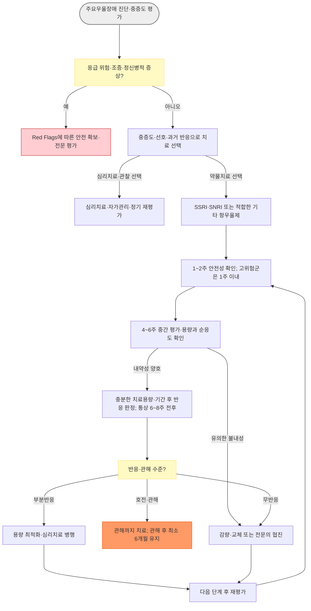
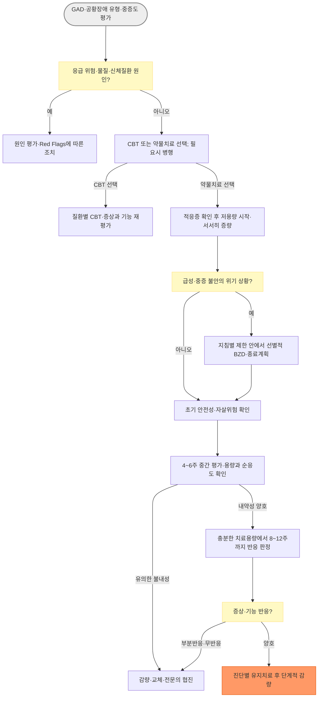

# 항우울제, 항불안제 Antidepressants & Anxiolytics

## <mark style="color:green;">일반 사항</mark>

> 이 장은 성인 외래 진료의 약물 선택과 안전한 처방을 위한 요약임. 실제 처방 시 해당 제품의 최신 국내 허가사항·급여기준, 환자의 진단·동반질환·병용약·간신기능을 확인함. 소아·청소년, 임신·수유, 양극성장애, 정신병적 우울증 및 치료저항성 우울증은 정신건강의학과와 협진함.

> 관련 질환별 평가·치료 : ☞ 025 범불안장애 / 026 공황장애 / 027 우울증 / 028 산후우울증.

### <mark style="color:$danger;">🚩 Red Flags!</mark>

<mark style="color:$danger;">**즉각 조치**</mark>

* 구체적인 자살 계획·수단·의도, 최근 자살시도, 타해 위험 또는 안전 확보 불가 → 즉시 안전을 확보하고 응급 평가  `고위험 자살·타해 위기`
* 심한 초조·공격성, 중증 정신병적 증상·긴장증, 음식·수분 섭취 불가 또는 중증 자기방임 → 즉시 응급 평가  `중증 정신·신체 상태`
* 조증·혼재성 상태와 판단력 저하·위험행동, 산후 정신병·조증 또는 모자 안전 확보 불가 → 즉시 정신건강의학과·응급 평가  `조증·산후 정신증`
* serotonergic 약물 노출 후 clonus·hyperreflexia·떨림과 초조·발한·고체온 등 발생 → 원인 약물을 중단하고 응급 평가  `세로토닌 증후군 의심`
* 항우울제 과량복용, 발작, 실신·중증 부정맥, 의식저하 또는 호흡억제 → 즉시 응급실 의뢰  `약물독성·중증 이상반응`
* 지속발기증, 중증 출혈 또는 증상성 중증 저나트륨혈증 의심 → 즉시 응급 평가  `중증 약물이상반응`
* benzodiazepine 급중단 후 발작·섬망 또는 중증 자율신경 항진 → 즉시 응급 평가  `중증 BZD 금단`

<mark style="color:$warning;">**당일~수일 내 평가**</mark>

* 자살사고가 새로 생기거나 악화되었으나 즉각적인 계획은 불명확하고 안전이 확보된 경우 → 당일 자살위험 평가; 안전 확보가 어려우면 즉각 조치 단계 적용  `자살사고 악화`
* 항우울제 시작·증량 후 현저한 activation·akathisia·충동성 또는 경조증 의심 → 당일 평가  `항우울제 유발 활성화`
* 안전은 확보되어 있으나 새로 발생한 정신병적 증상·경조증 또는 산후 급격한 기분·행동 변화 → 당일 정신건강의학과 평가  `정신병적 증상·주산기 변화`
* 중증 우울증의 빠른 악화 또는 현저한 기능 저하 → 당일~수일 내 중증도에 맞춰 평가  `우울증 악화`

<mark style="color:$info;">**조기 평가 및 추적**</mark>

* 치료 시작·증량·교체·감량 후 부작용 또는 중단 증상 → 약제·위험도별 조기 추적  `치료 변경 후 모니터링`
* 고령, 낙상 위험, 심혈관질환, 간·신장애 또는 다약제 복용 → 용량·검사·상호작용을 조기에 재평가  `약물이상반응 고위험`
* 부분반응·잔류 증상·순응도 저하 또는 성기능·체중·수면 부작용 → 치료 계획 재평가  `불충분 반응·내약성`
* 안전이 확보된 양극성장애·물질사용장애 의심, 반복 치료 실패·복잡한 병용 또는 임신·수유 중 약물 선택 → 조기 정신건강의학과 협진  `복합·특수 환자군`


**⚠️ 항우울제 자살위험 경고(FDA Boxed Warning 및 국내외 안전성 경고)**\
FDA는 항우울제 라벨에 소아·청소년 및 18\~24세 젊은 성인에서 치료 초기·증량 시 자살사고·행동 위험이 증가할 수 있다는 Boxed Warning을 요구함. NICE NG222는 우울증에서 18\~25세 또는 자살위험이 있는 환자에게 치료 시작·증량 1주 후 평가를 권고함. NICE CG113의 GAD 권고는 SSRI/SNRI를 시작하는 30세 미만 환자에게 1주 이내 첫 평가와 첫 1개월간 매주 자살사고·자해 위험 확인을 권고함. 두 기준을 구분하고 연령과 관계없이 activation·자살사고를 관찰함. <mark style="color:$info;">[NICE NG222·CG113]</mark>


***

## <mark style="color:green;">처방 전 평가</mark>

* 진단, 증상 지속기간, 기능 손상 및 중증도를 평가함. PHQ-9, GAD-7 등은 보조 도구이며 임상 진단을 대신하지 않음.
* 자살·자해·타해 위험, 정신병적 증상, 긴장증 및 안전하게 지낼 수 있는 환경인지 확인함.
* 과거 조증·경조증, 항우울제 유발 활성화, 양극성장애 가족력을 확인함.
* 음주, stimulant·opioid·benzodiazepine 및 기타 물질 사용을 확인함.
* 기존 약물, 건강기능식품, 임신 가능성·수유, 체중·혈압, 간·신장질환 및 출혈 위험을 확인함.
* 필요에 따라 CBC, 전해질(특히 Na), 간·신기능, TSH 등을 시행함. 고령자·이뇨제 복용자는 저나트륨혈증 위험이 높음.
* TCA 또는 QT 연장 위험 약물을 고려하거나 심질환·실신·전도장애·QT 연장 가족력·전해질 이상이 있으면 ECG를 고려함.

## <mark style="color:green;">치료 알고리듬</mark>

### <mark style="color:orange;">주요우울장애</mark>

***



<p align="center"><strong>주요우울장애 치료 알고리듬</strong></p>

***

### <mark style="color:orange;">불안장애</mark>

***



<p align="center"><strong>불안장애 치료 알고리듬</strong></p>

***

> 이 알고리듬은 주요우울장애·범불안장애·공황장애의 일반적인 외래 치료를 중심으로 함. 강박장애·외상후 스트레스장애는 권장 심리치료, 치료용량과 치료기간이 다르므로 별도로 평가하고 필요 시 정신건강의학과와 협진함.

## <mark style="color:$warning;">Management</mark>

## <mark style="color:green;">약물 선택 원칙</mark>

* 약물치료를 선택한 성인 주요우울장애에서는 SSRI, SNRI, bupropion, mirtazapine, vortioxetine 등이 1차 선택지가 될 수 있음. 약제 간 평균 효능 차이보다 과거 반응, 부작용, 동반 증상, 상호작용 및 환자 선호를 우선함.
* 경한 우울증에서는 심리치료·자가관리·능동적 관찰을 우선 고려하며, 중증도·환자 선호·과거 반응에 따라 약물치료를 선택함. <mark style="color:$info;">[NICE NG222]</mark>
* 불안장애에서는 CBT 등 심리치료 또는 SSRI/SNRI를 중증도·선호에 따라 선택함. 약물별 GAD·공황장애 국내 허가 여부를 구분함. 초기 불안·초조가 악화될 수 있어 낮은 용량에서 시작함.
* TCA는 항콜린성 부작용, 심독성 및 과량복용 위험 때문에 일반 외래의 1차 선택이 아님.
* Benzodiazepine은 우울증 치료제가 아님. 범불안장애·공황장애에서 항우울제 효과를 기다리기 위한 일률적 병용은 피함. 급성·중증 불안의 위기 상황에서 선별적으로 최단기간 사용하며, 아래의 지침별 제한을 따름.
* 항우울제는 처방한 약물의 치료용량에 도달한 후 충분한 기간 사용하고, 반응이 없으면 진단·복약 순응도·물질사용·양극성장애·동반질환을 재평가함.


KMAP-GAD 2024·KMAP-DD 2025는 국내 전문가 합의이며 국제 근거기반 지침과 권고 순위가 다를 수 있음. KMAP-GAD에서 초기 항우울제+항불안제 병용이 선호되었다는 결과를 모든 환자의 BZD 병용 권고로 해석하지 않음. 질환별 상세 전략은 025~028을 참조함.


## <mark style="color:green;">항우울제</mark>

### <mark style="color:orange;">SSRI</mark>

* 구역·설사, 두통, 불면 또는 졸림, 성기능 장애, 발한이 흔함. 치료 초기에는 불안·초조가 일시적으로 악화될 수 있음.
* 항혈소판제, NSAID 및 항응고제 병용 시 위장관 및 기타 출혈 위험이 증가할 수 있음. 출혈 증상을 관찰하고 warfarin 병용 시 필요에 따라 INR을 확인함.
* 고령자, 이뇨제 복용자 및 저체중 환자에서는 SIADH·저나트륨혈증에 주의함.
* 보통 1일 1회 투여함. 활성화가 두드러지면 아침, 진정이 두드러지면 저녁 투여를 고려하되 환자 반응에 맞춤.

| 성분명 \[대표 제품]                                            | 일반 성인 시작용량                                   | 통상 치료용량         | 일반 최대용량                                                                | 주요 특징·주의                                                                                |
| ------------------------------------------------------- | -------------------------------------------- | --------------- | ---------------------------------------------------------------------- | --------------------------------------------------------------------------------------- |
| citalopram <mark style="color:blue;">\[시탈로프람]</mark>  | <p>20 ㎎ 1일 1회<br>고령·간장애 등 10 ㎎</p>           | 20\~40 ㎎/day  | <p>40 ㎎/day<br>위험군 20 ㎎/day</p>                                        | 용량 의존 QT 연장. 고령(＞60세; FDA 기준), 간장애, CYP2C19 poor metabolizer 또는 강한 CYP2C19 억제제 병용 시 20 ㎎/day 이하 |
| escitalopram <mark style="color:blue;">\[렉사프로]</mark> | <p>우울증·GAD 10 ㎎ 1일 1회<br>공황장애 첫 1주 5 ㎎ → 10 ㎎<br>내약성이 우려되면 저용량 시작 고려</p>              | 10\~20 ㎎/day  | 20 ㎎/day                                                               | 상호작용이 비교적 적음. 고령자는 보통 5 ㎎으로 시작하고 더 낮은 최대용량을 고려함. 임상적으로 통상 10 ㎎/day 이내 사용을 고려하되, 국내 허가에는 고령자 상한이 수치로 명시되어 있지 않음. 간장애는 처음 2주 5 ㎎/day 후 최대 10 ㎎/day. 선천성·기존 QT 연장 및 QT 연장약 병용은 국내 허가상 금기                                                                |
| fluoxetine <mark style="color:blue;">\[푸록틴캡슐]</mark>    | <p>20 ㎎ 1일 1회<br>불안장애에서는 더 낮게 시작 가능</p>      | 20\~60 ㎎/day  | 우울증 최대 80 ㎎/day; 적응증별 구분 | 활성화·불면, 긴 반감기, 강한 CYP2D6 억제. 중단 증상은 상대적으로 적음                                            |
| fluvoxamine <mark style="color:blue;">\[듀미록스]</mark>  | 50 ㎎/day                                     | 적응증·제형별 조절      | 300 ㎎/day                                                              | CYP1A2·2C19 상호작용이 많음. tizanidine 병용금기; theophylline·clozapine·일부 BZD 농도 상승 주의. 국내 허가 적응증과 용법 확인                                                  |
| paroxetine <mark style="color:blue;">\[세로자트]</mark>   | <p>20 ㎎/day<br>공황장애는 10 ㎎/day 시작; 고령자 저용량 고려</p>         | 20\~40 ㎎/day  | 주요우울장애 최대 50 ㎎/day, 공황장애·강박장애 최대 60 ㎎/day; 그 밖의 적응증과 CR 제형은 국내 허가사항 확인 | 진정, 체중 증가, 성기능 장애, 항콜린성 부담과 중단 증상이 비교적 큼. 강한 CYP2D6 억제                                  |
| sertraline <mark style="color:blue;">\[졸로푸트]</mark>   | <p>50 ㎎/day<br>공황·PTSD·사회불안은 25 ㎎/day 시작 → 1주 후 50 ㎎</p> | 50\~200 ㎎/day | 200 ㎎/day                                                              | 설사·위장관 부작용이 비교적 흔함. 증량 간격은 최소 1주. 간장애 시 감량·간격 조절; PMDD는 연속 투여 최대 150 ㎎/day, 황체기 투여 최대 100 ㎎/day로 구분                                                            |


**불안장애의 국내 허가 여부를 질환별로 구분함**

* GAD : escitalopram, paroxetine IR, venlafaxine XR, duloxetine은 국내 허가 약물임. Agomelatine도 국내 GAD 허가가 있으나 간기능검사와 연령 제한을 별도로 적용함.
* Sertraline·fluoxetine·fluvoxamine·mirtazapine·vortioxetine의 국내 GAD 사용은 허가 외임. Vortioxetine을 GAD의 일반적인 대체약으로 간주하지 않음.
* 공황장애 : escitalopram·paroxetine·sertraline·venlafaxine XR 등의 해당 제품 허가사항을 확인함. Fluoxetine은 근거가 있으나 국내 공황장애 허가 외이며, 공황장애에서 60 ㎎/day 초과는 체계적으로 평가되지 않았음.
* 계열 전체의 유효성·해외 허가를 개별 약물의 국내 적응증으로 확대하지 않으며, 허가 외 사용의 필요성·대안과 급여 여부를 별도로 확인함.


> 용량은 성인 교육용 범위임. 국내 제품별 허가 적응증·제형, 고령자 및 간·신장애 용량을 별도로 확인함. 표의 대표 제품명은 예시이며, 실제 유통 여부·정확한 상품명은 최신 허가사항으로 재확인함.

### <mark style="color:orange;">SNRI</mark>

* SSRI와 유사한 부작용에 더해 혈압·맥박 상승, 발한, 입마름, 배뇨장애가 나타날 수 있음.
* Venlafaxine·desvenlafaxine은 갑작스러운 중단이나 복용 누락 때 중단 증상이 비교적 흔함.
* Duloxetine은 일부 신경병증성 통증과 섬유근육통 등에서 유용할 수 있으나 간질환·상당한 음주, 신기능 저하 및 국내 허가 적응증을 확인함.

<table><thead><tr><th>성분명 [대표 제품]</th><th>시작용량</th><th>통상용량</th><th>주요 특징·주의</th></tr></thead><tbody><tr><td>desvenlafaxine <mark style="color:blue;">[프리스틱]</mark></td><td>50 ㎎ 1일 1회</td><td>통상 50 ㎎/day; 일부 환자에서 100 ㎎/day 고려</td><td>50 ㎎ 초과 시 추가 효과는 제한적이고 부작용이 증가할 수 있음. 서방정을 통째로 복용</td></tr><tr><td>duloxetine <mark style="color:blue;">[드록틴캡슐]</mark></td><td>30 ㎎/day 후 60 ㎎/day</td><td>60 ㎎/day; 적응증에 따라 최대 120 ㎎/day</td><td>혈압, 간기능·신기능, 요폐 주의. 60 ㎎ 초과의 추가 이득은 적응증별로 제한적. CrCl ＜30 ㎖/min의 중증 신장애·말기 신질환은 국내 허가상 금기. 간장애를 유발하는 간질환 및 조절되지 않는 고혈압도 금기</td></tr><tr><td>venlafaxine XR <mark style="color:blue;">[이팩사 XR]</mark></td><td>우울증·GAD 75 ㎎/day; 적응을 위해 첫 4~7일 37.5 ㎎ 가능. 공황장애 첫 7일 37.5 ㎎ → 75 ㎎/day</td><td>우울증·GAD·공황장애 75~225 ㎎/day; 국내 XR 최대 225 ㎎/day</td><td>용량 의존 혈압 상승과 중단 증상. 우울증·GAD 증량 간격 최소 4일, 공황장애 최소 7일; 1회 증량 폭 75 ㎎/day 이하. 간·신장애 감량. 사회공포증은 75 ㎎/day이며 증량의 추가 이득 근거 없음. IR 제형과 용법을 혼용하지 않음</td></tr><tr><td>milnacipran <mark style="color:blue;">[익셀]</mark></td><td>우울증 25 ㎎/day로 시작 후 점차 증량</td><td>우울증 50 ㎎ bid(100 ㎎/day), 아침·저녁 식사 중 복용</td><td>국내 우울증·섬유근육통 허가. 고령자의 우울증은 25 ㎎/day를 2~3회 분할 시작, 최대 60 ㎎/day. 신장애는 CrCl에 따라 감량. 섬유근육통의 초기 적정·최대용량과 구분</td></tr></tbody></table>

> Levomilnacipran은 국내 허가·유통 여부를 확인하기 전 처방용 표에서 제외함. Milnacipran <mark style="color:blue;">[익셀]</mark>은 국내에서 우울증과 섬유근육통 모두 허가되어 있음. 미국 Savella는 섬유근육통 적응증만 있으므로 국가별 적응증과 질환별 용법을 구분함. 정확한 국내 적응증·보험기준은 최신 허가사항으로 확인함.


**세로토닌 증후군(Serotonin Syndrome) 주의**

* MAOI, linezolid, 정맥 methylene blue와의 병용은 금기 또는 원칙적 회피 (파킨슨병 치료용 MAO-B 억제제는 약제별 허가사항 확인)
* tramadol, meperidine, fentanyl, dextromethorphan, 성요한풀 등 다른 세로토닌성 약물을 병용하거나 증량한 뒤, 자발성·유발성·안구 clonus 또는 과반사·진전 등의 **신경근육 항진**과 초조·혼돈, 발한·고열 등의 **정신상태·자율신경 변화**가 함께 나타나면 세로토닌 증후군을 의심하여 세로토닌성 약물을 중단하고 응급 평가


### <mark style="color:orange;">기타 항우울제</mark>

| 성분명 \[대표 제품]                                             | 통상 시작용량                         | 주요 특징                                        | 중요 주의사항                                                                                                                                                                                        |
| -------------------------------------------------------- | ------------------------------- | -------------------------------------------- | ---------------------------------------------------------------------------------------------------------------------------------------------------------------------------------------------- |
| bupropion <mark style="color:blue;">\[웰부트린]</mark>     | 국내 XL: 150 ㎎ 아침 1회, 최소 4일 후 내약성에 따라 300 ㎎/day | NDRI. 성기능 장애와 체중 증가가 상대적으로 적고 금연치료에도 사용      | 불면·불안·혈압 상승·발작 위험. 발작장애, 현재 또는 과거 신경성 식욕부진증·폭식증, MAOI 병용 및 alcohol·benzodiazepine·항경련제 급중단 상황에서 금기 또는 회피. 국내 우울증 치료용 XL 제제와 금연치료용 SR 제제의 용법을 혼용하지 않으며, 제형별 1회 용량·투여 간격·1일 최대용량은 해당 제품 허가사항을 확인 |
| mirtazapine <mark style="color:blue;">\[레메론]</mark>    | 15 ㎎ 취침 전                       | 불면·식욕저하가 동반된 경우 고려. 성기능·위장관 부작용은 SSRI보다 적은 편 | 졸림, 식욕·체중 증가, 지질 이상. 용량에 따른 진정의 차이는 일정하지 않으므로 수면 효과만을 위해 임의 증량·감량하지 않음. 우울증 치료범위 15\~45 ㎎/day                                                                                                                                                      |
| vortioxetine <mark style="color:blue;">\[브린텔릭스]</mark> | <p>10 ㎎ 1일 1회<br>65세 이상 5 ㎎으로 시작</p> | 주요우울장애 치료. 치료범위 5\~20 ㎎/day; 치매 치료 적응증과 구분                   | 구역이 흔함. 강한 CYP2D6 억제제 또는 유도제 병용 시 조절 필요                                                                                                                                                        |
| trazodone <mark style="color:blue;">\[트리티코]</mark>     | 우울증 치료와 저용량 수면 목적을 구분           | 진정·수면 효과                                     | 기립저혈압, 낙상, 지속발기증, QT 연장·부정맥. 불면증만을 위한 저용량 사용은 국내 허가 외 용법이며 항우울 치료용량을 의미하지 않음                                                                                                                                      |
| agomelatine <mark style="color:blue;">\[아고틴]</mark>    | 25 ㎎ 취침 시; 필요 시 최대 50 ㎎/day | 국내 주요우울증·범불안장애 허가. 우울증은 2주, GAD는 4주 후 무반응 시 증량 고려                        | 간기능검사를 치료 시작 전과 약 3·6·12·24주 및 임상적으로 필요할 때 시행함. 증량 후에도 시작 때와 같은 빈도로 검사를 반복함. 간장애, AST/ALT ＞3×ULN, 강한 CYP1A2 억제제(예: fluvoxamine·ciprofloxacin) 병용은 금기. 75세 이상 투여하지 않음; 65세 이상 GAD 치료에는 권장하지 않음. 황달·짙은 소변·우상복부 통증 등 간손상 의심 시 즉시 중단·평가                                                                                   |

> Vilazodone, nefazodone 및 doxepin은 국내 허가 제품의 함량·적응증·유통 상태를 확인하기 전 국내 처방용 표에서 제외함. 특히 저용량 불면증용 doxepin 제품과 고용량 항우울 용법을 혼용하지 않음.

### <mark style="color:orange;">TCA 및 사환계 항우울제</mark>

* 일부 중증 우울증에서 효과적일 수 있으나 항콜린성 부작용, 기립저혈압, 낙상, 심장 전도장애 및 과량복용 시 치명적 심독성 때문에 일반 외래의 1차 선택이 아님.
* Nortriptyline 등 secondary amine이 일부 tertiary amine보다 항콜린성 부담이 낮을 수 있지만 고령자에서 안전한 약물로 간주해서는 안 됨.
* 녹내장, 요폐·전립선비대, 변비·장폐색 위험, 인지장애, 심장 전도장애, 발작 위험 및 자살·과량복용 위험을 평가함.
* 저용량에서 시작해 서서히 증량함. 적응증과 환자에 따라 혈압·맥박 및 혈중농도 모니터링을 고려함. 심질환·실신·전도장애 병력, QT 연장 가족력, 고령, 전해질 이상 또는 여러 QT 연장약 병용 등 위험요인이 있으면 투여 전 ECG를 시행하고, 증량 후 또는 임상적으로 필요할 때 반복함.

| 성분명 \[대표 제품]                                             | 특징                              | 주요 주의사항                                  |
| -------------------------------------------------------- | ------------------------------- | ---------------------------------------- |
| amitriptyline <mark style="color:blue;">\[에트라빌]</mark> | 진정·항콜린 작용이 강함; 일부 통증 질환에 저용량 사용 | 낙상, 인지저하, 체중 증가, 심독성                     |
| clomipramine <mark style="color:blue;">\[그로민]</mark>   | serotonergic 작용이 강하며 OCD 등에 사용  | serotonin syndrome, 발작, QT·전도장애, 항콜린 부작용 |
| imipramine <mark style="color:blue;">\[이미프라민]</mark>   | 항우울·항불안 효과                      | 기립저혈압, 항콜린 부작용, 심독성                      |
| nortriptyline <mark style="color:blue;">\[센시발]</mark>  | 상대적으로 항콜린·진정 부담이 적을 수 있음        | 여전히 낙상·부정맥·과량복용 위험 존재                    |
| amoxapine <mark style="color:blue;">\[아디센]</mark>      | dopamine 차단 관련 효과 가능            | 추체외로 증상, 지연성 운동장애, 발작                    |

> 국내 미유통 또는 사용이 드문 desipramine, protriptyline, trimipramine, maprotiline 등은 국내 허가·공급을 확인한 경우에만 처방표에 포함함. 표의 대표 제품명 역시 실제 유통 여부를 재확인함.

## <mark style="color:green;">항불안제</mark>

### <mark style="color:orange;">Benzodiazepine</mark>


**⚠️ Benzodiazepine Boxed Warning (FDA 2020)**\
모든 benzodiazepine 계열 약물은 오남용, 중독, 신체의존 및 중단 시 금단반응의 위험을 강조하는 Boxed Warning을 포함함. 최소 유효용량·최단기간 사용을 원칙으로 하며, opioid 등 다른 중추신경억제제와의 병용은 특히 위험함.


* 우울증 치료제가 아니며 장기 불안장애 치료의 기본 약제도 아님. **WHO mhGAP 2023은 성인 GAD·공황장애 치료에 권고하지 않으며, 급성·중증 불안의 응급 관리에서만 최대 3\~7일의 단기 사용을 고려**함. NICE는 GAD의 위기 상황에만 단기 사용을 허용하고 공황장애 치료에는 처방하지 않도록 권고함. 다른 지침·국내 진료에서 선택적 보조 사용을 고려하더라도 환자별 이유와 종료 계획을 명확히 함.
* 가능한 최소 유효용량·최단기간을 사용하고, 시작할 때부터 종료 계획을 설명함. 일부 지침의 2\~4주 제한을 모든 불안장애 환자에게 그 기간 동안 사용해도 된다는 의미로 적용하지 않음. 수일 사용 후 필요성을 재평가하고, 반복 처방으로 장기 사용이 되지 않도록 함.
* 졸림, 기억·인지 저하, 운동실조, 낙상·골절, 교통사고, 역설적 흥분, 내성·신체의존과 금단이 발생할 수 있음.
* Alcohol, opioid, gabapentinoid 및 다른 진정제와 병용하면 심한 진정·호흡억제·사망 위험이 증가함.
* 고령자는 단시간형을 포함한 모든 benzodiazepine의 낙상·인지저하 위험 때문에 원칙적으로 피함. 사용이 불가피하면 더 낮은 용량을 사용하며 긴 반감기·활성 대사체 약물의 축적에 특히 주의함. 간기능 저하에서는 glucuronidation으로 대사되는 lorazepam·oxazepam 등이 상대적으로 예측 가능할 수 있음.

| 성분명 \[대표 제품]                                          | 작용 특성                        | 주요 비고                                                 |
| ----------------------------------------------------- | ---------------------------- | ----------------------------------------------------- |
| diazepam <mark style="color:blue;">\[디아제팜]</mark>   | 장시간; 활성 대사체 있음               | 고령·간장애에서 축적과 낙상 위험. 일부 감량 과정에 사용할 수 있으나 일률적 전환은 하지 않음 |
| clorazepate                                           | 장시간; 활성 대사체                  | 축적 주의                                                 |
| alprazolam <mark style="color:blue;">\[자낙스]</mark>  | 중간\~짧은 작용                  | 반동성 불안·금단과 오남용 위험. 급중단 금지                             |
| lorazepam <mark style="color:blue;">\[아티반]</mark>   | 중간 작용; glucuronidation       | 활성 대사체는 없으나 진정·의존·낙상 위험은 동일                           |
| oxazepam                                              | 중간\~짧은 작용; glucuronidation | 작용 발현이 비교적 느림. 국내 유통 여부 확인                            |
| clonazepam <mark style="color:blue;">\[리보트릴]</mark> | 중간\~장시간                    | 국내 허가 적응증(뇌전증·공황장애 등)과 용법 확인                          |
| triazolam <mark style="color:blue;">\[할시온]</mark>   | 단시간 수면제                      | 기억장애·반동성 불면·이상행동 주의; 불안장애 유지치료제로 사용하지 않음              |
| etizolam <mark style="color:blue;">\[데파스]</mark>    | thienodiazepine 유사체; 단시간 작용 | Benzodiazepine과 유사한 의존·금단 위험. 국내 허가 용량과 투여기간 확인                           |

#### <mark style="color:$primary;">Benzodiazepine 감량</mark>

* 신체의존 가능성이 있는 환자에서 갑자기 중단하지 않음.
* 초기에는 대체로 현재 용량의 5\~10%를 2\~4주마다 감량하는 방법을 고려하며, 통상 2주에 25%를 넘는 빠른 감량은 피함.
* 장기간·고용량 사용, 과거 심한 금단, 동반 정신질환이 있으면 더 느린 감량이 필요할 수 있음. 감량 말기에는 더 작은 폭으로 줄임.
* 금단 증상이 현저하면 현재 단계에서 유지하거나 감량 속도를 늦춤. 매 감량 단계에서 불안·불면·떨림·지각과민·발작 위험을 평가함.
* 긴 반감기 약제로의 전환은 선택지일 뿐 필수는 아님. 고령자·간장애에서는 diazepam 전환이 부적절할 수 있음.
* 감량 중 불안·불면이 뚜렷하게 악화되면 감량 속도를 조정함. 감량 성공을 돕기 위해 기저 불안·불면에 맞는 CBT·CBT-I 등 행동중재를 제공하거나 이용할 수 있도록 의뢰함.

### <mark style="color:orange;">Buspirone</mark>

* Buspirone <mark style="color:blue;">[부스파]</mark> : 범불안장애에서 고려할 수 있는 비benzodiazepine 항불안제임. 국내 허가 효능은 불안장애의 치료 또는 불안증상의 단기 완화이며, 공황장애의 일반적 대체약으로 간주하지 않음.
* 국내 허가 용법 : 5 ㎎ tid로 시작하여 필요시 2~3일 간격으로 1일 총량을 5 ㎎씩 증량함. 통상 20~30 ㎎/day를 분할 투여하며 최대 60 ㎎/day. 중증 간·신장애 등 금기를 제품별로 확인함.
* 즉각적인 진정 효과가 없으며 효과 발현에 수주가 걸릴 수 있음. 공황발작의 즉시 완화나 benzodiazepine 금단 치료제로 사용하지 않음.
* 어지럼, 구역, 두통이 나타날 수 있음. MAOI 및 다른 serotonergic 약물 병용 시 serotonin syndrome 위험을 확인함.

### <mark style="color:orange;">Gabapentinoid</mark>

* Gabapentin과 pregabalin은 우울증 치료제가 아니며, 불안장애 치료는 국내 허가 외 사용으로 구분함. Pregabalin의 GAD 유효성 근거·해외 허가를 gabapentin에 그대로 적용하지 않음. 국내 보험 적용도 별도로 확인하고 허가 외 사용의 필요성을 설명함.
* 졸림, 어지럼, 운동실조, 부종, 체중 증가, 오남용·의존 및 중단 증상에 주의함.
* Opioid, benzodiazepine, alcohol 등 중추신경억제제와 병용하면 호흡억제 위험이 증가할 수 있음(FDA 2019 안전성 경고).
* 과거 물질사용장애(알코올·약물사용장애) 병력이 있으면 오남용·의존 위험이 높아 처방·모니터링에 더 주의함.
* 신기능에 따라 감량함. 단일 최대용량으로 일률 표기하지 않고 적응증·제품 허가사항에 따라 개별화함.

## <mark style="color:green;">Serotonin syndrome</mark>

* 정신상태 변화, 자율신경 항진 및 신경근육 이상이 조합되어 나타나는 잠재적으로 치명적인 약물독성임.
* Clonus와 hyperreflexia가 중요한 단서임. 중증에서는 고체온, 근육강직, 횡문근융해, 발작 및 장기부전이 생길 수 있음.
* 의심되면 serotonergic 약물을 즉시 중단하고 중증도에 따라 응급실로 의뢰함. 고체온·강직·의식변화가 있으면 즉시 응급조치함.

### <mark style="color:orange;">Hunter serotonin toxicity criteria</mark>

Serotonergic 약물 노출 후 다음 중 하나이면 serotonin toxicity를 강하게 의심함.

* spontaneous clonus
* inducible clonus + (초조 또는 발한)
* ocular clonus + (초조 또는 발한)
* 떨림 + hyperreflexia
* hypertonia + 체온 38℃ 초과 + (ocular 또는 inducible clonus)

> Hunter 기준은 임상 판단을 보조하며, 기준을 충족하지 않는다는 이유만으로 초기 또는 비전형적 serotonin syndrome을 배제하지 않음.

### <mark style="color:orange;">임상적으로 중요한 위험 약물</mark>

* MAOI, linezolid, 정맥 methylene blue
* SSRI, SNRI, clomipramine을 포함한 serotonergic TCA 및 기타 serotonergic 항우울제
* tramadol, meperidine, methadone, fentanyl, dextromethorphan
* lithium, buspirone, amphetamine계 약물, triptan, tryptophan, St. John's wort

> Bupropion, carbamazepine 및 valproate를 serotonin 재흡수 억제제로 분류하지 않음. Ondansetron 등 5-HT3 수용체 길항제는 규제기관 경고가 있으나, 강한 serotonergic 약물과 동일한 위험도로 일괄 분류하지 않음.

## <mark style="color:green;">주요 부작용과 대처</mark>

| 문제            | 우선 평가·대처                                        | 추가 고려                                                                                                   |
| ------------- | ----------------------------------------------- | ------------------------------------------------------------------------------------------------------- |
| 구역·설사         | 초기 일시적 증상인지 확인, 식사와 함께 복용 가능 여부·감량·서서히 증량 고려    | 지속되면 약제 변경                                                                                              |
| 불면·activation | 자살위험·akathisia·경조증 평가, 아침 투여·감량 또는 변경           | 현저한 충동성·조증 의심 시 당일 평가                                                                                   |
| 졸림            | Alcohol·진정제 병용, 수면무호흡, 낙상·운전 위험 평가; 저녁 투여·감량·변경 | 자극제를 일률적으로 추가하지 않음                                                                                      |
| 성기능 장애        | 기저 성기능과 우울 증상 영향 평가; 관찰·감량·부작용이 적은 약제로 교체 고려    | 우울증에서는 bupropion 교체·추가 또는 남성 발기부전에 PDE5 억제제를 고려함. GAD·공황장애는 해당 질환의 효과 근거·국내 허가를 확인하며 성기능 부작용만으로 bupropion·vortioxetine으로 일률 전환하지 않음; CBT 병행·기존 약제 조정·협진 고려. Drug holiday는 제한적 초기 연구가 있으나 순응도 저하·중단 증상 때문에 통상적인 1차 대처로 권고하지 않음 |
| 체중 증가·대사 이상   | 체중·식습관·활동 평가, 생활요법, 감량·약제 변경                    | 항우울제 부작용만을 이유로 statin을 자동 추가하지 않음                                                                       |
| 기립저혈압·낙상      | 혈압, 탈수, 병용약 평가; 천천히 일어나기, 감량·변경                 | Fludrocortisone·고염식 등을 일률적으로 처방하지 않음                                                                    |
| 저나트륨혈증        | 혼돈·두통·구역·경련 평가, 혈청 Na 측정, 원인 약제 중단 여부 결정        | 증상성·중증이면 응급 평가                                                                                          |
| 출혈            | NSAID·항혈소판제·항응고제 병용과 출혈 부위 평가                   | 중증 출혈은 응급실 의뢰                                                                                           |
| QT 연장·부정맥     | 용량·병용약·전해질·심질환 평가, ECG                          | 실신·지속성 부정맥이면 응급 평가                                                                                      |
| 지속발기          | 원인 약물 중단 및 즉시 응급실 의뢰                            | 4시간 이상 지속되기 전이라도 진행 중이면 지체하지 않음                                                                         |

## <mark style="color:green;">중요한 약물 상호작용</mark>

| 약물·효소           | 대표 항우울제                                     | 임상적 의미                                                                                                                                                                                                                          |
| --------------- | ------------------------------------------- | ------------------------------------------------------------------------------------------------------------------------------------------------------------------------------------------------------------------------------- |
| CYP2D6 강한 억제    | fluoxetine, paroxetine, bupropion           | Tamoxifen의 활성 대사체(endoxifen) 농도를 낮춰 효과를 감소시킬 가능성이 있음. 임상적 재발·사망 위험에 관한 연구 결과는 일관되지 않지만, 가능하면 강한 CYP2D6 억제제를 피하고 venlafaxine, escitalopram, desvenlafaxine 등 CYP2D6 억제가 적은 대체약을 환자별로 고려함. 일부 beta-blocker·항정신병약·TCA 등과도 상호작용 확인 |
| CYP1A2·2C19 억제  | fluvoxamine                                 | Tizanidine 병용금기(심한 저혈압·진정 위험). Theophylline, clozapine, 일부 benzodiazepine 등의 농도 상승과 감량 필요성 확인                                                                                                                                                                           |
| CYP2D6 억제       | duloxetine                                  | CYP2D6 기질 병용 시 농도 상승 가능                                                                                                                                                                                                         |
| 출혈 위험           | SSRI·SNRI + NSAID·aspirin·항응고제              | 출혈 증상과 위험요인 평가; 필요한 경우 위장관 보호 및 모니터링 고려                                                                                                                                                                                         |
| QT 연장           | citalopram, escitalopram, TCA, trazodone 등  | 다른 QT 연장약, 저K·저Mg, 서맥·심질환과 중첩 주의                                                                                                                                                                                                |
| Serotonergic 병용 | MAOI, linezolid, methylene blue, tramadol 등 | 금기·washout 기간과 serotonin syndrome 위험 확인                                                                                                                                                                                         |

> MAOI를 시작하거나 중단할 때는 약물별 washout 기간을 반드시 확인함. 많은 serotonergic 항우울제 중단 후 비가역적 MAOI 시작 전 최소 14일이 필요하지만, fluoxetine은 최소 5주가 필요함. **Vortioxetine은 국내 브린텔릭스 허가상 양방향 최소 14일**이며, 미국 Trintellix 라벨은 vortioxetine 중단 후 MAOI 시작까지 최소 21일을 요구하므로 출처를 구분함. 비가역적 MAOI 중단 후 다른 serotonergic 항우울제는 일반적으로 최소 14일을 두며 가역적 MAOI·MAO-B 억제제는 해당 제품 기준을 따름. MAOI 전환에서는 교차감량으로 중첩 투여하지 않음.

## <mark style="color:green;">치료 반응 평가와 유지치료</mark>

* 일반 성인은 시작 후 1~2주 이내 부작용·자살사고·activation·복약 순응도를 확인함. 위험도와 약제에 따라 더 일찍 평가함.
* 우울증 : NICE NG222는 18~25세 또는 자살위험 환자에게 시작·증량 1주 후 평가를 권고함. FDA 자살 관련 위험분석의 젊은 성인은 18~24세로 연령 기준이 다름.
* GAD : NICE CG113은 SSRI/SNRI를 시작하는 30세 미만 환자에게 1주 이내 첫 평가와 첫 1개월간 매주 자살사고·자해 위험 확인을 권고함. 이후 약효·부작용은 첫 3개월간 2~4주마다, 이후 3개월마다 평가함. <mark style="color:$info;">[NICE NG222·CG113]</mark>
* 공황장애 : 일반적으로 시작 후 2주 이내 안전성을 확인하고 4·6·12주에 효과·부작용을 평가함. 30세 미만 또는 자살위험 환자에서 1주 이내 첫 평가와 초기 매주 확인을 적용하는 것은 GAD 권고·환자 위험도에 근거한 보수적인 임상적 확대 적용이며, 공황장애 절의 직접적인 연령별 권고와 구분함.
* 우울증은 대개 4주 이내 일부 효과를 느낄 수 있음. 4~6주에 중간 반응을 평가하고, 진단·순응도·용량·기간을 확인한 뒤 통상 6~8주 전후에 다음 단계를 결정함. 부분반응은 더 긴 치료가 필요할 수 있으며 유의한 불내성·임상 악화는 예정된 판정 시점보다 먼저 재평가함.
* GAD·공황장애는 4~6주에 중간 반응을 확인하고 충분한 치료용량에서 8~12주까지 반응을 판정함. 4주 무반응만으로 일률 교체하지 않음.
* 부분반응이면 내약성 범위에서 용량을 최적화하고 심리치료 병행을 고려함. 충분한 치료 후 무반응 또는 불내성이면 해당 질환에 적합한 약제로 교체함. 충분한 치료 2가지 이상 실패·복잡한 병용은 정신건강의학과 협진을 고려함.

| 진단 | 유지치료의 기준 | 장기치료 고려 |
| --- | --- | --- |
| 주요우울장애 | 관해 후 최소 6개월, 통상 6~12개월 | 반복 삽화, 중증·정신병적 삽화, 잔류 증상, 자살위험, 만성 경과·중단 후 재발 시 개별 연장 |
| GAD | 효과적인 약물을 최소 1년 유지(NICE); 025의 실무 기준은 관해 후 최소 12개월 | 재발력·잔류 증상·동반질환에 따라 2년 이상 개별 고려 |
| 공황장애 | NICE는 호전 시 최적용량 도달 후 최소 6개월; 026의 실무 기준은 충분한 반응·관해 후 6~12개월 | 재발력·광장공포·잔류 증상·반복 삽화가 있으면 12~24개월 이상 개별 고려 |
| 산후우울증 | 관해 후 최소 6~12개월 | 반복성·중증 삽화, 자살위험·이전 중단 후 재발에 따라 개별 연장; 028 참조 |

## <mark style="color:green;">항우울제 중단</mark>

* 대부분의 항우울제는 갑자기 중단하지 않고 단계적으로 감량함. 감량 기간은 수주에서 수개월 이상까지 개인화함. Agomelatine은 국내 허가상 감량 없이 중단할 수 있는 예외이며, 모든 약물에 같은 중단 원칙을 일률 적용하지 않음.
* Paroxetine, venlafaxine, desvenlafaxine, 고용량·장기복용 및 과거 중단 증상이 심했던 환자는 더 천천히 감량함. Fluoxetine은 긴 반감기로 중단 증상이 상대적으로 적음.
* 어지럼·전기충격감·감각 이상·불면·불안·오심·발한·독감 유사 증상이 감량·중단 수일 내 생기면 중단 증후군을 의심함. 원래 증상의 점진적 악화는 재발 가능성을 평가하되, 지연성·지속성 중단 증상도 있어 발생 시점만으로 구분하지 않음. 감량과의 시간 관계, 신체·감각 증상, 경과와 재투여 반응을 함께 평가함.
* 용량이 낮아질수록 절대 감량 폭을 더 작게 하고, 중단 증상이 호전되거나 견딜 만해진 것을 확인한 후 다음 단계로 진행함. <mark style="color:$info;">[NICE NG222]</mark>
* 반감기가 짧은 약물은 격일 복용으로 농도 변동·중단 증상이 커질 수 있어 일반적인 감량법으로 권하지 않음. 국내 가용 저함량·액상 제형과 분할 가능 여부를 확인하여 매일 복용량을 줄임. Fluoxetine 등 긴 반감기 약물의 예외는 개별 판단함.
* 심한 중단 증상이 발생하면 직전 내약 용량으로 일시 복귀한 뒤 더 작은 단계로 감량하는 방법을 고려함.

## <mark style="color:green;">특수 환자군</mark>

### <mark style="color:orange;">소아·청소년</mark>

* 1차 치료는 심리치료이며, 약물치료가 필요하면 정신건강의학과와 협진함.
* 국내에서 소아·청소년 적응증이 확인된 항우울제는 제한적이므로 개별 제품의 허가 연령·적응증을 확인함.
* 모든 항우울제는 소아·청소년에서 자살사고·행동 위험 증가 경고가 있으므로 치료 초기·증량 시 특히 면밀히 관찰함.
* Benzodiazepine은 소아·청소년에서 일반적으로 권장하지 않음.

### <mark style="color:orange;">임신·수유</mark>

* 치료하지 않은 우울·불안의 위험과 약물 노출 위험을 함께 평가함. 임의로 중단하지 않음.
* 기존에 효과적이었던 항우울제가 있으면 임신 시기·재발위험·수유 계획·약물별 자료를 함께 검토하여 유지 가능성을 우선 평가함. 안정적으로 복용한 약을 임신·수유만을 이유로 일률 교체하지 않음.
* 치료력이 없어 새로 시작할 때 sertraline 또는 escitalopram을 우선 고려할 수 있음. 임상지침상 사용 가능성과 국내 제품의 임신·수유 허가 문구는 구분하며 산부인과·정신건강의학과와 공동 결정함. <mark style="color:$info;">[ACOG CPG No. 5·CANMAT 2024]</mark>
* 수유 중 영아의 졸림·수유 장애·체중 증가 불량을 관찰함. Sertraline·paroxetine은 영아 노출이 낮은 편이나 paroxetine의 신규 처방은 다음 임신 계획도 함께 고려함. Fluoxetine은 긴 반감기·활성 대사체로 수유 중 신규 처방에서는 후순위일 수 있으나 임신 중부터 효과적이었다면 유지 가능성을 평가함.
* Paroxetine 등 개별 약물의 임신 관련 주의와 benzodiazepine의 신생아 진정·금단 위험을 최신 국내 허가사항으로 확인함.
* Benzodiazepine은 주산기 불안에서 회피하거나 매우 제한적으로 사용함. 신생아 진정·호흡억제·금단과 산모의 야간 돌봄 안전성을 함께 평가함.
* 출산 전후 항우울제·benzodiazepine에 노출된 신생아는 호흡곤란, 과도한 울음, 근긴장 이상, 수유 곤란 등 적응·금단 증상을 보일 수 있어 분만 전 신생아과와 정보를 공유하고 출생 후 관찰함.

### <mark style="color:orange;">고령자</mark>

* 낮은 용량에서 시작하고 천천히 증량함. 낙상, 저나트륨혈증, 출혈, QT 연장, 인지저하와 다약제 상호작용을 확인함.
* Paroxetine과 TCA의 항콜린성 부담, 장시간형 benzodiazepine의 축적에 특히 주의함.

### <mark style="color:orange;">간·신장애</mark>

* 간장애에서는 대부분의 항우울제 시작·최대용량을 낮추거나 투여 간격을 조절할 수 있음. Sertraline 등 약물별 제한을 확인함.
* 신장애에서는 duloxetine, desvenlafaxine, gabapentin, pregabalin 등의 제한·감량 기준을 확인함.

***

### <mark style="color:red;">질병코드</mark>

F32 우울에피소드

F33 재발성 우울장애

F40 공포성 불안장애

F40.1 사회공포증

F41 기타 불안장애

F41.0 공황장애

F41.1 범불안장애

F42 강박장애

F43.1 외상후 스트레스장애

***

## <mark style="color:purple;">처방례</mark>

> 아래 처방은 교육용 예시임. 진단·연령·동반질환·병용약·간신기능 및 국내 제품 허가사항에 따라 조정함.

> **처방례 1.** 성인 주요우울장애의 초기 약물치료 예
>
> ```
> 렉사프로정 10 ㎎  1T  1일 1회(qd)  × 14일
> ```
>
> _✽일반 성인은 1~2주 이내 부작용·자살사고·activation을 확인함. 18~25세 또는 자살위험 환자는 시작·증량 1주 후 평가함. 내약성이 우려되면 5 ㎎으로 시작 후 증량할 수 있으며, 일반 성인은 반응에 따라 최대 20 ㎎/day. 고령·간장애는 별도 용량 기준을 적용함._

> **처방례 2.** 공황장애, 초기 activation 우려
>
> ```
> 졸로푸트정 50 ㎎  0.5T  1일 1회(qd)  × 7일 → 1T qd
> ```
>
> _✽25 ㎎으로 1주 시작 후 50 ㎎으로 증량하는 공황장애 허가 용법 예임. 일반적으로 2주 이내 첫 평가하며, 젊은 성인·자살위험 환자는 더 이른 평가를 개별 적용함. 초기 불안 악화 가능성을 설명하고 서서히 증량함. Benzodiazepine을 일률 병용하지 않으며, 급성 위기 상황에서 고려한다면 위의 지침별 제한과 종료계획을 따름._

> **처방례 3.** 불면·식욕저하가 동반된 우울증
>
> ```
> 레메론정 15 ㎎  1T  취침 전(hs)  × 14일
> ```
>
> _✽다음 날 졸림, 식욕·체중 증가, 낙상 위험을 확인함._

> **처방례 4.** Duloxetine을 고려하는 경우
>
> ```
> 드록틴캡슐 30 ㎎  1C  1일 1회(qd)  × 7일 → 60 ㎎ qd
> ```
>
> _✽혈압, 간질환·음주, 신기능, 요폐 위험과 적응증별 국내 허가사항을 확인함._

> **처방례 5.** 범불안장애 환자의 일시적 위기 상황에서 단기간 보조치료가 필요한 경우
>
> ```
> 렉사프로정 10 ㎎  1T  1일 1회(qd)
> 아티반정 0.5 ㎎  1T  필요시(prn)  1일 최대 2회  × 최대 3일
> ```
>
> _✽모든 범불안장애 환자에게 일률적으로 병용하지 않음. 자살위험, 물질사용장애, 수면무호흡, 낙상 위험 및 opioid·다른 진정제 병용 여부를 먼저 확인함. 최단기간만 사용하고 3일 이내 실제 복용량·잔여량과 안전성을 재평가함. GAD에서 30세 미만이면 SSRI 시작 후 1주 이내 평가하고 첫 1개월간 매주 자살사고·자해 위험을 확인함. 자동 연장하지 않음. 이는 WHO의 최대 3\~7일 제한 범위 내에서 더 짧게 정한 예시이며, 이미 장기간 복용하여 신체의존이 있는 환자의 급중단 용법은 아님._

***

### <mark style="color:$success;">핵심 복약 지도</mark>

> **효과 발현 시간**
>
> 항우울제는 바로 기분을 좋게 하는 약이 아니며, 효과를 느끼기까지 보통 2\~4주가 걸릴 수 있습니다. 임의로 조기에 중단하지 않도록 설명합니다.

> **초기 activation·자살사고 모니터링**
>
> 처음 복용하거나 증량한 뒤 불안·초조·불면이 심해지거나 자살 생각, 충동적인 행동, 수면이 거의 필요 없을 정도로 지나치게 활발해지는 증상이 생기면 즉시 알리도록 안내합니다. FDA 위험분석의 18\~24세 젊은 성인은 특히 주의가 필요합니다. 우울증은 NICE NG222의 18\~25세 또는 자살위험 환자 1주 평가, GAD는 NICE CG113의 30세 미만 1주 이내 평가·첫 1개월간 매주 확인 기준을 구분하여 추적 일정을 정합니다.

> **임의 중단 금지**
>
> 담당 의사와 감량 계획을 정하고 갑자기 끊지 않도록 설명합니다. Agomelatine은 허가상 점진 감량이 필요 없는 예외지만 임의 중단을 권하지 않습니다. 어지럼, 전기충격 같은 느낌, 불안·불면·구역 등 중단 증상이 생길 수 있으며, paroxetine·venlafaxine 등 반감기가 짧은 약물에서 더 흔합니다.

> **약물 상호작용**
>
> 새로운 처방약·감기약·진통제·건강기능식품을 복용하기 전 상호작용을 확인하도록 안내합니다. 특히 tramadol, dextromethorphan, St. John's wort 병용에 주의합니다.

> **Benzodiazepine 병용 시 주의**
>
> Benzodiazepine 복용 중에는 음주하지 않고, 졸리면 운전·기계 조작을 하지 않도록 안내합니다. Opioid 진통제나 다른 수면·진정제와 함께 복용하기 전 반드시 상의하도록 설명합니다.

> **언제 다시 병원을 방문해야 하나요?**
>
> * 자살 생각이나 자해·타해 충동이 생기는 경우 — 즉시 내원 또는 응급실
> * 고열과 함께 근육이 뻣뻣해지거나 떨림·심한 발한이 나타나는 경우 (serotonin syndrome 의심) — 즉시 내원
> * 조증·경조증 증상(수면이 거의 필요 없이 지나치게 활발해짐)이 나타나는 경우
> * 지속발기, 심한 출혈, 실신·경련이 발생하는 경우 — 즉시 응급실
> * 정해진 추적 일정에 따라 효과·부작용을 재평가(일반적으로 1~2주 이내 첫 평가; 연령·진단·위험도에 따라 1주 이내 또는 매주 확인)

***

### <mark style="color:blue;">환자 안내서</mark>


**우울증·불안장애, 약은 증상을 조절하는 데 도움이 되지만 시간이 필요합니다**

항우울제는 뇌의 신경전달과 관련 회로에 점진적인 변화를 일으켜 우울·불안 증상을 완화하는 데 도움을 줍니다. 충분한 효과가 나타나기까지 보통 몇 주가 걸리며, 처방받은 대로 꾸준히 복용하는 것이 중요합니다.


#### <mark style="color:$primary;">약은 왜 바로 효과가 나타나지 않나요?</mark>

* 항우울제는 신경전달물질 체계가 서서히 재조정되면서 효과가 나타나므로, 대개 2\~4주 후부터 변화를 느끼기 시작합니다.
* 초반에는 오히려 불안·초조·불면이 일시적으로 심해질 수 있습니다. 이 시기에 스스로 중단하지 말고 의료진과 상의하십시오.

#### <mark style="color:$primary;">복용 중 꼭 지켜야 할 것은?</mark>

* **처방받은 대로 매일 같은 시간에 복용하십시오.** 효과가 없다고 느껴져도 스스로 증량하거나 중단하지 마십시오.
* 증상이 좋아진 뒤에도 재발을 막기 위해 일정 기간(보통 최소 6개월 이상) 계속 복용하는 경우가 많습니다.
* 새로운 처방약, 감기약, 진통제, 건강기능식품을 복용하기 전에는 반드시 상의하십시오.
* Benzodiazepine 계열(항불안제·수면제)을 함께 복용 중이라면 음주를 피하고, 졸릴 때는 운전이나 기계 조작을 하지 마십시오.

#### <mark style="color:$primary;">이럴 때는 즉시 병원을 방문하세요</mark>

* 구체적인 자살 생각이나 자해·타해 충동이 들 때
* 심한 초조, 혼란, 환청·망상 또는 위험한 행동을 보일 때
* 고열과 함께 근육이 뻣뻣해지거나 떨림·경련·심한 발한이 나타날 때
* 잠을 거의 자지 않아도 기분이 지나치게 좋고 활발해질 때
* 실신, 심한 두근거림, 발작, 검은 변·토혈 등 심한 출혈이 있을 때
* 발기가 가라앉지 않고 지속될 때

자살 생각이 들 때는 혼자 견디지 말고 즉시 의료진 또는 자살예방상담전화 **109**(24시간)로 연락하십시오. 구체적인 계획·수단이 있거나 스스로 안전을 지키기 어렵다면 혼자 있지 말고 **119 신고·응급실 진료**를 받으십시오.

## <mark style="color:green;">주요 참고문헌 및 확인 자료</mark>

### <mark style="color:orange;">임상 근거</mark>

* [NICE. Depression in adults: treatment and management. NG222. 2022.](https://www.nice.org.uk/guidance/ng222/chapter/Recommendations) - 중증도별 치료 선택, 18~25세·자살위험 환자의 초기 추적, 유지치료·단계적 중단
* [NICE. Generalised anxiety disorder and panic disorder in adults: management. CG113. 2011; updated 2020.](https://www.nice.org.uk/guidance/cg113/chapter/Recommendations) - GAD의 30세 미만 SSRI/SNRI 초기 추적, 공황장애 치료 평가 일정, 진단별 유지기간·BZD 제한
* [Kim MK, et al. Korean Guidelines for the Treatment of Generalized Anxiety Disorder 2024: Initial and Maintenance Treatment Strategies for the Pharmacological Treatment of Generalized Anxiety Disorder. Anxiety Mood. 2024;20(2):54-64.](https://doi.org/10.24986/anxmod.2024.20.2.004) - KMAP-GAD 2024; 국내 전문가 합의와 국제 근거기반 지침을 구분
* [최원석 외. 한국형 우울장애 약물치료 알고리듬 2025 (I): 주요우울삽화의 치료 전략. 신경정신의학. 2025;64(3):178-192.](https://doi.org/10.4306/jknpa.2025.64.3.178) - KMAP-DD 2025; 국내 전문가 합의에 따른 약물 선택·불충분 반응 전략
* [Lam RW, et al. CANMAT 2023 Update on Clinical Guidelines for Management of Major Depressive Disorder in Adults. Can J Psychiatry. 2024;69(9):641-687.](https://doi.org/10.1177/07067437241245384) - 성인 주요우울장애의 치료·유지·중단; 지침명 2023, 출판 2024
* [Brunner E, et al. Joint Clinical Practice Guideline on Benzodiazepine Tapering: Considerations When Risks Outweigh Benefits. J Gen Intern Med. 2025;40(12):2814-2859.](https://doi.org/10.1007/s11606-025-09499-2) - 개별 감량 속도·금단·CBT/CBT-I; [ASAM 지침 페이지](https://www.asam.org/quality-care/clinical-guidelines/benzodiazepine-tapering)
* [WHO. Benzodiazepines in treatment of adults with generalized anxiety disorder and/or panic disorder. mhGAP. 2023.](https://www.who.int/teams/mental-health-and-substance-use/treatment-care/mental-health-gap-action-programme/evidence-centre/anxiety/benzodiazepines-in-treatment-of-adults-with-generalized-anxiety-disorder-and-or-panic-disorder) - 일상 치료 비권고, 급성·중증 불안의 응급 관리에서 최대 3~7일
* [ACOG. Treatment and Management of Mental Health Conditions During Pregnancy and Postpartum. Clinical Practice Guideline No. 5. 2023.](https://www.acog.org/clinical/guidance/clinical-practice-guideline/2023/06/treatment-and-management-of-mental-health-conditions-during-pregnancy-and-postpartum/) - 과거 반응에 따른 약물 선택, 치료력 없는 환자의 sertraline·escitalopram 고려 및 주산기 BZD 최소화
* [Vigod SN, et al. CANMAT 2024 Clinical Practice Guideline for the Management of Perinatal Mood, Anxiety, and Related Disorders. Can J Psychiatry. 2025;70(6):429-489.](https://doi.org/10.1177/07067437241303031) - 임신·산후·수유 중 개별 치료; 지침명 2024, 출판 2025

### <mark style="color:orange;">허가·급여 확인 자료</mark>

* [식품의약품안전처. 의약품안전나라 - 의약품 품목허가정보.](https://nedrug.mfds.go.kr/) - 국내 제품별 적응증·용량·고령자·간신기능·임신수유·상호작용·금기 및 허가 상태 확인. 익셀의 우울증·섬유근육통 적응증, 이팩사 XR·졸로푸트·부스파의 용법, 아고틴의 증량 후 간기능검사 일정 등을 국내 제조사 공개 제품정보와 대조함(2026-10-24).
* 건강보험심사평가원. 약제별 현행 급여기준 및 관련 질의·응답 - 허가 적응증과 급여 인정은 별도로 확인하며, 타 진료과 처방·장기 투여·허가 외 사용 조건을 개별 확인함.
* FDA. Paxil, Wellbutrin SR/XL, Celexa, Lexapro, Zoloft, Pristiq, Cymbalta, Trintellix 및 fluvoxamine 허가문서 - 해외 용량·연령·상호작용·MAOI 휴약기간 비교 자료이며 국내 허가사항을 대신하지 않음.
* FDA. Benzodiazepine 계열 Boxed Warning 개정(2020), gabapentin·pregabalin의 호흡억제 안전성 경고(2019) - 미국 안전성 경고의 출처를 구분함.
