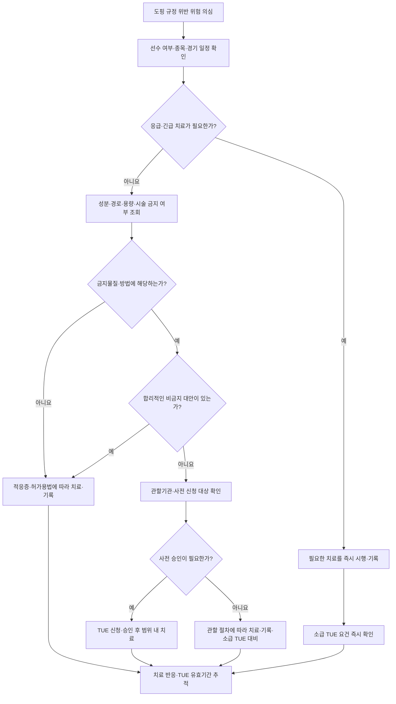

# 도핑 방지 가이드 Doping Prevention Guide

## <mark style="color:green;">일반 사항</mark>

* 도핑(doping) : 금지물질·금지방법의 사용·사용 시도뿐 아니라 검체 채취 회피·거부, 소재지정보 위반, 검체 변조, 소지, 거래, 선수에게 투여, 공모·방조, 금지된 연계 및 신고자 보복 등 세계도핑방지규약(World Anti-Doping Code, WADC)이 정한 도핑방지규정위반 전반
* 근거 (한국도핑방지위원회, 2026 금지목록 국제표준) : 세계도핑방지기구(WADA)가 통상 시행 약 3개월 전(전년도 9월 말경) 공표하고 매년 1월 1일부터 시행하는 «금지목록 국제표준(Prohibited List)»이 근간이며, 국내에서는 한국도핑방지위원회(KADA)가 이를 반영하여 적용하며, 선수의 관할 국제연맹·국내 경기단체 및 프로스포츠 규정도 확인
* 적용 연도 : 2026 금지목록 국제표준(2026. 1. 1. 시행) — 금지목록·모니터링 프로그램·허용용량은 매년 변경될 수 있으므로 **매년 1월과 처방 시점에 최신 자료를 다시 확인**. 국내 허가·급여 여부와 도핑 규정상 허용 여부는 별개이므로 **처방 시 최신 품목정보/급여기준 조회**도 함께 시행
* 분류 : 시기·상황에 따라 상시 금지(all-time), 경기기간 중 추가 금지(in-competition), 특정 경기 금지(particular sports)로 구분
* 대상 : 소속 경기단체 또는 도핑방지기구의 규정 적용을 받는 선수는 경기 수준과 무관하게 검사 대상이 될 수 있음. 등록검사대상자명부(RTP)는 소재지정보 제출 등 추가 의무가 있는 일부 선수군으로, 검사 대상 전체와 같은 개념이 아님

### <mark style="color:$primary;">엄격책임 원칙 (Strict Liability)</mark>

* 선수는 자신의 체내에서 검출된 금지물질에 대해 고의성·과실 여부와 무관하게 책임을 짐(세계도핑방지규약 제2.1조)
* 처방 의사나 약사의 부주의한 처방·조제로 인한 양성 반응도 선수 본인의 제재로 이어질 수 있음 → 1차 진료의의 확인 의무가 실질적으로 중요
* 의사도 선수지원인력(Athlete Support Personnel)으로서 부당한 금지물질·금지방법의 투여, 공모·방조 등에 관여하면 별도의 도핑방지규정위반 책임이 생길 수 있음. 다만 규약상 «투여»의 정의는 선의의 의료진이 정당하고 적법한 치료 목적으로 시행한 행위를 제외하며, 선수에게 필요한 TUE·기록 의무는 별도로 확인
* 처방 전 반드시 <mark style="color:blue;">\[한국도핑방지위원회 금지약물검색]</mark> 등 공식 도구로 확인함(☞ 문서 하단 링크)


**2026년도 금지목록 국제표준 주요 변경사항** (2026. 1. 1. 시행, 한국도핑방지위원회 공지 기준)\
① S3(베타-2 작용제) — salmeterol 흡입 시 예외적 허용 기준 변경 : 24시간 총 허용량(200 ㎍)은 유지되나, 8시간 이내 100 ㎍ 초과 흡입 금지로 세분화\
② M1.4(신설) — 진단 목적 외 CO 전달을 위한 재호흡 시스템·장비 사용 금지(적혈구생성 촉진 우려). 의료·과학 전문가 감독하의 진단 절차는 예외\
③ M3(유전자 및 세포 도핑) — 미토콘드리아·리보솜 등 세포 소기관("세포 구성요소") 사용까지 금지 범위 확대\
④ M1 — 혈액·혈액성분 채취는 원칙적으로 금지하되 의학검사·도핑검사 등 분석 목적 및 관련 규제기관이 인정한 채혈기관에서의 헌혈은 예외임을 명확화(PRP 및 관련 시술 자체는 금지되지 않음)\
⑤ S1·S2·S4·S6 — 선수와 관계자의 식별을 돕기 위한 예시 물질 다수 추가(신규 금지물질 지정이 아니라 기존 금지 범주에 대한 예시 보강)



**2027년 시행 예정 자료 — 2026년 기준과 구분** : WADA는 2026년 9월 21일 2027 금지목록과 변경 설명서를 공표했으며 **2027년 1월 1일부터 시행**함. S5의 eplerenone·finerenone, S4의 imlunestrant·seladelpar 등을 예시로 추가하고, 미승인 펩티드의 S0 해당 가능성을 명확히 함. 예시 추가가 곧 그 전까지 허용되었다는 뜻은 아님. S8의 카나비노이드 분류 설명을 보완하고 CBD 자체의 비금지를 유지하며, S9에는 질내 투여를 허용 경로로 명시함. 2027 모니터링 프로그램에서 codeine·hydrocodone·dermorphin 및 유사체와 경기기간 외 fentanyl·tramadol은 제외되지만, **fentanyl·tramadol의 경기기간 중 금지는 유지**됨. 2027년 진료·경기에는 금지목록뿐 아니라 새 규약·ISTUE도 해당 시행본으로 다시 확인함.


***

### <mark style="color:$primary;">금지 약물 및 방법 분류 체계</mark>

### <mark style="color:orange;">상시 금지 약물 및 방법 (경기기간 내·외 모두 적용)</mark>

<table><thead><tr><th width="70">코드</th><th width="230">계열</th><th>대표 예시 / 비고</th></tr></thead><tbody><tr><td>S0</td><td>비승인 약물</td><td>다른 금지목록 항목에서 다루지 않는 약리물질 중, 어느 정부 보건당국에서도 현재 인체 치료용으로 승인하지 않은 물질(개발·임상시험 단계 약물, 승인 중단 약물, 디자이너 약물, 동물용으로만 승인된 약물 등). 국내 미허가 또는 허가 외 사용이라는 이유만으로 자동으로 S0에 해당하지는 않으며 다른 범주의 금지 여부도 확인</td></tr><tr><td>S1</td><td>동화작용제</td><td>anabolic-androgenic steroid(AAS) 및 그 에스테르, tibolone, clenbuterol 등 기타 동화작용제 — 2026년에는 금지 스테로이드의 에스테르(예: testosterone cypionate/propionate)도 기존 금지 범위에 포함됨을 명확화</td></tr><tr><td>S2</td><td>펩티드 호르몬, 성장인자 및 관련 약물</td><td>erythropoietin-receptor agonist(EPO 등), growth hormone(hGH), IGF-1 및 유사체·방출인자 등</td></tr><tr><td>S3</td><td>β-2 작용제</td><td>원칙적으로 금지. 흡입용 salbutamol·formoterol·salmeterol·vilanterol만 정해진 용량 이내에서 예외적으로 허용(☞ 아래 용량표); 경구·주사 경로 및 별도 허용량이 없는 β-2 작용제는 금지</td></tr><tr><td>S4</td><td>호르몬 및 대사 변조제</td><td>aromatase inhibitor, SERM, myostatin 억제제, insulin·insulin mimetic, AMPK 활성제, PPARδ 작용제, meldonium, trimetazidine 등 — 당뇨병 선수의 insulin 치료는 대표적인 TUE 검토 상황</td></tr><tr><td>S5</td><td>이뇨제 및 기타 은폐제</td><td>thiazide, furosemide, spironolactone, acetazolamide, probenecid, desmopressin, vaptan류 및 정맥투여 혈장증량제(albumin, dextran, hydroxyethyl starch, mannitol) 등. 다만 drospirenone·pamabrom, 안과용 탄산탈수효소억제제 및 치과 국소마취의 felypressin은 금지되지 않음. 치료 목적 사용 시 TUE 필요성을 확인</td></tr><tr><td>M1</td><td>혈액 및 혈액성분의 조작</td><td>자가·동종·이종 혈액 또는 적혈구 제제의 투여·재투여, 산소 섭취·운반·전달의 인위적 향상 및 혈액·혈액성분의 혈관 내 조작. 혈액·혈액성분 채취도 원칙적으로 금지하되 분석 목적 또는 공인 채혈기관에서의 헌혈은 예외</td></tr><tr><td>M1.4 (신설, 2026)</td><td>일산화탄소(CO)의 비진단적 사용</td><td>폐확산능·총 헤모글로빈량 측정 등 의료·과학 전문가 감독하의 진단 절차가 아닌 CO 재호흡 시스템·장비의 사용 금지</td></tr><tr><td>M2</td><td>화학적·물리적 조작</td><td>M2.1 검체 변조·변조 시도. M2.2 12시간 동안 총 100 ㎖를 초과하는 정맥주입·주사 금지 — 병원 치료, 수술 또는 임상적 진단검사 과정에서 정당하게 시행된 경우는 예외</td></tr><tr><td>M3</td><td>유전자 및 세포 도핑</td><td>경기력을 향상시키거나 향상시킬 잠재력이 있는 유전자 편집·유전자 발현 조절, 정상·유전자변형 세포 또는 세포 구성요소(핵, 미토콘드리아, 리보솜 등)의 사용</td></tr></tbody></table>

### <mark style="color:orange;">경기기간 중 추가 금지 약물</mark>

상시 금지 목록(S0~S5, M1~M3)에 아래가 추가됨.

<table><thead><tr><th width="70">코드</th><th width="230">계열</th><th>대표 예시 / 비고</th></tr></thead><tbody><tr><td>S6</td><td>흥분제</td><td>amphetamine, methylphenidate 등. 요중 기준은 cathine 5 ㎍/㎖, ephedrine·methylephedrine 각각 10 ㎍/㎖, pseudoephedrine 150 ㎍/㎖ 초과. Epinephrine은 비강·안과 등 국소 투여 또는 국소마취제와의 병용 시 금지되지 않음. 근육·정맥 투여는 경기기간 중 금지에 해당하나 아나필락시스에서는 즉시 치료하고 소급 TUE 절차 확인</td></tr><tr><td>S7</td><td>마약류</td><td>buprenorphine, fentanyl 및 유도체, morphine, oxycodone, methadone, tramadol 등. Codeine·dihydrocodeine·hydrocodone·tapentadol 등 일부 비금지 성분은 2026 모니터링 대상이며, dextromethorphan은 금지목록에 포함되지 않음</td></tr><tr><td>S8</td><td>카나비노이드류</td><td>천연·합성 카나비노이드는 경기기간 중 금지하며, THC 관련 요검사는 WADA 기술문서의 역치·판정기준에 따라 해석. CBD 자체는 금지되지 않지만 CBD 제품에 THC·다른 카나비노이드가 혼입될 수 있어 제품 사용의 안전을 보장하지 않음</td></tr><tr><td>S9</td><td>glucocorticoid</td><td>경기기간 중 경구(구강점막·협점막·치은·설하 포함), 직장 및 모든 주사 경로(정맥·근육·피하·관절강내·건주위·경막외 등) 금지. 허가용량·치료 적응증 내 흡입, 비강, 점안, 귀, 피부, 항문주위 및 치아 근관 내 투여는 금지되지 않음</td></tr></tbody></table>

* **2026 모니터링 프로그램 예시** : bupropion, caffeine, nicotine, phenylephrine, phenylpropanolamine, pipradrol, synephrine 등은 금지물질이 아니며 사용 추세만 감시함. Codeine 등 일부 마약성 진통제, 경기기간 외 fentanyl·tramadol, ecdysterone, hypoxen, **18세 미만 여성에서의 GnRH 유사체**, semaglutide·tirzepatide 등도 포함됨. 모니터링 자체는 도핑방지규정위반이나 제재를 의미하지 않음. 다만 GnRH 및 그 작용제 유사체는 **남성에서는 S2 상시 금지**이므로 여성 모니터링 규정과 혼동하지 않음.

### <mark style="color:orange;">특정 경기에 대한 금지 약물</mark>

<table><thead><tr><th width="70">코드</th><th width="230">계열</th><th>대표 예시 / 비고</th></tr></thead><tbody><tr><td>P1</td><td>β-차단제류</td><td>atenolol, carvedilol, propranolol 등</td></tr></tbody></table>

* 경기기간 중 금지 : 자동차 경주, 당구 전 종목, 다트, 골프, 미니골프
* 경기기간 내·외 모두 금지 : 양궁, 사격, 수중 종목 중 프리다이빙·스피어피싱·표적사격 — **훈련 중 사용도 규정 위반이 될 수 있음**
* 2026 목록에서는 스키·스노보드가 P1 금지 종목에 포함되지 않음
* 경구·주사제뿐 아니라 녹내장 치료용 timolol 등 β-차단제 점안제도 P1에 해당할 수 있으므로 투여경로와 관계없이 확인
* 고혈압 등으로 β-차단제가 필요한 선수 환자는 반드시 종목을 확인하고, 필요시 ACE 억제제·ARB·칼슘차단제 등 대체 약물을 우선 고려

☞ [금지 약물 검색](https://www.kada-ad.or.kr/kada?where=drug/drug_search) — 처방 전 상품명 단위로 반드시 재확인(복합제·해외직구 제품은 특히 주의)

***

### 🚩 Red Flags

<mark style="color:$danger;">**즉각 조치**</mark>

* 아나필락시스 → **근육주사 epinephrine을 즉시 투여하고 응급 이송**. 경기기간 중 S6에 해당하더라도 치료를 지연하지 말고 진단·용량·경로·시간을 기록한 뒤 소급 TUE 절차 확인. Glucocorticoid는 epinephrine을 대체하는 1차 치료제가 아님  <mark style="color:$danger;">[즉각 조치]</mark>
* 중증 천식 악화 등에서 경구·직장·주사 glucocorticoid 또는 허용량을 초과하는 β-2 작용제가 필요한 경우 → **필요한 치료를 우선 시행**하고 소급 TUE 요건을 KADA·관할 연맹에 즉시 확인  <mark style="color:$danger;">[즉각 조치]</mark>
* 경기기간 중 morphine·oxycodone·tramadol·fentanyl 등 S7 약물이 불가피한 급성 중증 통증(골절, 수술 후 등) → 필요한 진통을 우선 제공하고 기록한 뒤 소급 TUE 대상 여부를 즉시 확인  <mark style="color:$danger;">[즉각 조치]</mark>
* Insulin 누락에 따른 케톤산증 위험, 중추성 요붕증에서 desmopressin 중단에 따른 중증 탈수 등 필수 치료의 지연이 위험한 경우 → 치료를 우선하고 진단·투여기록 및 소급 TUE 요건을 확인함  <mark style="color:$danger;">[즉각 조치]</mark>

<mark style="color:$warning;">**당일~수일 내 평가**</mark>

* S1·S2·S4·S5 등 상시 금지 약물 또는 금지방법 사용이 예견되는 만성질환(당뇨병으로 insulin 필요, 천식으로 경구 스테로이드 반복 필요, P1 종목 선수의 부정맥으로 β-차단제 필요, 신질환·심부전으로 이뇨제 필요 등) → **사전 TUE** 신청 절차 조기 안내  <mark style="color:$warning;">[당일~수일 내 평가]</mark>
* 관절강내 스테로이드 주사 등 시술적 처치가 필요하나 경기 일정이 임박한 경우 → 성분·경로별 휴약기간 확인, 시기 조정 및 TUE 상담  <mark style="color:$warning;">[당일~수일 내 평가]</mark>
* 선수 여부가 불명확하나 국가대표·실업팀·학교 운동부 소속이 의심되는 환자 → 진료 시작 시 확인 질문 추가  <mark style="color:$warning;">[당일~수일 내 평가]</mark>

<mark style="color:$info;">**조기 평가 및 추적**</mark>

* 경기기간 외 glucocorticoid를 사용한 뒤 경기 일정이 다가오는 경우 → 성분·경로별 휴약기간과 서방형 여부를 확인하고 진단·대체 치료 검토·성분·용량·경로·투여시각 기록 보관  <mark style="color:$info;">[조기 평가 및 추적]</mark>
* 감기약·건강기능식품·해외직구 보충제 등 비처방 물질 복용 이력이 있는 선수 → 성분 확인 및 기록 습관화 교육  <mark style="color:$info;">[조기 평가 및 추적]</mark>
* TUE 신청서·진료 기록 보관 여부 확인(사후 이의 제기 시 근거 자료로 필요)  <mark style="color:$info;">[조기 평가 및 추적]</mark>

***

## <mark style="color:green;">진단 및 처방 전 평가</mark>

1. **선수 여부 확인** : 국가대표·실업팀·학교운동부 소속, 국제·국내 경기연맹 등록 여부, KADA 등록검사대상자명부(RTP) 포함 여부, 프로스포츠 여부와 적용 규정을 문진에 포함
2. **경기기간 여부 확인** : 세계도핑방지규약상 경기기간은 원칙적으로 "선수가 참가할 경기 전날 23:59부터 해당 경기 및 관련 검체 채취 절차 종료 시까지". 다만 특정 종목은 WADA가 승인한 별도 정의가 적용될 수 있으므로 소속 국제·국내경기연맹의 최신 규정 확인
3. **처방 예정 약물·시술의 금지 여부 확인** : 성분명·상품명 단위로 [금지 약물 검색](https://www.kada-ad.or.kr/kada?where=drug/drug_search) 조회(복합제는 성분별로 개별 확인). 조회일·적용 연도·투여경로·용량·빈도와 확인 결과를 기록. 검색 결과나 FAQ가 해당 연도 시행 목록과 다르거나 불명확하면 최신 시행본을 대조하고 관할 도핑방지기구에 확인
4. **대체 약물 검토** : 동일 적응증에 대해 금지되지 않은 대안이 있는지 우선 검토(☞ 아래 «약물 치료» 참고)
5. **대체 불가 시 TUE 필요성 판단** : 사전 신청을 원칙으로 하되, 응급·긴급 치료 등 소급 신청 요건에 해당하는지 관할기관에 확인

***



***

## <mark style="background-color:$warning;">Management</mark>


**1차 진료 상황별 접근 원칙**


<table><thead><tr><th width="90">단계</th><th>핵심 접근</th><th>비고</th></tr></thead><tbody><tr><td>Step 1</td><td>선수 여부·경기기간 확인</td><td>문진 습관화, WADA 승인 종목별 예외 확인</td></tr><tr><td>Step 2</td><td>예정 처방·시술의 금지 여부 확인</td><td>성분·상품명·경로·용량별 금지약물검색</td></tr><tr><td>Step 3</td><td>비금지 대체 약물·시술 우선 선택</td><td>아래 «약물 치료» 참고</td></tr><tr><td>Step 4</td><td>대체 불가 시 TUE 절차 안내</td><td>사전 신청 원칙, 응급치료 후 소급 가능성 확인</td></tr><tr><td>Step 5</td><td>진단·대체 치료 검토·처방·투약 기록 보관</td><td>소급 TUE 및 결과관리 대비</td></tr></tbody></table>

***

### <mark style="color:orange;">치료목적사용면책(TUE)</mark>

* 정의 : 선수가 진단된 질환의 치료를 위해 금지물질·금지방법 사용이 불가피할 때, 소정 절차를 거쳐 예외적으로 사용을 인정받는 제도(세계도핑방지기구 치료목적사용면책 국제표준, ISTUE)
* 통상 승인 요건(ISTUE 2023 제4.2조, 4가지 모두 충족) : ① 관련 임상 근거로 뒷받침되는 진단된 질환의 치료에 해당 물질·방법이 필요함 ② 정상 건강상태로 회복되는 수준을 넘어서는 부가적 경기력 향상을 초래하지 않음 ③ 해당 질환에 적응되는 치료이며 합리적인 비금지 치료 대안이 없음 ④ 치료 필요성이, 당시 금지된 물질·방법을 TUE 없이 과거 사용한 결과로 전부 또는 일부 발생한 것이 아님
* «치료하지 않으면 중대한 건강 손상이 발생해야 함»은 현행 제4.2조의 필수 문구가 아님. 대체 치료를 모두 시도하여 실패해야만 신청할 수 있는 것도 아니며, 선택한 치료가 적절한 이유를 의학적으로 설명함. 필요한 진단검사를 위해 금지물질·방법을 사용하는 경우에도 TUE 검토가 필요할 수 있음

#### <mark style="color:$primary;">신청 유형</mark>

* **사전 TUE** : 사전 신청 대상 선수의 계획된 사용은 금지되는 투여 전에 신청·승인받는 것이 원칙. ISTUE 2023 제6.1조에 따라 경기기간 중에만 금지되는 물질은 원칙적으로 다음 경기 최소 30일 전까지 신청하고, 상시 금지물질·방법은 치료 필요가 확인되는 즉시 신청. 응급·예외 상황은 소급 신청 요건을 별도로 확인
* **소급 TUE** : 금지물질·방법을 사용·소지한 뒤 신청하는 방식. 응급·긴급 치료, 사전에 신청할 충분한 시간·기회가 없었던 경우, 해당 선수 수준에서 사전 신청 의무가 없었던 경우, 경기기간 중에만 금지되는 물질을 경기기간 외에 치료 목적으로 사용한 경우(제4.1(e)조) 등 ISTUE가 정한 요건을 충족해야 함. 소급 신청 자격과 의학적 승인 요건 충족은 별개임
* 단순한 착오나 사전 신청 누락만으로는 소급 승인이 보장되지 않음. 응급치료는 TUE 결정을 기다리느라 지연하지 말고, 사용 직후 정확한 의무기록을 준비하여 KADA·관할 연맹에 즉시 확인함.
* **경기기간 외 glucocorticoid 투여** : 휴약기간을 확보하지 못했어도 자동으로 사전 TUE를 신청해야 하는 것은 아님. 투여 당시 의무기록을 준비하고 관할기관 정책을 확인하며, 경기기간 중 검사에서 비정상분석결과(AAF)가 보고되면 소급 TUE 신청. 휴약기간을 확보한 경우에도 기록 보관
* TUE 승인 후에는 승인된 물질·방법, 용량·빈도·경로·기간을 준수하고 변경·만료 시 갱신 필요성 확인. 처방전이나 진단서만으로 TUE가 성립하지 않음

#### <mark style="color:$primary;">국내 신청 절차</mark>

* 국내 관할 선수는 한국도핑방지위원회(KADA)의 «TUE 마법사» 등으로 사전 신청 대상과 제출기관을 확인
* 국제수준선수는 소속 국제연맹(IF)에 신청해야 할 수 있으며, 국내에서 승인된 TUE도 국제연맹·종합대회 주최기관의 별도 인정이 필요한지 확인
* 처방 의사는 진단명, 검사 소견, 치료 필요성, 대체 치료 검토 내역을 포함한 소견서 작성에 협조


**주의** : TUE의 의학적 승인 기준은 ISTUE에 따라 공통으로 적용되지만 신청기관, 사전 신청 의무가 적용되는 선수 수준, 유효기간 및 국제대회 인정 절차는 관할 경기단체에 따라 달라질 수 있음. 최신 요건은 KADA와 관할 국제·국내경기연맹에서 확인함.


***

## <mark style="color:green;">비-약물 치료 및 예방</mark>

* 처방약·일반약·한약·건강기능식품·보충제의 전체 사용 목록을 확인하고, 복합제는 성분별로 조회함.
* 제품명·제조번호·처방전·투여기록과 금지약물 조회일·결과를 보관함. 도핑검사 시 최근 사용 약물과 보충제를 신고하되, 신고 자체가 TUE를 대신하지는 않음.
* 보충제의 제3자 배치검사도 오염 위험을 완전히 없애지 못함. WADA·KADA가 모든 보충제의 안전을 승인·보증하는 제도로 오해하지 않도록 설명함. KADA 검색 결과가 없다는 이유만으로 사용 가능하다고 판단하지 않음.

***

## <mark style="color:green;">약물 치료 — 1차 진료 상황별 안전 처방 전략</mark>


**⚠️ 관절강내·근육내 글루코코르티코이드 주사, 경기기간 중 금지 — 유효한 TUE가 있으면 승인 범위 내 사용 가능**\
2022년 개정 이후 경구·직장뿐 아니라 관절강내(intra-articular)·건주위(peritendinous)·경막외(epidural) 등 **모든 주사 경로**의 글루코코르티코이드가 경기기간 중 금지됨. 경기기간 외 투여라도 경기기간 중 검출될 수 있으므로 단순히 경기 전날만 피해서는 안 되며, 아래 성분·경로별 휴약기간을 확인해야 함. 경기기간 중 투여가 계획되면 사전 TUE를 원칙으로 하고, 응급치료는 TUE 때문에 지연하지 않음.


### <mark style="color:orange;">Glucocorticoid</mark>

#### <mark style="color:$primary;">Glucocorticoid 투여경로별 경기기간 중 상태</mark>

<table><thead><tr><th width="160">경기기간 중 상태</th><th>투여경로</th></tr></thead><tbody><tr><td><mark style="color:red;">금지</mark></td><td>경구·구강점막·협점막·치은·설하, 직장, 모든 주사 경로(정맥·근육·피하·관절강내·관절주위·건주위·경막외 등)</td></tr><tr><td>금지되지 않음</td><td>흡입, 비강, 점안, 귀, 피부, 항문주위, 치아 근관 내 투여 — 제조사의 허가용량과 치료 적응증 내에서 사용. 구강 궤양에 바르는 구강점막·치은용 제제는 치아 근관 내 투여와 다르며 경기기간 중 금지 경로에 해당</td></tr></tbody></table>

#### <mark style="color:$primary;">WADA glucocorticoid 휴약기간</mark>

<table><thead><tr><th width="150">경로</th><th>성분</th><th width="100">휴약기간</th></tr></thead><tbody><tr><td>경구(구강점막·협점막·치은·설하 포함)</td><td>아래 예외 성분을 제외한 glucocorticoid</td><td>3일</td></tr><tr><td>경구</td><td>Triamcinolone, triamcinolone acetonide</td><td>10일</td></tr><tr><td>근육주사</td><td>Betamethasone, dexamethasone, methylprednisolone</td><td>5일</td></tr><tr><td>근육주사</td><td>Prednisolone, prednisone</td><td>10일</td></tr><tr><td>근육주사</td><td>Triamcinolone acetonide</td><td><mark style="color:red;">60일</mark></td></tr><tr><td>국소주사(관절강내·관절주위·건주위·건내 등)</td><td>아래 예외 성분을 제외한 glucocorticoid</td><td>3일</td></tr><tr><td>국소주사</td><td>Prednisolone, prednisone, triamcinolone acetonide, triamcinolone hexacetonide</td><td>10일</td></tr><tr><td>직장</td><td>아래 예외 성분을 제외한 glucocorticoid</td><td>3일</td></tr><tr><td>직장</td><td>Triamcinolone diacetate, triamcinolone acetonide</td><td>10일</td></tr></tbody></table>


**휴약기간 계산과 한계** : 마지막 투여 시점부터 **경기기간 시작 시점**까지 계산함. 위 표는 제조사의 최대 허가용량 내 사용을 바탕으로 한 최소 권고기간으로, 음성 결과를 보장하지 않음. 고용량·반복투여·서방형 제제에서는 더 오래 검출될 수 있음. 정맥·피하·경막외 등 표에 별도 기간이 없는 경로에는 국소주사 3일을 일률적으로 적용하지 말고 관할 도핑방지기구에 확인. 성분·제형·용량·경로·주사 부위와 투여시각을 상세히 기록함. 표에 제시된 주사 경로는 도핑 규정의 분류이며, 건내 주사 등을 임상적으로 권장한다는 의미가 아님.


### <mark style="color:orange;">감기·상기도 감염 (비충혈·기침)</mark>

<table><thead><tr><th width="170">상황</th><th width="240">주의·금지 약물</th><th>대안</th></tr></thead><tbody><tr><td>비충혈</td><td>Pseudoephedrine·ephedrine은 경기기간 중 요중 기준 적용(S6). Pseudoephedrine은 경기기간 시작 최소 24시간 전 중단 권고</td><td>생리식염수 비강세척·분무, 단기간의 oxymetazoline 등 국소 비충혈제. 경구 phenylephrine은 금지물질은 아니지만 비충혈 개선 효과가 불확실하여 일률적 대체약으로 권하지 않음</td></tr><tr><td>기침·진해</td><td>Codeine은 WADA 금지목록에는 없지만 2026 모니터링 대상이며, 진정·반응속도 저하와 morphine 대사를 고려하여 사용기록 보관. Dihydrocodeine 자체가 비금지여도 복합제에 dl-methylephedrine 등이 들어 있으면 S6 요중 기준이 따로 적용되므로 전체 성분 확인. Tramadol 등 S7 성분은 경기기간 중 금지</td><td>Dextromethorphan(비금지)</td></tr><tr><td>발열·통증</td><td>—</td><td>Acetaminophen, NSAIDs(비금지; 제품별 금기 확인)</td></tr></tbody></table>


Pseudoephedrine의 24시간은 **경기 시작**이 아니라 통상 경기 전날 23:59인 **경기기간 시작**을 기준으로 함. 고용량·반복복용과 개인차가 있어 중단이 요중 기준 이하를 보장하지 않으며, 계속 치료해야 하면 허용 대안 또는 TUE 필요성을 확인함.


### <mark style="color:orange;">알레르기비염·결막염</mark>

* 대부분의 경구·비강·점안 항히스타민제는 금지 목록에 해당하지 않음(cetirizine, loratadine, fexofenadine 등 통상 사용 가능)
* 비강용 glucocorticoid(fluticasone, mometasone 등)는 허가용량·치료 적응증 내 비강 경로로 사용하면 금지되지 않음

### <mark style="color:orange;">천식·기관지 경련</mark>

* **진단·TUE 자료** : 호흡곤란·기침 등 증상만으로 천식을 확정하지 않으며, 폐기능검사에서 가변적 기류제한·기관지확장제 반응 또는 적절한 기관지유발검사의 객관적 자료를 확보함. 금지 흡입 β-2 작용제나 경기기간 중 전신 glucocorticoid의 TUE가 필요하면 호흡기 전문 평가·검사자료와 악화 당시 소견을 준비하되, 응급치료를 검사 때문에 지연하지 않음. 흡기 시 소음·운동 중 목 조임 등이 주되면 운동유발 후두폐쇄 등 감별을 고려함.

<table><thead><tr><th width="170">흡입 β-2 작용제</th><th>2026년 TUE 없이 허용되는 최대 용량</th></tr></thead><tbody><tr><td>Salbutamol</td><td>24시간 1,600 ㎍ 이하, 임의의 8시간 동안 600 ㎍ 이하</td></tr><tr><td>Formoterol</td><td><strong>전달용량</strong> 기준 24시간 54 ㎍ 이하, 임의의 12시간 동안 36 ㎍ 이하</td></tr><tr><td>Salmeterol</td><td>24시간 200 ㎍ 이하, 임의의 8시간 동안 100 ㎍ 이하(8시간 제한은 2026년 변경)</td></tr><tr><td>Vilanterol</td><td>24시간 25 ㎍ 이하</td></tr></tbody></table>

* 위 네 성분도 흡입 경로와 허용용량을 모두 충족해야 하며, arformoterol·levosalbutamol(levalbuterol)·terbutaline·procaterol·tulobuterol(경피 패취 포함)·indacaterol·olodaterol·fenoterol 등은 별도의 허용 흡입용량이 없어 상시 금지
* 요중 salbutamol **1,000 ng/㎖ 초과** 또는 formoterol **40 ng/㎖ 초과**는 원칙적으로 AAF에 해당. 허용 흡입용량을 지켰다는 사실만으로 자동 면책되지 않으며, 필요시 통제된 약동학시험으로 치료용 흡입에 따른 결과임을 입증해야 함
* **S5 병용 규칙** : 이뇨제·은폐제와 함께 salbutamol·formoterol이 검출되면 농도와 무관하게 각각의 TUE가 필요함(점안용 탄산탈수효소억제제 및 치과 국소마취용 felypressin은 예외). 이 특별 규칙은 cathine·ephedrine·methylephedrine·pseudoephedrine에도 적용되며, salmeterol·vilanterol에는 같은 역치물질 병용 규칙을 일률적으로 적용하지 않음
* 분무기(nebulizer)는 통상 투여량이 허용 상한을 넘기기 쉬워 제품·투여량별 확인 및 TUE 검토 필요. 위 도핑상 상한은 치료 목표용량이나 모든 천식 환자에게 권장되는 일일용량이 아님
* **천식 치료계획과 도핑상 상한을 구분** : GINA 2026은 성인·청소년에서 저용량 ICS-formoterol을 증상완화제로 사용하는 Track 1(AIR-only 또는 단계에 따른 MART)을 우선 권고함. 유지 흡입제와 별도 SABA를 사용하는 대안도 환자 상태에 따라 선택할 수 있으나, SABA 단독치료는 피함. ICS는 허가용량·치료 적응증 내 흡입 시 금지되지 않음.
* **MART 합산 예시** : formoterol 전달용량이 1흡입당 4.5 ㎍인 제형은 유지·증상완화·운동 전 사용을 모두 합쳐 임의의 12시간 8흡입(36 ㎍), 24시간 12흡입(54 ㎍)이 도핑상 상한임. 이는 권장 복용량이 아니며, 제품별 허가상 1회·1일 제한과 재평가 기준을 함께 지킴. 다른 함량·흡입기에 같은 흡입 횟수를 적용하지 않음.
* 경구·주사용 β-2 작용제는 상시 금지. 경구·주사 glucocorticoid가 불가피한 급성 악화는 치료를 우선하고 소급 TUE 대상 여부를 확인

### <mark style="color:orange;">근골격계 통증·염증</mark>

<table><thead><tr><th width="170">상황</th><th width="220">주의·금지 약물</th><th>대안</th></tr></thead><tbody><tr><td>급성 염좌·건염</td><td>경구·모든 주사 경로 glucocorticoid — 경기기간 중 금지. 경기기간 전 주사도 성분·경로별 휴약기간 확인</td><td>NSAIDs, 국소(외용) NSAID 제형, 비마약성 국소마취제 주사(원칙적으로 허용)</td></tr><tr><td>급성 중증 통증</td><td>경기기간 중 S7 해당 마약성 진통제</td><td>가능하면 NSAIDs·acetaminophen 우선. 불가피하면 필요한 진통을 제공하고 기록한 뒤 소급 TUE 대상 여부 확인</td></tr></tbody></table>

### <mark style="color:orange;">Tramadol 등 마약성 진통제</mark>

* Tramadol은 국내 마약류 관리상 분류와 관계없이 WADA S7에 따라 **2024년부터 경기기간 중 금지**되며, acetaminophen 복합제도 동일하게 확인함.
* WADA가 제시한 tramadol 휴약기간은 마지막 투여부터 **경기기간 시작까지 24시간**임. 개인차·반복투여 등에 따라 검출 위험이 남을 수 있어 음성을 보장하지 않으며, 이 기간 안에 치료상 사용했다면 의무기록을 준비하고 소급 TUE 대상 여부를 확인함.
* WADA의 S7 목록은 국내 법률상 마약류 목록과 일치하지 않음. «비마약성 진통제»라는 국내 분류만으로 도핑상 허용된다고 판단하지 않음.

### <mark style="color:orange;">고혈압·부종</mark>

* thiazide, furosemide 등 이뇨제는 은폐제(S5)로 상시 금지 — 대체로 ACE 억제제, ARB, 칼슘차단제 우선 고려
* Eplerenone·finerenone은 2027 목록에 S5 예시로 추가되었으나, 예시 추가를 근거로 2026년 사용이 허용된다고 판단하지 말고 현행 S5 범주와 KADA에서 확인함.
* β-차단제는 전 종목에서 금지되는 것은 아니나 P1 해당 종목에서 제한됨. 양궁·사격 및 수중 종목 중 프리다이빙·스피어피싱·표적사격에서는 훈련기간을 포함해 상시 금지

### <mark style="color:orange;">ADHD·비만·내분비질환 등</mark>

<table><thead><tr><th width="170">상황</th><th>금지 여부와 진료 시 확인점</th></tr></thead><tbody><tr><td>ADHD·각성 관련 치료</td><td>Methylphenidate·amphetamine 계열, modafinil은 S6로 경기기간 중 금지. 진단·치료 필요성·대안 검토를 문서화하고 TUE 절차 확인. 임의로 약을 중단하지 않도록 설명</td></tr><tr><td>비만 치료</td><td>Phentermine·phendimetrazine은 S6로 경기기간 중 금지. Semaglutide·tirzepatide는 2026년 및 공표된 2027년 목록에서 금지물질이 아닌 모니터링 대상이며, 적응증·환자 안전성 판단은 별개</td></tr><tr><td>당뇨병</td><td>Insulin은 S4 상시 금지로 TUE 검토가 필요하나, 필수 치료를 중단하거나 지연하지 않음</td></tr><tr><td>성선기능저하증·호르몬 치료</td><td>Testosterone·DHEA는 S1 상시 금지이며 경구·주사·겔 등 제형만 바꾸어 피할 수 없음. 남성 성선기능저하증 TUE는 기질적 원인을 뒷받침하는 진단자료가 필요하며, 낮은 수치나 비특이 증상만으로 승인이 보장되지 않음</td></tr><tr><td>빈혈·신장질환</td><td>EPO 제제뿐 아니라 HIF 활성제(예: roxadustat·daprodustat)도 S2 상시 금지. 만성 치료가 필요한 선수는 사전 TUE와 갱신 절차 확인</td></tr></tbody></table>

### <mark style="color:orange;">불면·불안</mark>

* Zolpidem 등 수면제 및 대부분의 BZD 계열은 WADA 금지 목록에 포함되지 않음. 비금지라는 사실이 선수의 운전·경기 수행에 안전하다는 뜻은 아니므로 졸림·반응속도 저하·낙상·의존 위험과 다음 날 잔여효과를 평가하고, 종목별 별도 규정도 확인

***

## <mark style="color:green;">시술 및 기타 처치</mark>

* 관절강내·건주위·경막외 등 모든 glucocorticoid 주사는 **경기기간 중 금지**. 경기기간 전에 시행할 때도 성분·경로별 휴약기간을 경기기간 시작 시점부터 역산하고, 서방형 제제와 예상 밖 전신흡수 가능성을 고려
* 12시간 동안 총 100 ㎖를 초과하는 정맥주입·주사는 **M2.2**에 해당 — 병원 치료, 수술 또는 임상적 진단검사 과정에서 정당하게 시행된 경우만 예외이며, 단순 외래 영양수액이 의료기관에서 시행됐다는 이유만으로 자동 예외가 되지는 않음
* 비금지 성분인 비타민·생리식염수도 예외 상황 밖에서 12시간 합계 100 ㎖를 초과하면 금지방법에 해당. **100 ㎖ 이하이거나 병원 치료에 해당하더라도 금지성분 자체가 허용되는 것은 아님**. 의원·경기장 의무실·호텔 등에서 예외 요건 없이 100 ㎖ 초과 주입이 치료상 불가피하면 방법에 대한 TUE 요건 확인; 응급치료는 우선 시행. 의원에서 시행한 수술·임상 진단검사도 해당 예외가 성립할 수 있으므로 장소만으로 판단하지 않음
* 경구 수분 섭취가 가능한 운동 후 경도~중등도 탈수에서는 경구 수분·전해질 보충을 우선하고, 피로 회복 목적의 관행적 영양수액은 피함.
* 혈액·혈액성분 채취는 M1에 따라 원칙적으로 금지하되 의학검사·도핑검사 등 분석 목적 또는 공인 채혈기관에서의 헌혈은 예외. 수혈·자가혈 재투여 등은 반드시 사전 검토
* PRP·PRF의 국소 치료 및 이를 위한 채혈은 금지되지 않음. 별도 성장인자 추가, 금지약물 병용, 혈관 내 혈액 조작은 각각 따로 확인
* **혈액투석·수혈 등** : 의학적으로 필요한 혈액투석이나 혈액의 제거·조작·재주입을 포함하는 처치는 M1에 따른 TUE 검토가 필요함. 병원 치료라는 M2.2 수액 예외가 M1의 혈액 조작까지 자동으로 면제하지는 않음. EPO·수혈 등 병행 물질·방법도 각각 확인하고, 응급치료는 지연하지 않음.
* **CO를 이용한 진단검사** : 의료·과학 전문가 감독하의 정당한 진단 목적은 비금지이나, 진단을 가장한 반복 노출과 구별함. WADA FAQ는 총 헤모글로빈량 측정 등 CO 호흡 진단검사를 연속 2일 동안 2회 이내로 시행하고 감독·검사 내용을 기록하도록 안내함.

***

## <mark style="color:purple;">처방례</mark>

_✽아래는 성인 처방 예시임. 처방 시 최신 품목정보/급여기준 조회. 제품별 허가용법·제형, 신장·간기능, 병용약과 도핑 규정을 함께 확인함._

> **처방례 1. 경기기간 중 감기 증상 (비충혈)**
>
> ```
> 생리식염수 비강분무제  각 비강 1~2 puff  필요시
> 옥시메타졸린 0.05% 비강분무제 (예: 오트리빈에스비강분무액)
> 각 비강 1~2 puff  1일 1~2회  최소 8시간 간격  최대 3일
> ```
>
> _✽위 옥시메타졸린 용법은 해당 제품 기준이며 다른 제품에 일괄 적용하지 않음. 과용·장기 사용 시 반동성 비충혈에 주의하고, MAO 억제제 복용 중 또는 중단 후 2주 이내 등 제품별 금기·주의를 확인함. Pseudoephedrine은 경기기간 중 요중 기준이 적용되며 경기기간 시작 최소 24시간 전 중단을 권고하지만 음성을 보장하지 않음. 경구 phenylephrine은 금지물질은 아니나 비충혈 개선 효과가 불확실하여 일률적 대체약으로 사용하지 않음._

> **처방례 2. 알레르기비염 동반 선수**
>
> ```
> 세티리진 10 ㎎/T  1T  qd
> 모메타손 비강분무제 50 ㎍/분무 (예: 나조넥스나잘스프레이)  각 비강 2 puff  qd
> ```
>
> _✽경구 항히스타민제 및 허가용량·치료 적응증 내 비강용 glucocorticoid는 금지 목록에 해당하지 않음._

> **처방례 3. 무릎 통증(활막염), 관절강내 스테로이드 주사가 필요하나 경기가 임박한 경우**
>
> ```
> naproxen 250 ㎎/T  1T  bid  pc  필요시 단기간
> ```
>
> _✽국소 통증에는 경구 NSAID 대신 제품별 허가용법에 따른 외용 NSAID를 선택할 수 있음. 경구·외용 NSAID를 일률적으로 병용하지 않음. 관절강내 glucocorticoid 주사는 경기기간 중 금지됨. 경기기간 전 시행도 대부분 3일, prednisolone·prednisone·triamcinolone acetonide·hexacetonide는 10일의 휴약기간을 고려하며, 서방형 제제·전신흡수 가능성과 기록 보관에 유의함. 경기기간 중 시술이 필요하면 사전 TUE를 원칙으로 함._

> **처방례 4. 흡입 스테로이드 포함 유지치료와 증상완화제를 사용하는 천식 선수**
>
> ```
> 살부타몰 정량흡입기 100 ㎍/분무  필요시 1~2 puff (증상완화)
> 부데소니드/포르모테롤 160/4.5 ㎍ (심비코트터부헬러)  1회 1흡입  bid (유지치료)
> ```
>
> _✽유지치료와 증상완화제의 구성은 천식 조절 상태와 치료계획에 따라 선택하며, 이 예시는 ICS-LABA 유지치료와 별도 SABA를 사용하는 대안으로, 중증 급성 악화의 전체 처방이 아님. GINA 2026의 우선 접근인 ICS-formoterol AIR/MART도 국내 제형별 허가에 따라 고려함. 심비코트터부헬러160/4.5는 12세 이상 AIR/MART에 사용할 수 있으나, 심비코트라피헬러160/4.5를 같은 목적으로 대체하지 않음(유지요법 전용). 해당 터부헬러의 AIR/MART 허가용법은 증상 시 1흡입, 필요시 추가하되 1회 6흡입을 초과하지 않으며, 통상 1일 8흡입 이하이고 예외적으로 일시적 최대 12흡입임. 1일 8흡입 이상 필요하면 재평가하며, 도핑상 12시간 상한을 지켰다는 이유로 진료를 미루지 않음. 제품별 1회 흡입량·표시용량·전달용량과 모든 흡입기의 합산량을 확인하여 salbutamol·formoterol의 구간별 및 24시간 허용 상한을 관리함. 환자 안전을 위해 필요한 천식 치료를 제한해서는 안 되며, 허용량 초과 또는 경구·주사용 glucocorticoid가 불가피한 중증 악화는 치료를 우선하고 소급 TUE 대상 여부를 즉시 확인함._

> **처방례 5. 급성 중등도 통증, 마약성 진통제 회피가 필요한 경우**
>
> ```
> 아세트아미노펜 일반정 500 ㎎/T (예: 타이레놀정500밀리그람)  1~2T  q6h  필요시
> 이부프로펜 400 ㎎/T  1T  tid  pc
> ```
>
> _✽두 약물은 증상·금기·위험에 따라 선택 또는 병용하며, acetaminophen 함유 복합제와 중복 복용하지 않으며 1일 총 4 g을 넘기지 않음. 반복 복용 시 보수적으로 3 g/d 이하를 고려하고, 간경변에서는 2 g/d 이하 등 별도 용량을 검토하되 국내 해당 품목의 심한 간장애 등 금기에 해당하면 감량 투여로 대체하지 않음. 650 ㎎ 서방정을 사용할 때는 이 일반정 복용 간격을 적용하지 말고 해당 제품의 허가용법을 따름. NSAIDs·acetaminophen은 금지 목록에 해당하지 않아 우선 고려함. NSAID는 활동성 위장관 궤양·출혈, 중증 신장·심장질환, NSAID 과민반응 및 임신 등 금기·주의를 제품별로 확인하며, ibuprofen은 위장관 궤양·출혈 또는 그 병력 및 기관지천식 또는 그 병력 등 국내 허가 금기에 유의함. 통증 조절이 불충분하면 필요한 진통을 부당하게 제한하지 말고 S7 해당 여부를 확인하여 사용기록을 남긴 뒤, 경기기간 중 사용은 소급 TUE 대상 여부를 관할기관에 확인함._

***

## <mark style="color:red;">질병코드</mark>

* 도핑 방지 상담 전용 단일 코드는 별도로 제시하지 않음. 실제 진료에서는 치료 대상 기저질환과 진료 목적에 맞게 선택하며, 상담·검사 코드만으로 TUE나 급여 적정성이 인정되는 것은 아님.
* 저장된 **KCD9_251216(6).xlsx**의 «상병분류기호(완전코드)» 시트와 아래 코드·한영 명칭을 대조함. 원자료의 점 없는 코드를 통상 표기(Z718 → Z71.8 등)로 표시함.

<table><thead><tr><th width="85">코드</th><th>한글명 / 영문명</th><th>적용 시 주의점</th></tr></thead><tbody><tr><td>Z71.8</td><td>기타 명시된 상담을 위해 보건서비스와 접하고 있는 사람<br>Persons encountering health services for other specified counselling</td><td>질환 치료보다 도핑 관련 약물 사용 상담 자체가 방문 목적일 때 고려. 실제 상담 내용에 따라 선택</td></tr><tr><td>Z71.9</td><td>상세불명의 상담을 위해 보건서비스와 접하고 있는 사람<br>Persons encountering health services for counselling, unspecified</td><td>상담 내용이 특정되지 않은 경우. 도핑 상담 목적이 명확하면 Z71.8 적용 가능성을 우선 검토</td></tr><tr><td>Z02.5</td><td>운동경기 참가를 위한 검사<br>Examination for participation in sport</td><td>실제 참가 적격성 검사·검진을 시행한 경우. 단순 금지약물 상담이나 TUE 서류 작성에 자동 적용하지 않음</td></tr></tbody></table>

***

### <mark style="color:$success;">핵심 복약 지도</mark>

> **처방 전 확인 습관화**
>
> * 선수 환자에게는 처방·조제 전 반드시 [금지 약물 검색](https://www.kada-ad.or.kr/kada?where=drug/drug_search)으로 성분·상품명을 재확인하십시오.
> * 복합제는 개별 성분 단위로 확인해야 합니다(예: 종합감기약의 pseudoephedrine, 복합 진해제의 methylephedrine). Dihydrocodeine 자체가 비금지라는 이유로 복합제 전체가 허용되는 것은 아닙니다.

> **관절강내 스테로이드 주사 관련 안내**
>
> * 경기기간 중에는 모든 경로(관절강내·근육내·경막외 등)의 글루코코르티코이드 주사가 금지되며, 유효한 TUE가 있으면 승인 범위 안에서 사용 가능합니다.
> * 경기기간 전 시술도 성분·경로별 휴약기간을 확인하십시오. 특히 triamcinolone acetonide 근육주사는 60일이며, 휴약기간은 음성 결과를 보장하지 않습니다.
> * 경기기간 중 시술이 꼭 필요하면 사전 TUE를 원칙으로 하되, 응급치료는 지연하지 말고 이후 즉시 소급 TUE 대상 여부를 확인하십시오.

> **건강기능식품·해외직구 보충제 주의**
>
> * 국내외 보충제에는 표시되지 않은 sibutramine, 흥분제, 동화작용스테로이드 또는 SARM 등이 혼입된 사례가 보고되어 있어, 성분이 불명확한 제품은 권장하지 않습니다.
> * KADA 금지약물검색에서 검색되지 않았다는 사실은 보충제의 안전을 보증하지 않습니다. 제3자 배치검사 제품도 위험을 낮출 뿐 완전히 없애지는 못하므로 제품명·제조번호·영수증·포장사진을 보관하십시오.

> **언제 다시 병원을 방문해야 하나요?**
>
> * 처방받은 약물이 도핑검사에서 문제가 될 수 있다고 확인된 경우 — 즉시 내원하여 대체 처방 상담
> * 치료 목적으로 금지물질·금지방법 사용이 예정된 경우 — TUE 신청을 위해 사전 상담
> * 도핑검사 통보를 받았거나 양성 소견을 통보받은 경우 — 진료 기록·처방 내역 확인을 위해 즉시 내원

***

## <mark style="color:blue;">주요 참고문헌 및 확인 자료</mark>

### ＜임상 근거＞

* [GINA. Global Strategy for Asthma Management and Prevention, 2026](https://ginasthma.org/2026-gina-strategy-report/) — 성인·청소년 Track 1 및 ICS 포함 치료
* [ASCIA. Guidelines — Acute Management of Anaphylaxis, 2026](https://allergy.org.au/hp/anaphylaxis/acute-management-guidelines)

### ＜허가·급여 확인 자료＞

도핑 규정 확인 자료

* [WADA. 2027 Prohibited List 및 변경 설명서·모니터링 프로그램](https://www.wada-ama.org/en/resources/2027-prohibited-list) — 2027. 1. 1. 시행 예정
* [WADA. The 2026 Prohibited List](https://www.wada-ama.org/sites/default/files/2025-09/2026list_en_final_clean_september_2025.pdf) — 2026. 1. 1. 시행
* [WADA. Summary of Major Modifications and Explanatory Notes: 2026 Prohibited List](https://www.wada-ama.org/sites/default/files/2025-09/2026_list_explanatory_note_en_final_september_2025.pdf)
* [WADA. The 2026 Monitoring Program](https://www.wada-ama.org/sites/default/files/2025-09/2026_list_monitoring_program_en_final_clean_september_2025.pdf)
* [WADA. International Standard for Therapeutic Use Exemptions (ISTUE), 2023](https://www.wada-ama.org/sites/default/files/2022-09/international_standard_for_therapeutic_use_exemptions_istue_2023.pdf) — 제4.1·4.2·6.1조
* [WADA. Glucocorticoids and Therapeutic Use Exemptions, September 2025](https://www.wada-ama.org/sites/default/files/2025-09/glucocorticoids_and_therapeutic_use_exemptions_september_2025.pdf)
* [WADA. TUE Physician Guidelines: Asthma, Version 9.2, January 2025](https://www.wada-ama.org/sites/default/files/2025-01/tue_physician_guidelines_asthma_-_version_9.2_january_2025_-_final.pdf) — 진단자료·TUE 준비; 흡입 허용량은 2026 금지목록을 우선 적용
* [WADA. TUE Physician Guidelines: Intravenous infusions and/or injections, October 2023](https://www.wada-ama.org/sites/default/files/2023-10/tue_physician_guidelines_iv_infusion_october_2023.pdf)
* [WADA. The Prohibited List — Frequently asked questions](https://www.wada-ama.org/en/prohibited-list)
* [WADA. Tramadol Factsheet for Medical Professionals, 2023](https://www.wada-ama.org/sites/default/files/2023-12/Tramadol%20Factsheet%20for%20Medical%20Professionals_FINAL_2023_ENG.pdf) — 경기기간 중 금지·24시간 휴약 안내
* [WADA. Checklist for a TUE Application: Male Hypogonadism, Version 8.1, 2023](https://www.wada-ama.org/sites/default/files/2023-12/tue_checklist_male_hypogonadism_-_version_8.1-_october_2023.pdf)

☞ [한국도핑방지위원회-금지약물검색](https://www.kada-ad.or.kr/kada?where=drug/drug_search)\
☞ [한국도핑방지위원회-치료목적사용면책(TUE)](https://www.kada-ad.or.kr/) — «치료목적사용면책» 메뉴에서 최신 신청 대상·절차 확인

국내 품목정보·질병분류 확인 자료

* [식품의약품안전처. 의약품안전나라](https://nedrug.mfds.go.kr/) — 국내 제품별 허가사항 확인. 처방 시 최신 품목정보/급여기준 조회
* KCD9_251216(6).xlsx — 사용자 보유 KCD-9 원본, «상병분류기호(완전코드)» 시트; Z718·Z719·Z025 대조

_✽금지목록 적용 연도: 2026년. 검토일: 2026. 11. 3. 다음 연도 목록은 공표 시점과 시행일을 구분하여 적용함._

***

### <mark style="color:blue;">환자 안내서</mark>


**도핑, 나도 모르게 규정을 어길 수 있습니다**

도핑에는 정해진 금지물질·금지방법의 사용뿐 아니라 검사 거부·회피, 검체 조작 등 규정 위반도 포함됩니다. 감기약이나 건강기능식품처럼 흔히 쓰는 약에도 금지 성분이 들어 있을 수 있어, 선수라면 병원에서 처방을 받을 때마다 반드시 확인하는 습관이 필요합니다.


#### <mark style="color:$primary;">왜 조심해야 하나요?</mark>

* 선수는 자신의 몸에서 금지물질이 검출되면, 일부러 사용하지 않았더라도 책임을 질 수 있습니다("엄격책임 원칙").
* 감기약, 진통제, 관절 주사, 건강기능식품 등 일상적으로 쓰는 약에도 금지 성분이 포함될 수 있습니다.

#### <mark style="color:$primary;">일상생활에서 어떻게 관리하나요?</mark>

* **병원에 갈 때는 반드시 본인이 선수임을 먼저 알리십시오.** 의사가 처방 전에 금지 여부를 확인할 수 있습니다.
* **아무 감기약이나 임의로 사 먹지 마십시오.** 성분에 따라 금지물질(예: pseudoephedrine)이 포함된 경우가 있습니다.
* **해외직구 보충제, 다이어트·근육증가 보조제는 특히 주의하십시오.** 표시되지 않은 sibutramine, 흥분제, 동화작용스테로이드 또는 SARM 등이 섞인 사례가 보고되어 있습니다. 공식 의약품 검색에서 나오지 않는다고 안전한 것은 아닙니다.
* **치료 중인 필수 약물을 임의로 끊지 마십시오.** Insulin이나 심장·신장질환 약물을 도핑 때문에 스스로 중단하지 말고, 의사와 대체 치료 또는 TUE 절차를 상의하십시오.
* **관절 주사(스테로이드 주사) 등 시술 전에도 미리 알리십시오.** 경기기간 중에는 금지되고, 경기기간 전 주사도 약에 따라 휴약기간이 필요합니다.
* **모니터링 대상과 금지물질은 다릅니다.** Caffeine, nicotine, bupropion 등 일부 성분은 사용 추세를 감시하지만 현재 금지물질은 아닙니다. 다만 목록은 매년 달라질 수 있습니다.

#### <mark style="color:$primary;">치료가 꼭 필요한 경우는 어떻게 하나요?</mark>

* 질병 치료를 위해 금지물질·금지방법이 꼭 필요한 경우, "치료목적사용면책(TUE)"이라는 절차를 통해 예외적으로 사용을 인정받을 수 있습니다.
* 사전 신청 대상인 선수의 계획된 치료는 금지되는 사용 전에 신청·승인받는 것이 원칙입니다. 단순히 신청을 잊었다는 이유만으로 소급 승인이 보장되지 않습니다.
* 응급·긴급 상황에서는 TUE 때문에 치료를 미루지 마십시오. 먼저 필요한 치료를 받고 정확한 진료기록을 준비한 뒤, KADA 또는 관할 경기연맹에 소급 TUE 대상 여부를 즉시 확인하십시오.
* TUE의 의학적 승인 기준은 공통이지만 신청기관, 사전 신청 대상, 유효기간 및 국제대회 인정 절차는 선수 수준과 관할 경기단체에 따라 달라질 수 있습니다.

#### <mark style="color:$primary;">이럴 때는 즉시 병원이나 KADA에 문의하세요</mark>

* 이미 복용 중인 약이나 예정된 시술이 금지물질·금지방법에 해당하는지 확실하지 않은 경우
* 도핑검사 통보를 받았거나 검사 결과에 대해 궁금한 점이 있는 경우

***
