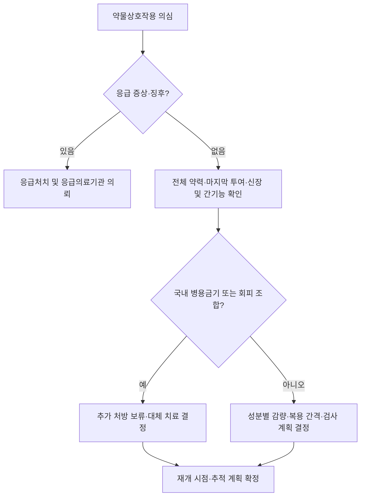

# 주요 약물상호작용 Major Drug Interactions

## <mark style="color:green;">일반 사항</mark>

* 이 챕터는 개별 약물군의 적응증·용량이 아니라, **여러 질환·약물 챕터를 가로지르는 고위험 상호작용**을 처방 시점에 빠르게 확인하기 위한 참조 목록임
* CYP3A는 임상에서 사용되는 다수 약물의 대사에 관여하며, 강력한 억제제 또는 유도제를 추가·중단할 때 임상적으로 중요한 상호작용이 발생할 수 있음
* 대사효소 억제는 기질 약물 또는 활성 대사체의 노출을 변화시켜 **독성을 증가**시키거나 **치료 효과를 감소**시킬 수 있음
  * 활성 대사체가 필요한 전구약물에서는 효소 억제로 오히려 효과가 감소할 수 있음 — CYP2D6 억제 → codeine·tramadol 진통 효과 감소, tamoxifen 활성화 감소; CYP2C19 억제 → clopidogrel 활성화 감소
* 제품명은 예시이며 함량·제형·유통 상태를 확인함. **처방 시 최신 품목정보/급여기준 조회**; 병용금기·회피·용량 조절·감시를 구분하고 국내 허가사항과 DUR을 함께 확인함
* 효소 유도는 투여 즉시가 아니라 수일에 걸쳐 발현하며, 유도제 중단 후에도 일정 기간 지속할 수 있으므로 **병용 시작뿐 아니라 중단 시에도** 기질 약물의 효과와 독성을 재평가해야 함


**이 챕터의 사용법**\
개별 약물군의 적응증·용량은 해당 챕터(국소 스테로이드, 항히스타민제, 항우울제·항불안제, 항응고제·항혈전제 등)를 참고. 이 챕터는 약물군을 가로지르는 고위험 조합을 빠르게 확인하는 용도이며, 완전한 상호작용 목록이 아님.


***

### <mark style="color:$danger;">🚩 Red Flags!</mark>

<mark style="color:$danger;">**즉각 조치**</mark>

* 중추신경억제제 병용 후 깨우기 어렵거나 느리고 얕은 호흡·청색증 → 호흡억제 의심; 기도·호흡 지원과 opioid 노출 시 naloxone 필요성 평가  <mark style="color:$danger;">[즉각 조치]</mark>
* 새 serotonergic 약물·증량 후 초조·혼돈, 발열, 발한, 떨림, 근간대성 경련·clonus 또는 과반사 → 세로토닌 독성 의심  <mark style="color:$danger;">[즉각 조치]</mark>
* QT 연장 약물 병용 중 실신·경련·지속되는 심계항진, 또는 서맥 유발 약물 병용 중 실신·저혈압 → 응급 ECG·전해질 평가  <mark style="color:$danger;">[즉각 조치]</mark>
* 항혈전제 병용 후 지속되는 출혈, 토혈·혈변·흑색변과 전신 증상 또는 새 신경학적 이상 → 중대한 출혈 평가  <mark style="color:$danger;">[즉각 조치]</mark>
* Colchicine·lithium 등 독성 위험 조합에서 반복 구토·설사와 심한 위약, 보행실조·혼돈·의식 변화 → 즉시 독성 평가  <mark style="color:$danger;">[즉각 조치]</mark>
* ACE 억제제·sacubitril/valsartan 관련 혀·입술·인후 부종, 호흡곤란 → 혈관부종 의심; 즉시 기도 평가  <mark style="color:$danger;">[즉각 조치]</mark>
* 새 약물 또는 valproate·lamotrigine 병용 후 발진과 점막 미란·수포·피부 박리·발열 → 중증 피부약물이상반응 의심; 의심 약물 투여를 보류하고 즉시 평가  <mark style="color:$danger;">[즉각 조치]</mark>
* 혈당강하제와 항감염제 병용 중 의식 저하·경련 → 중증 저혈당 평가·즉시 처치  <mark style="color:$danger;">[즉각 조치]</mark>
* PDE5 억제제 복용 후 흉통 → nitrate를 자가 복용하지 않도록 하고 즉시 응급평가; 마지막 복용 약물·용량·시각을 의료진에게 전달함  <mark style="color:$danger;">[즉각 조치]</mark>

<mark style="color:$warning;">**당일~수일 내 평가**</mark>

* Methotrexate·thiopurine 관련 고위험 병용 후 새 구강궤양·인후통·발열·이유 없는 멍·출혈 → 당일 CBC·신기능 등으로 골수억제 평가; 중증 감염·출혈 또는 전신상태 불량이면 즉시 의뢰  <mark style="color:$warning;">[당일~수일 내 평가]</mark>
* 새 고칼륨혈증, 소변량 감소, 심한 기립성 어지럼 또는 약물 추가 후 뚜렷한 진정·보행 불안정 → 당일 평가; 중증 고칼륨혈증·ECG 이상·실신·의식 변화가 있으면 즉각 조치  <mark style="color:$warning;">[당일~수일 내 평가]</mark>

<mark style="color:$info;">**조기 평가 및 추적**</mark>

* 무증상이라도 아래 고위험 조합이 확인되면 다음 복용·처방 전에 병용 회피·중단·감량 및 검사 계획을 결정함. 이미 복용 중인 필수약을 환자가 임의로 중단하도록 안내하지 않음  <mark style="color:$info;">[조기 평가 및 추적]</mark>

***

## <mark style="color:green;">상호작용 의심 시 평가 알고리듬</mark>

***

## <mark style="color:$warning;">Management</mark>

* 처방약·일반약·복합 감기약·건강기능식품·한약뿐 아니라 흡입제·점안제·비강제·주사제와 최근 중단 약물까지 확인함. 증상 발생 시각, 마지막 투여 시각, 신·간기능 및 탈수 여부를 기록함
* **효소 억제 강도와 개별 병용금기 분류는 동일하지 않음.** 예를 들어 fluconazole은 CYP3A 중등도 억제제이지만 domperidone과는 국내 DUR 병용금기임. 일반 분류표만으로 특정 조합의 안전성을 판단하지 않음
* 생명유지에 필요한 항응고제·항혈소판제·항발작약·면역억제제를 환자가 임의 중단하게 하지 않으며, 처방 의사가 대체 치료와 보류·감량·재개 시점을 함께 결정함

### <mark style="color:orange;">놓치면 위험한 주요 병용 조합</mark>

<table><thead><tr><th width="230">병용 조합</th><th width="200">주요 위험</th><th width="190">위험이 특히 큰 상황</th><th>권장 조치</th></tr></thead><tbody><tr><td>강력한 CYP3A 억제제 + simvastatin/lovastatin</td><td>횡문근융해증</td><td>고용량 스타틴, 신기능 저하, 고령</td><td>병용금기. 일시 중단 또는 대체를 결정함. 팍스로비드 처방 시 simvastatin/lovastatin은 시작 최소 12시간 전부터 투여 중 및 종료 후 5일까지 중단함. CYP3A 영향이 적은 스타틴도 수송체 상호작용을 확인; ritonavir 병용 시 rosuvastatin 노출도 증가할 수 있어 자동으로 안전한 대체제로 간주하지 않음</td></tr>
<tr><td>강력한 CYP3A 억제제 + ergotamine 계열</td><td>말초혈관 연축, 허혈</td><td>편두통 급성기 반복 사용</td><td>병용금기; CYP3A 억제 영향을 받지 않는 급성기 치료를 환자별 검토. Rimegepant 등 gepant도 강력한 CYP3A 억제제와 병용을 피해야 하므로 자동 대체하지 않음</td></tr>
<tr><td>강력한 CYP3A 억제제 또는 P-gp 억제제 + colchicine</td><td>colchicine 독성(골수억제, 다발장기부전)</td><td>신·간기능 저하</td><td>신장애 또는 간장애에서 해당 억제제 병용은 금기이며 단순 감량으로 해결하지 않음. 또한 clarithromycin·팍스로비드와 colchicine은 국내 DUR 병용금기이므로 신·간기능 정상만으로 허용하지 않음. 다른 억제제도 해당 국내 허가사항·DUR을 확인하고 회피를 우선 검토. 국외 colchicine 감량표를 국내 제품에 그대로 적용하지 않음</td></tr>
<tr><td>강력한 CYP3A/P-gp 억제제 또는 유도제 + DOAC</td><td>출혈 또는 혈전 위험 변화</td><td>신기능 저하, 고령</td><td>DOAC별 회피·금기·감량 기준 확인. Dabigatran·edoxaban은 P-gp, apixaban·rivaroxaban은 P-gp와 CYP3A 영향을 함께 평가; 임의 감량으로 유도제 병용을 보정하지 않음. 필요시 대체 항응고 전략을 전문진료와 결정</td></tr>
<tr><td>CYP3A 억제제·유도제 + DORA(suvorexant, lemborexant)/gepant</td><td>DORA: 과도한 진정/효과 감소; gepant: 노출 증가에 따른 이상반응/효과 감소</td><td>-</td><td>강력·중등도 억제제의 회피·감량 기준과 유도제 병용 기준은 성분별로 다름. Rimegepant와 atogepant에도 동일한 감량 규칙을 적용하지 않음. DORA 용량 기준은 해당 챕터 참조 (☞ <a href="029_-insomnia-sleep-disorder.md#orexin-수용체-길항제-dual-orexin-receptor-antagonist-dora">불면증</a>)</td></tr>
<tr><td>ciprofloxacin/fluvoxamine + tizanidine</td><td>저혈압, 과도한 진정</td><td>-</td><td>병용금기</td></tr>
<tr><td>clopidogrel + omeprazole/esomeprazole</td><td>clopidogrel 활성화 감소 → 항혈소판 효과 저하</td><td>관상동맥 스텐트 등 고위험군</td><td>Omeprazole·esomeprazole 병용은 피하고, PPI가 필요하면 pantoprazole·rabeprazole 등으로 대체 고려. 복용 시각을 나누는 것만으로 해결하지 않음; 위장관 보호 적응증이 있으면 PPI 자체를 일률적으로 중단하지 않음</td></tr>
<tr><td>강력한 CYP2D6 억제제(fluoxetine, paroxetine, bupropion) + codeine/tramadol/tamoxifen</td><td>활성 대사체 감소로 진통 효과 저하; tramadol 모약물 증가로 경련·세로토닌 독성 증가; tamoxifen 활성화 저하</td><td>유방암 치료 중(tamoxifen)</td><td>대체 약물 고려; tamoxifen 병용 시 paroxetine·fluoxetine 회피</td></tr>
<tr><td>lithium + thiazide/NSAID/ACE 억제제·ARB</td><td>리튬 독성(신배설 감소)</td><td>탈수, 신기능 저하</td><td>병용 시 리튬 농도·신기능 모니터링 강화</td></tr>
<tr><td>methotrexate + trimethoprim 또는 trimethoprim-sulfamethoxazole</td><td>골수억제 위험 증가</td><td>주 1회 저용량 MTX에서도 발생; 신기능 저하·고령·엽산 결핍에서 위험 증가</td><td>원칙적으로 회피하고 항균제 대체를 검토. 불가피하면 전문진료 협의, CBC·신기능 추적 및 골수억제 증상 교육; MTX 또는 항균제 중단 후에도 지연 독성 가능</td></tr>
<tr><td>Nitrate·NO 공여제(nicorandil 등) 또는 riociguat + PDE5 억제제(sildenafil 등)</td><td>중증 저혈압</td><td>-</td><td>병용금기</td></tr>
<tr><td>opioid + benzodiazepine/Z-drug/가바펜티노이드</td><td>호흡억제, 과도한 진정</td><td>고령, 호흡기질환, 다른 중추신경 억제제 병용</td><td>병용 최소화; 불가피 시 최소 유효용량·모니터링</td></tr>
<tr><td>QT 연장 약물의 중복</td><td>Torsades de pointes</td><td>저칼륨·저마그네슘혈증, 서맥, 구조적 심질환</td><td>중복 처방 회피; 전해질 교정, 필요시 ECG 확인</td></tr>
<tr><td>MAOI·linezolid·정맥 methylene blue + serotonergic 약물(SSRI/SNRI/tramadol 등)</td><td>세로토닌 증후군</td><td>-</td><td>통상 회피·금기 및 약물별 휴약기간 확인. Linezolid·정맥 methylene blue가 응급으로 필요하면 대체 가능성·감염 위험을 평가하고 serotonergic 약물 중단과 감시를 전문진료와 결정</td></tr>
<tr><td>ACE 억제제/ARB + 이뇨제 + NSAID (triple whammy)</td><td>급성 신손상</td><td>탈수, 고령, 기존 신기능 저하</td><td>가능한 한 회피; 불가피 시 체액 상태에 맞춘 탈수 예방과 creatinine·K 추적; 심부전·신부전 환자에게 일률적으로 음료량을 늘리지 않음</td></tr>
<tr><td>RAAS 억제제/MRA + 칼륨제제·칼륨 대체소금·trimethoprim</td><td>고칼륨혈증</td><td>신기능 저하</td><td>병용 시 혈중 K 모니터링</td></tr>
<tr><td>β차단제 + verapamil/diltiazem</td><td>서맥, 방실차단, 심부전 악화</td><td>기존 전도장애·심부전</td><td>서맥·전도장애 또는 HFrEF에서는 회피; 선택적 적응증으로 불가피하면 심장 전문진료와 ECG·심박수·혈압 추적</td></tr>
<tr><td>Warfarin + TMP-SMX·metronidazole·azole 항진균제 등</td><td>INR 상승·출혈; rifampicin 등 유도제는 INR 저하 가능</td><td>감염·섭취 저하·다약제</td><td>추가·중단 시 INR를 조기에 재확인하고 이후 안정될 때까지 추적; 조정 시점·용량은 환자별 결정</td></tr>
<tr><td>항응고제/항혈소판제 + NSAID, 또는 불필요한 항혈전제 중복</td><td>위장관·기타 출혈</td><td>고령, 궤양 병력, CKD</td><td>중복 적응증과 기간을 확인하고 NSAID 회피·대체; PPI가 모든 출혈 위험을 없애지는 않음</td></tr>
<tr><td>ACE 억제제 + sacubitril/valsartan</td><td>혈관부종</td><td>이전 ACE 억제제 관련 혈관부종</td><td>병용금기; 양방향 전환 시 최소 36시간 간격. Sacubitril/valsartan에는 ARB가 포함되므로 별도 ARB도 중복하지 않음</td></tr>
<tr><td>Cholinesterase 억제제(donepezil 등) + β차단제/verapamil·diltiazem/digoxin 등</td><td>서맥·방실차단·실신</td><td>고령, 기존 전도장애, 원인 불명 낙상·실신</td><td>일률적 병용금기로 취급하지 않고 적응증·기저 맥박·전도장애와 병용약을 검토. 시작·증량 시 맥박·증상을 추적하고 위험요인이나 증상이 있으면 ECG 확인; 실신·심한 서맥은 Red Flags에 따라 평가. 033·215장 참조</td></tr>
<tr><td>Digoxin + amiodarone·verapamil 등 P-gp 억제제</td><td>Digoxin 노출 증가·서맥·부정맥</td><td>CKD, 고령, 저칼륨혈증</td><td>감량 필요성 검토, ECG·신기능·K 및 적절한 시점의 혈중농도 추적</td></tr>
<tr><td>Nirmatrelvir/ritonavir + clopidogrel 또는 ticagrelor</td><td>Clopidogrel 활성 대사체 감소에 따른 항혈소판 효과 저하; ticagrelor 노출 증가에 따른 출혈</td><td>최근 관상동맥 스텐트·급성관상동맥증후군</td><td>국내 DUR 병용금기이며 허가사항에서도 병용 회피를 안내함. 항혈소판제를 임의 중단하지 않으며 항바이러스제 대체 또는 항혈소판 전략을 관련 전문진료와 결정</td></tr>
<tr><td>강력한 CYP3A 억제제(ritonavir 등) + 전신 tacrolimus/cyclosporine 또는 sirolimus/everolimus</td><td>면역억제제 독성, 신손상·신경독성</td><td>장기이식, 신기능 저하; 단기간 항바이러스 치료에서도 발생 가능</td><td>팍스로비드와 이 면역억제제들은 국내 DUR 병용금기이므로 대체 항바이러스 치료를 우선 검토함. 허가사항의 농도 감시하 병용 문구를 외래 임의 병용의 근거로 삼지 않음. 예외적 치료가 불가피하면 이식 전문진료에서 국내 기준을 확인하고 치료 중·종료 후 보류·감량·재개와 빈번한 혈중농도 추적을 직접 관리함</td></tr>
<tr><td>Ritonavir 등 강력한 CYP3A 억제제 + fluticasone/budesonide/triamcinolone 등</td><td>의인성 쿠싱증후군·부신억제</td><td>흡입·비강·주사 등 투여경로도 포함; 반복·장기 노출</td><td>투여경로와 누적 노출을 확인하고 적응증에 맞는 대체 스테로이드 등을 검토. 단기간 팍스로비드 병용의 위험은 상대적으로 낮지만, 국소 투여라는 이유만으로 상호작용을 배제하지 않음</td></tr>
<tr><td>Azathioprine/6-mercaptopurine + allopurinol 또는 febuxostat</td><td>심한 골수억제·감염</td><td>Thiopurine 대사능 저하, 신기능 저하</td><td>Febuxostat 병용은 국내 DUR 병용금기. Allopurinol 병용은 전문진료에서 thiopurine을 크게 감량하고 CBC 등 추적을 전제로 결정; 이뮤란정 허가사항은 상용량의 1/4로 감량하도록 함. 이 수치를 다른 제품에 자동 적용하지 않음</td></tr>
<tr><td>Valproate + carbapenem(meropenem, ertapenem 등)</td><td>Valproate 농도 급감·발작 조절 소실</td><td>기존 뇌전증; 정주 valproate도 해당</td><td>병용 회피하고 대체 항균제를 우선 검토. 농도 측정이나 valproate 증량만으로 보정하기 어려움; carbapenem이 필수이면 신경과·감염 전문진료와 대체/추가 항발작약 및 종료 후 관리 계획을 결정</td></tr>
<tr><td>Nirmatrelvir/ritonavir + amiodarone/dronedarone/flecainide/propafenone 등</td><td>중대한 부정맥</td><td>기존 부정맥·전도장애, 반감기가 긴 항부정맥제</td><td>해당 성분은 병용금기. Amiodarone은 반감기가 길어 단순한 당일 중단으로 해결되지 않으므로 대체 항바이러스 치료를 검토</td></tr>
<tr><td>Domperidone + 강력한 CYP3A 억제제 또는 QT 연장 약물</td><td>QT 연장·심실성 부정맥·돌연사</td><td>고령, 전해질 이상, 심장질환</td><td>병용금기. Fluconazole과도 국내 DUR 병용금기임. 다른 항구토제도 QT·중추신경 부작용 및 병용금기를 확인하여 선택</td></tr>
<tr><td>Finerenone/eplerenone + 강력한 CYP3A 억제제</td><td>고칼륨혈증·저혈압</td><td>CKD, RAAS 억제제·칼륨제제 병용</td><td>병용금기. Finerenone은 중등도·약한 억제제 추가·중단·변경 시 K 추적을 강화하고 제품별 조정 기준 적용; MRA 전 계열에 동일한 대사 상호작용을 적용하지 않음</td></tr>
<tr><td>Nirmatrelvir/ritonavir + salmeterol(흡입 복합제 포함)</td><td>QT 연장·빈맥·심계항진</td><td>부정맥·심혈관질환</td><td>병용 회피 및 국내 DUR 확인. 흡입제라는 이유로 제외하지 않으며, 호흡기 유지치료를 끊어 방치하지 않고 대체 항바이러스제 또는 흡입제 변경을 결정</td></tr>
<tr><td>Valproate + lamotrigine</td><td>Lamotrigine 노출 증가·중증 피부반응</td><td>높은 초기용량·빠른 증량</td><td>병용용 초기용량·증량표를 적용; valproate 추가·중단 때에도 재조정. 새 발진은 신속히 평가하고 점막 병변·수포·발열 동반 시 즉각 조치</td></tr>
<tr><td>에스트로겐 함유 피임제 + lamotrigine</td><td>피임제 복용 중 lamotrigine 효과 감소; 중단·휴약기에 lamotrigine 독성 증가 가능</td><td>발작 조절이 불안정하거나 피임제 변경 시</td><td>시작·중단·휴약기 변화를 확인하고 신경과·정신건강 전문진료와 용량·피임법을 조정. 임의 증량이나 휴약기만의 용량 변경을 피함</td></tr>
<tr><td>Sulfonylurea + fluconazole/TMP-SMX/일부 quinolone</td><td>저혈당</td><td>고령, CKD, 식사량 감소</td><td>혈당 추적 강화, 대체 항감염제 또는 혈당강하제 감량 검토. 의식 저하·경련 등 중증 저혈당은 즉각 조치</td></tr>
<tr><td>Colchicine + statin/fibrate</td><td>근육병증·횡문근융해증</td><td>고령, CKD, 추가 CYP3A/P-gp 억제제</td><td>필요성·증상 및 신기능 평가; CYP3A 영향이 적은 statin도 예외가 아님. 증상 발생 시 CK·신기능 등 확인</td></tr>
<tr><td>Nirmatrelvir/ritonavir + mavacamten</td><td>Mavacamten 노출 증가·심부전</td><td>폐색성 비대심장근육병증 치료 중</td><td>2026 국내 코로나19 관리자료의 병용금기 성분에 포함. 대체 항바이러스 치료를 우선 검토하고, 복용 보류·재개는 심장 전문진료와 결정. 팍스로비드 종료 직후 임의 재개하지 않음</td></tr></tbody></table>

***

## <mark style="color:green;">CYP3A 억제제·유도제</mark>

### <mark style="color:orange;">강력한 억제제 (Strong Inhibitors)</mark>

* 민감 기질 약물의 전신 노출(AUC)을 대조군의 5배 이상으로 증가시킬 수 있는 약제
* 항균제 : clarithromycin <mark style="color:blue;">\[클래리시드정]</mark>, <mark style="color:blue;">\[클래리정]</mark>
* 항진균제 : itraconazole <mark style="color:blue;">\[스포라녹스캡슐]</mark>, voriconazole <mark style="color:blue;">\[브이펜드정]</mark>, posaconazole <mark style="color:blue;">\[노사필정]</mark>
* 항바이러스제 : ritonavir <mark style="color:blue;">\[노비르정]</mark>, nirmatrelvir/ritonavir <mark style="color:blue;">\[팍스로비드]</mark>, lopinavir/ritonavir <mark style="color:blue;">\[칼레트라정]</mark>
* 억제 강도는 민감 기질을 이용한 기준이며 모든 기질 약물의 AUC가 같은 배수로 증가한다는 뜻은 아님

### <mark style="color:orange;">중등도 억제제 (Moderate Inhibitors)</mark>

* 민감 기질 약물의 전신 노출(AUC)을 대조군의 2배 이상 5배 미만으로 증가시킬 수 있는 약제
* 심혈관계 약물 : diltiazem <mark style="color:blue;">\[헤르벤정]</mark>, verapamil <mark style="color:blue;">\[이솝틴정]</mark>, dronedarone <mark style="color:blue;">\[멀택정]</mark>
* 항균제 : erythromycin — 처방 가능한 국내 품목·제형을 확인
* 항진균제 : fluconazole <mark style="color:blue;">\[디플루칸캡슐]</mark>, <mark style="color:blue;">\[푸루나캡슐]</mark> — CYP3A·CYP2C9 중등도 억제 외에 CYP2C19 강력 억제도 함께 고려
* 자몽 주스(Grapefruit juice) : 대개 중등도 장관 CYP3A 억제이지만 농축도·섭취량·제품에 따라 강력 억제도 가능. Felodipine·simvastatin 등 경구 기질 노출을 높일 수 있으므로 처방약별 회피 지침을 확인; 약과 몇 시간 간격을 두는 것만으로 해결되지 않을 수 있음

### <mark style="color:orange;">그 밖의 억제제 분류 시 주의</mark>

* Amiodarone <mark style="color:blue;">\[코다론정]</mark>은 FDA 분류상 **CYP3A·CYP2D6 약한 억제제, CYP2C9 중등도 억제제 및 P-gp 억제제**임. CYP3A 중등도 억제제로 분류하지 않으며, 억제 강도가 약하다는 이유로 digoxin·warfarin·DOAC 등과의 임상적 상호작용이 작다고 판단하지 않음

### <mark style="color:orange;">CYP3A 유도제 (Inducers)</mark>

* rifampicin, carbamazepine <mark style="color:blue;">\[테그레톨정]</mark>, phenytoin, phenobarbital, St. John's wort(세인트존스워트)
* 영향을 받는 대표 약물 : DOAC, 경구피임제, DORA, gepant, 일부 항바이러스제·면역억제제
* 효소 유도제와 호르몬 피임제 병용 시 피임 실패 위험을 평가하고, 영향을 받지 않는 피임법 또는 추가 피임의 종류·기간을 제품별로 확인함. 유도제를 중단한 당일에 피임 효과가 회복된다고 보지 않으며, 응급피임약도 영향을 받을 수 있음
* Nirmatrelvir/ritonavir와 강력한 유도제의 병용은 항바이러스 효과 저하로 금기이며, 유도제를 처방 당일 중단해도 바로 해결되지 않음. 시간 제한이 있는 항바이러스 치료에서는 대체 치료를 검토
* 유도 효과의 발현·소실 시점은 약물별 반감기와 효소 회복 속도에 따라 차이가 크므로, 필요시 개별 허가사항에서 확인

### <mark style="color:orange;">처방 시 참고사항</mark>

* Gepants(rimegepant, atogepant) 및 ergotamine 계열 처방 시 위 억제제 목록 해당 여부 확인 필요
* 강력한 억제제 병용 시 기질 약물 노출이 크게 증가할 수 있으므로 성분별 병용금기·회피·용량 조절 기준을 적용함. 전구약물은 활성화 저하로 효과가 감소할 수도 있음
* 억제제를 중단한 즉시 상호작용이 소실된다고 보지 않음. Ritonavir 등으로 일시 중단·감량한 병용약은 억제 효과의 지속기간과 제품별 지침을 확인하여 재개함; amiodarone처럼 반감기가 긴 약물은 당일 중단만으로 위험이 해소되지 않음
* 항균 범위·감염 부위·국내 감수성상 적절하고 CYP3A 영향을 피해야 하는 항균제가 필요할 경우 azithromycin <mark style="color:blue;">\[지스로맥스]</mark>을 대안으로 고려할 수 있으나, QT 연장 등 다른 상호작용 위험은 별도로 평가

***

## <mark style="color:green;">기타 주요 대사경로와 P-gp</mark>

### <mark style="color:orange;">CYP1A2</mark>

* ciprofloxacin, fluvoxamine → tizanidine, theophylline 농도 상승. Ciprofloxacin은 일반적으로 CYP1A2 중등도 억제제로 분류되지만 tizanidine 노출은 크게 증가시킬 수 있어 이 조합은 병용금기임; 분류 강도만으로 위험을 낮게 평가하지 않음
* 담배 연기의 다환방향족탄화수소가 CYP1A2를 유도함. 흡연 중단·감소 또는 금연 병원 입원 후 clozapine·olanzapine·theophylline 노출이 증가할 수 있어 농도·증상과 용량을 재평가; 니코틴 자체의 효과가 아니므로 니코틴대체요법·전자담배로 전환해도 같은 평가가 필요

### <mark style="color:orange;">CYP2D6</mark>

* fluoxetine, paroxetine, bupropion → codeine·tramadol 활성 대사체 감소, metoprolol 노출 증가(서맥 위험), tamoxifen 활성화 감소 가능
* Tramadol은 활성 대사체 감소와 동시에 모약물 증가로 경련·세로토닌 독성 위험이 커질 수 있음. 억제제 중단 후에는 활성 대사체 노출이 다시 증가하므로 진통 효과뿐 아니라 호흡억제도 관찰하며 임의로 tramadol을 증량하지 않음

### <mark style="color:orange;">CYP2C19</mark>

* omeprazole, esomeprazole → clopidogrel 활성화 감소; 병용 회피를 권고하지만 심혈관 임상결과에 미치는 영향의 크기는 불확실함

### <mark style="color:orange;">CYP2C9</mark>

* Fluconazole·amiodarone 등의 억제 효과는 warfarin 노출·INR 상승에 관여함. Warfarin 상호작용을 CYP3A만으로 평가하지 않으며, 새 약물의 시작·중단 양쪽에서 INR를 추적함

### <mark style="color:orange;">P-gp 및 복합 CYP3A/P-gp 상호작용</mark>

* digoxin, DOAC, colchicine 등이 대표 기질. P-gp 억제만으로도 중요한 상호작용이 발생할 수 있으며, CYP3A와 P-gp를 반드시 동시에 억제해야 위험해지는 것은 아님
* Dabigatran은 전구약물 dabigatran etexilate가 P-gp 기질이며 CYP3A 대사가 주된 경로가 아님; DOAC 전 계열에 동일한 병용·감량 규칙을 적용하지 않음

***

### <mark style="color:orange;">글루쿠론산 포합(UGT) 경로</mark>

* Valproate는 lamotrigine 대사를 억제하여 노출과 중증 발진 위험을 높임. 병용 자체가 일률적인 금기는 아니지만, 병용 여부에 맞는 **낮은 초기용량·느린 증량**이 필요하며 valproate 추가·중단 시에도 lamotrigine 용량을 재검토함
* 에스트로겐 함유 피임제는 lamotrigine 청소율을 증가시켜 효과를 낮출 수 있음. 피임제 중단·휴약기에는 lamotrigine 농도가 상승할 수 있으므로 시작·중단·제제 변경 시 발작, 어지럼·복시·보행실조와 필요시 혈중농도를 평가함. 모든 호르몬 피임제에 동일한 영향을 가정하지 않음

***

## <mark style="color:green;">흡수 단계의 상호작용</mark>

* 철·칼슘·마그네슘·알루미늄·아연 함유 제제(제산제·영양제 포함)는 일부 경구 fluoroquinolone·tetracycline의 흡수를 감소시킴. 필요한 복용 간격은 항균제별·제품별로 확인하며, 모든 약에 일률적으로 2시간 간격을 적용하지 않음
* Levothyroxine과 칼슘·철 제제는 흡수 저하를 피하도록 복용 간격을 확보함(통상 최소 4시간; 제품별 허가사항 확인). 병용약 추가·중단과 복용 습관 변경 후 TSH를 재평가함
* PPI는 levothyroxine 또는 itraconazole 캡슐 등 일부 경구 azole 제제의 흡수를 감소시킬 수 있음. 위산도 변화에 의한 상호작용은 단순한 시간 간격만으로 해결되지 않을 수 있으며 성분·제형별로 확인함
* Tirzepatide는 위 배출을 지연시켜 경구 호르몬 피임제의 노출을 낮출 수 있음. **시작 후 4주 및 매 증량 후 4주간** 비경구 피임법으로 전환하거나 콘돔 등 차단 피임법을 추가하도록 안내함. 국내 마운자로바이알주 허가사항과 국외 안전성 권고에서 확인되는 내용이며, 처방할 국내 제형의 최신 허가사항을 확인함. 이 규칙을 모든 GLP-1 수용체작용제에 일률적으로 적용하지 않음

***

## <mark style="color:green;">약력학적 고위험 상호작용</mark>

### <mark style="color:orange;">QT 연장</mark>

* 여러 QT 연장 약물의 중복, 저칼륨·저마그네슘혈증, 서맥, 구조적 심질환 동반 시 위험 증가 — 개별 약물보다 이런 위험 요인을 함께 평가
* Domperidone은 강력한 CYP3A 억제제 또는 QT 연장 약물과 병용금기이며, fluconazole과의 국내 DUR 금기도 확인됨. 단순히 ECG를 추적하거나 복용 시간을 나누는 방식으로 금기를 대체하지 않음

### <mark style="color:orange;">중추신경 억제·호흡억제</mark>

* opioid + benzodiazepine/Z-drug, opioid + gabapentin/pregabalin
* 진정성 항히스타민제·알코올 병용 시 추가 위험 — 고령, 호흡기질환, 신기능 저하에서 특히 주의

### <mark style="color:orange;">세로토닌 독성</mark>

* MAOI, linezolid, methylene blue와 serotonergic 약물의 병용이 고위험 조합의 핵심
* SSRI/SNRI/TCA와 tramadol·dextromethorphan 등의 병용도 위험을 높일 수 있음

* 정신과적 MAOI와 항우울제의 **전환 방향·성분별 휴약기간**을 확인함. 비가역적 MAOI 중단 후 serotonergic 항우울제 시작은 통상 최소 14일, fluoxetine 중단 후 정신과적 MAOI 시작은 최소 5주가 필요함. 다른 항우울제에서 MAOI로 전환할 때에는 성분별 허가사항을 적용하며 모든 전환·linezolid 상황에 일률적으로 14일을 적용하지 않음
* Linezolid·정맥 methylene blue 응급 투여는 적절한 대안이 없는 상황에서 감염·중독 치료의 긴급성을 함께 판단함. 고위험 병용을 재평가 없이 지속하거나 필요한 응급치료를 기계적인 휴약기간 때문에 지연하지 않음

### <mark style="color:orange;">출혈</mark>

* 항응고제·항혈소판제·NSAID 중복과 SSRI/SNRI 병용은 출혈 위험을 높일 수 있음. 적응증·기간·궤양 병력·신기능을 함께 검토
* Warfarin은 억제제·유도제 및 감염·식사량 변화의 영향을 함께 받으므로 새 약의 추가·중단 시 INR 추적 계획을 세움

### <mark style="color:orange;">신손상·고칼륨혈증</mark>

* Triple whammy(ACE 억제제/ARB + 이뇨제 + NSAID) — 절대적 병용금기라기보다 가능한 한 회피하고, 불가피하면 탈수 예방과 creatinine·K 추적
* RAAS 억제제/MRA + 칼륨제제·trimethoprim·NSAID → 고칼륨혈증. 심부전·당뇨병성 만성콩팥병 등에서 근거에 따라 사용하는 ACE 억제제 또는 ARB와 MRA의 병용까지 일괄 금기로 처리하지 않음
* Finerenone·eplerenone과 강력한 CYP3A 억제제는 병용금기. Finerenone은 중등도·약한 억제제 추가·변경 시에도 K를 추가 추적하며, 강력·중등도 유도제와의 병용을 피함(국내 DUR 금기 성분은 해당 분류를 적용)

### <mark style="color:orange;">저혈당·근육독성·골수억제</mark>

* Sulfonylurea(glimepiride 등) 복용 중 fluconazole·TMP-SMX·일부 quinolone 등 항감염제를 추가하면 저혈당 위험을 재평가함. 고령·CKD·섭취 저하에서 혈당 확인을 강화하고 대체 항균제 또는 혈당강하제의 일시 감량을 검토함
* Colchicine과 statin·fibrate 병용 시 근육병증 위험을 평가함. Pravastatin·rosuvastatin처럼 CYP3A 영향이 적은 statin도 이 위험에서 제외되지 않으며, 근육통·심한 위약·짙은 소변이 생기면 CK·신기능 등을 확인함
* 저용량 주 1회 MTX에서도 TMP-SMX·trimethoprim은 원칙적으로 회피함. 불가피한 노출 후 CBC 추적 기간은 전문진료와 결정하며, 국외 SPS는 지연 골수억제 사례에 근거하여 통상 검사 외 추가 CBC 감시를 최소 2개월 고려하도록 제시함
* MTX와 NSAID·penicillin·PPI의 상호작용은 고용량 MTX·신장애에서 특히 문제됨. 저용량 MTX의 전문진료하 NSAID 병용이나 항혈소판용 aspirin을 모두 금기로 묶지 않으며, 일반약 NSAID의 임의 추가를 피하고 CBC·신기능 및 독성 증상을 확인함

### <mark style="color:orange;">저혈압·서맥·전도장애</mark>

* Nitrate·NO 공여제(nicorandil 등) + PDE5 억제제는 병용금기임. 마지막 복용 시각을 확인하며 sildenafil·vardenafil 후 최소 24시간, tadalafil 후 최소 48시간은 nitrate를 회피함. **이 시간이 경과했다고 안전한 병용이 보장되는 것은 아님**; 신·간기능 저하·억제제 병용 등에서는 더 오래 영향을 받을 수 있음. 특히 sildenafil은 24시간 후 nitrate 투여의 안전성이 확립되지 않았으며, 생명위협 상황에서 nitrate가 불가피하면 응급·심장 전문진료에서 혈역학 감시하에 판단함
* Riociguat와 PDE5 억제제도 중증 저혈압 위험 때문에 병용금기임; α차단제·다른 혈압강하제와 PDE5 억제제는 같은 금기로 묶지 않고 용량·혈압·증상을 개별 평가함
* ACE 억제제와 sacubitril/valsartan은 병용금기이며 양방향 전환 시 최소 36시간 간격; ACE 억제제+ARB 등 불필요한 이중 RAAS 차단도 회피
* β차단제 + verapamil/diltiazem, digoxin·amiodarone 추가 시 → 서맥·방실차단 위험 증가 — 기존 전도장애·심부전 환자에서 특히 주의
* Cholinesterase 억제제(donepezil 등)는 단독으로도 서맥·실신을 유발할 수 있으며, 위 서맥 유발 약물과 병용 시 위험 증가를 평가함. 약효를 상쇄할 수 있는 항콜린제의 불필요한 중복도 검토; 고령자 처방 적정성 평가는 [고령 환자 진료](215_-elderly.md) 참조

***

## <mark style="color:green;">상호작용 확인 경로</mark>

* 건강보험심사평가원(HIRA) DUR 병용금기·연령금기 정보 확인
* 식약처 의약품안전나라의 최신 허가사항 확인 — 병용 회피·용량 조절 기준은 해당 제품 허가사항이 우선
* 일반의약품, 건강기능식품, 한약·생약, 흡연 및 음주 여부 확인
* 새 약물의 추가뿐 아니라 **중단 시에도** 상호작용 재평가


**DUR 경고가 없다고 임상적으로 중요한 상호작용이 없다는 의미는 아님.**\
DUR은 병용·연령·임부금기, 중복, 용량·투여기간 주의 등 다양한 정보를 제공하지만 모든 임상적 상호작용, 일반약·건강기능식품 노출 또는 환자별 위험을 포괄하지 않음. 경고 유무와 별개로 제품 허가사항·신기능·약물 목록을 검토함.


***

## <mark style="color:green;">질병코드</mark>

* 약물상호작용의 가능성만으로 중독·유해작용 코드를 부여하지 않음. 실제 임상 진단과 투여 적정성·과량·오투약 여부를 기록하고 유해작용과 중독을 구분함
* 저장된 **KCD9_251216(6).xlsx**의 「상병분류기호(전체)」 시트와 코드·한글명·영문명·완전코드 여부·주상병 사용 제한을 대조함(2026-01-01 시행 KCD-9)

<table><thead><tr><th>코드</th><th>한글명</th><th>영문명</th><th>적용 시 유의사항</th></tr></thead><tbody>
<tr><td>Z71.8</td><td>기타 명시된 상담을 위해 보건서비스와 접하고 있는 사람</td><td>Persons encountering health services for other specified counselling</td><td>이상반응 없이 구체적인 복약·상호작용 상담을 시행한 경우 고려; 해당 질환 진료를 대체하는 코드는 아님</td></tr>
<tr><td>T88.7</td><td>약물 또는 약제의 상세불명의 유해작용</td><td>Unspecified adverse effect of drug or medicament</td><td>상세한 유해작용이 확인되지 않은 경우 고려; 구체적 임상 진단이 있으면 이를 우선 검토</td></tr>
<tr><td>T50.9</td><td>기타 및 상세불명의 약물, 약제 및 생물학적 물질에 의한 중독</td><td>Poisoning by other and unspecified drugs, medicaments and biological substances</td><td>중독이 확인되고 약물 종류가 기타 또는 상세불명인 경우; 정상 치료 중 유해작용에 일률 적용하지 않음</td></tr>
<tr><td>E87.5</td><td>고칼륨혈증</td><td>Hyperkalaemia</td><td>실제 고칼륨혈증 진단 시</td></tr>
<tr><td>N17.9</td><td>상세불명의 급성 신부전</td><td>Acute renal failure, unspecified</td><td>급성 신손상 평가 후 상세 유형이 확정되지 않은 급성 신부전 진단 시</td></tr>
<tr><td>D68.3</td><td>순환 항응고제에 의한 출혈장애</td><td>Haemorrhagic disorder due to circulating anticoagulants</td><td>항응고제 관련 출혈장애에 해당하는 경우; 항혈소판제 복용 또는 출혈 위험만으로 부여하지 않음</td></tr>
<tr><td>Y44.2</td><td>치료용으로 사용시 유해작용을 나타내는 항응고제</td><td>Anticoagulants causing adverse effects in therapeutic use</td><td>항응고제의 치료용 사용에 따른 유해작용의 외인 코드; 주상병 사용 불가</td></tr>
<tr><td>Y57.9</td><td>치료용으로 사용시 유해작용을 나타내는 상세불명의 약물 또는 약제</td><td>Drug or medicament, unspecified causing adverse effects in therapeutic use</td><td>유해작용 원인 약물이 상세불명인 경우의 외인 코드; 주상병 사용 불가. 원인 성분을 알면 해당 약물군 코드 검토</td></tr>
</tbody></table>

***

### <mark style="color:$success;">핵심 복약 지도</mark>

* 다른 병원 처방약, 일반약·감기약, 영양제·한약, 흡입제·주사제를 포함한 전체 약 목록을 진료 때마다 보여주도록 안내
* 새 약을 시작할 때뿐 아니라 기존 약을 끊거나 금연·흡연을 재개할 때에도 상호작용 확인이 필요함
* 약을 몇 시간 띄워 먹는 방법으로 모든 상호작용이 해결되지는 않음. 필요한 복용 간격·일시 중단·재개 시점은 약별로 안내받도록 함
* 심한 졸림·호흡곤란·실신·출혈·발열과 피부 벗겨짐·심한 근력 저하가 생기면 즉시 진료. 복약 후 새 구강궤양·인후통·멍도 신속히 알리도록 함
* 필수약을 임의 중단하거나 줄이지 않고, 의사가 작성한 보류·감량·재개 계획을 따르도록 안내

***

## <mark style="color:green;">주요 참고문헌 및 확인 자료</mark>

### <mark style="color:$info;">임상 근거</mark>

* [Medsafe. Donepezil: Syncope, Heart Block and Beta-adrenergic Blockade. 2013.](https://medsafe.govt.nz/profs/PUArticles/Sept2013Donepezil.htm) — β차단제·diltiazem 병용과 서맥·실신·전도장애 감시
* [FDA. Examples of Drugs that Interact with CYP Enzymes and Transporter Systems](https://www.fda.gov/drugs/drug-interactions-labeling/healthcare-professionals-fdas-examples-drugs-interact-cyp-enzymes-and-transporter-systems) — 효소 억제·유도 강도와 수송체 분류
* [NHS SPS. Managing interactions with methotrexate](https://sps.nhs.uk/articles/managing-interactions-with-methotrexate/) — 저용량 MTX와 trimethoprim/co-trimoxazole; 중단 후 지연 골수독성 가능
* [NHS SPS. Using clopidogrel with proton pump inhibitors](https://sps.nhs.uk/articles/using-clopidogrel-with-proton-pump-inhibitors-ppis/) — omeprazole·esomeprazole 회피 및 임상결과의 불확실성
* [NHS SPS. Considering drug interactions with smoking](https://sps.nhs.uk/articles/considering-drug-interactions-with-smoking/) — 금연·흡연 재개 및 니코틴대체요법 전환 시 평가
* [MHRA. Carbapenems: concomitant use with valproic acid not recommended](https://www.gov.uk/drug-safety-update/carbapenems-concomitant-use-with-valproic-acid-not-recommended) — valproate 농도 급감; 증량·농도 측정만으로 보정하기 어려움
* [질병관리청. 2026년도 코로나바이러스감염증-19 관리지침](https://kdca.go.kr/bbs/kdca/55/309272/download.do) — 팍스로비드 병용금기 및 마바캄텐 추가 확인
* [FDA. Gabapentin and pregabalin: serious breathing problems](https://www.fda.gov/safety/medical-product-safety-information/neurontin-gralise-horizant-gabapentin-and-lyrica-lyrica-cr-pregabalin-drug-safety-communication) — opioid 등 중추신경 억제제 병용 시 호흡억제 위험
* [MHRA. GLP-1 medicines for weight loss and diabetes: what you need to know.](https://www.gov.uk/government/publications/glp-1-medicines-for-weight-loss-and-diabetes-what-you-need-to-know/glp-1-medicines-for-weight-loss-and-diabetes-what-you-need-to-know) — tirzepatide와 경구피임제; 시작·매 증량 후 4주 추가 피임
* [KSSMA Guideline on Erectile Dysfunction. World J Mens Health. 2013;31:83–102](https://wjmh.org/DOIx.php?id=10.5534/wjmh.2013.31.2.83) — nitrate·nicorandil과 PDE5 억제제 병용금기 및 회피 간격

### <mark style="color:$info;">허가·급여 확인 자료</mark>

* [식품의약품안전처 의약품안전나라](https://nedrug.mfds.go.kr/) — 국내 제품별 최신 허가사항·DUR 확인. 주요 확인 품목: 팍스로비드정(202302166), 콜킨정(198801219), 이뮤란정(199203272), 페브릭정80밀리그램(200904445), 씬지록신정75마이크로그램(201706147), 돔페리움엠정(201207597), 케렌디아정40밀리그램(202601915), 티자리드정1밀리그람(201001737), 마운자로바이알주2.5밀리그램/0.5밀리리터(202503264). 국외 감량표를 국내 제품에 자동 적용하지 않음
* [건강보험심사평가원 DUR](https://www.hira.or.kr/ra/medi/form.do?pgmid=HIRAA030029000000) — 국내 병용금기·주의 정보
* [GSK. Lamictal prescribing information](https://gskpro.com/content/dam/global/hcpportal/en_US/Prescribing_Information/Lamictal/pdf/LAMICTAL-PI-MG.PDF) — valproate·에스트로겐 함유 피임제와의 상호작용; 국외 허가자료
* 저장된 KCD9_251216(6).xlsx, 「상병분류기호(전체)」 — 본문 질병코드 8개와 주상병 사용 제한 직접 대조
* [Pfizer. Paxlovid prescribing information](https://www.pfizermedical.com/paxlovid/drug-interactions) — ritonavir의 CYP·수송체 상호작용; 국외 허가자료
* [Colchicine tablets prescribing information](https://www.dailymed.nlm.nih.gov/dailymed/drugInfo.cfm?setid=dd93a40f-92ab-47ac-9083-b8a7a0b18ad6) — 신·간장애와 CYP3A/P-gp 억제제; 국외 허가자료
* [Sacubitril/valsartan prescribing information](https://dailymed.nlm.nih.gov/dailymed/drugInfo.cfm?setid=000dc81d-ab91-450c-8eae-8eb74e72296f) — ACE 억제제와 양방향 36시간 전환 간격; 국외 허가자료
* [Tramadol prescribing information](https://www.dailymed.nlm.nih.gov/dailymed/fda/fdaDrugXsl.cfm?setid=f7f9ab10-de24-2bfa-e053-6394a90a4d17&type=display) — CYP2D6 억제제 병용·중단; 국외 허가자료
* [Pfizer. Viagra prescribing information](https://labeling.pfizer.com/ShowLabeling.aspx?id=652) — sildenafil 복용 24시간 후에도 nitrate 투여 안전성이 확립되지 않음; 국외 허가자료
* [Cialis prescribing information](https://www.dailymed.nlm.nih.gov/dailymed/drugInfo.cfm?setid=bcd8f8ab-81a2-4891-83db-24a0b0e25895) — 생명위협 상황에서 nitrate가 필요한 경우 최소 48시간 경과 및 면밀한 혈역학 감시; 국외 허가자료
* [Ciprofloxacin prescribing information](https://dailymed.nlm.nih.gov/dailymed/drugInfo.cfm?setid=888dc7f9-ad9c-4c00-8d50-8ddfd9bd27c0) — 다가 양이온에 의한 흡수 감소; 국외 허가자료
* [Sporanox capsules prescribing information](https://www.janssenlabels.com/package-insert/product-monograph/prescribing-information/SPORANOX-Capsules-pi.pdf) — 위산도 감소에 따른 itraconazole 캡슐 흡수 저하; 국외 허가자료
* [Microgynon 30 SmPC](https://www.medicines.org.uk/emc/product/1130/smpc) — 효소 유도제와 피임 효과 감소; 국외 허가자료
* [Fluoxetine prescribing information](https://dailymed.nlm.nih.gov/dailymed/lookup.cfm?setid=a9ed97dd-8041-4a02-889c-dcb8b2805f36) — MAOI 전환 방향별 휴약기간과 linezolid·정맥 methylene blue 응급 병용 관리; 국외 허가자료
* [Levothyroxine prescribing information](https://dailymed.nlm.nih.gov/dailymed/lookup.cfm?setid=46bc9ab7-7251-490e-b16a-56200d6f26b4) — 칼슘·철 제제와의 복용 간격; 국외 허가자료


**검토 기준일: 2026년 11월 3일.** 국내 허가사항의 병용 회피·모니터링 문구와 DUR 병용금기 분류가 다르게 표현될 수 있으므로 두 정보를 함께 확인함.


***

## <mark style="color:green;">환자 안내서</mark>

### 여러 약을 함께 복용할 때

약끼리 서로 영향을 주면 약효가 약해지거나 부작용이 심해질 수 있습니다. 짧게 먹는 항생제·감기약·코로나19 치료제도 해당합니다. 처방약뿐 아니라 영양제·한약과 흡입제·주사제까지 의료진에게 알려주세요.

* 약을 새로 받거나 끊을 때에는 기존 약과 함께 사용해도 되는지 확인하세요. 처방된 필수약은 임의로 끊지 마세요.
* 일부 약은 시간을 띄워 복용해야 하지만, 함께 먹으면 안 되는 약은 시간만 나누어도 위험할 수 있습니다.
* 깨우기 어려울 만큼 졸리거나 숨이 느려질 때, 실신·심한 출혈·의식 저하가 있으면 즉시 119 또는 응급실의 도움을 받으세요. 심한 발진에 입안이 헐거나 물집·피부 벗겨짐·열이 동반될 때에도 즉시 진료받으세요.
* 약을 먹은 뒤 새 입안 궤양·인후통·멍, 심한 근육통·위약·짙은 소변이 생기면 신속히 의료진에게 알리세요.
* 발기부전약을 복용한 뒤 흉통이 생기면 니트로글리세린을 스스로 사용하지 말고 즉시 응급 진료를 받으세요. 마지막 복용 약과 시간을 반드시 알려주세요.
